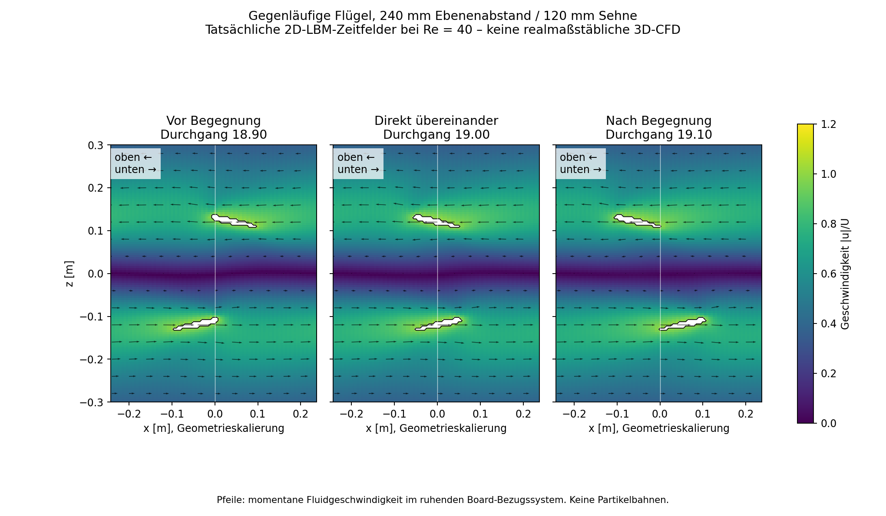
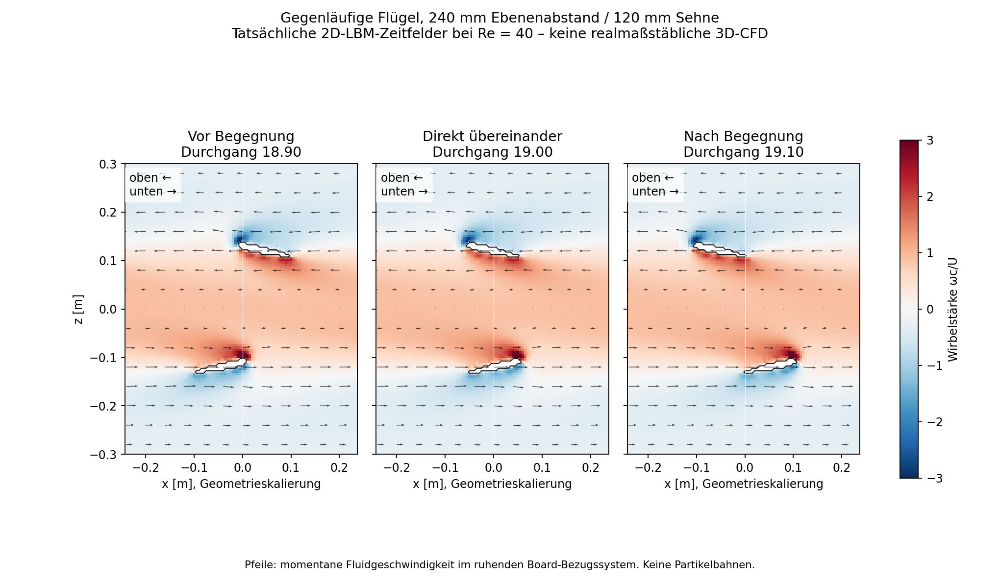
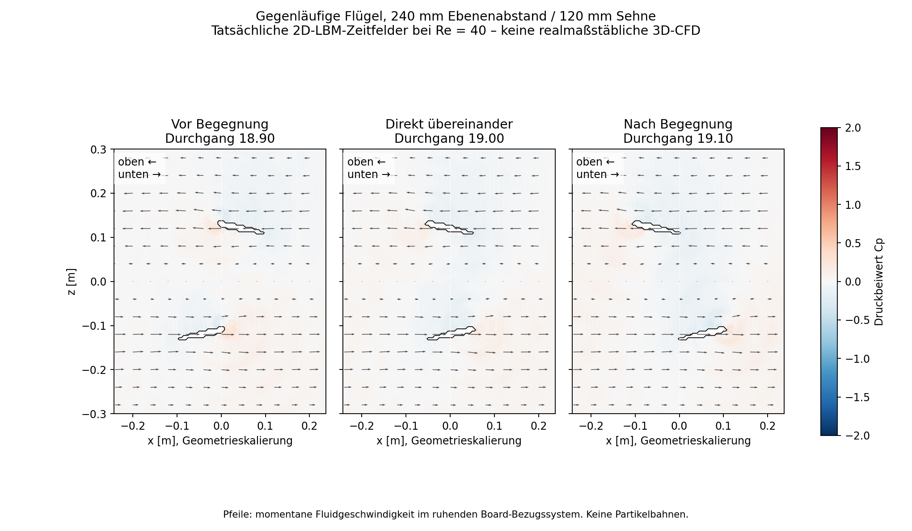
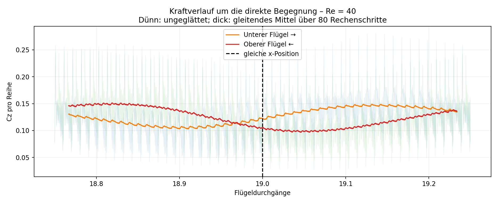

# Ergebnis und Einordnung

Die direkte Überdeckung verdient eine eigene zeitaufgelöste Untersuchung. Dafür wurde der vorhandene 240-mm-Versuch erneut gerechnet und um gespeicherte Strömungsfelder sowie getrennte Kraftausgaben für die obere und untere Reihe erweitert. Die Rechnung enthält beide Flügel gleichzeitig; ihre Strömungsfelder werden nicht nachträglich aus zwei Einzelrechnungen überlagert.

**Im ausgewählten Zeitfenster ist die direkte Überdeckung kein Maximum der gemittelten Gesamtkraft.** Oberer und unterer Flügel zeigen unterschiedliche Kraftverläufe. Dieser Befund gilt nur für das vorhandene lokale 2D-Modell bei Re = 40, nicht als Vorhersage realer Fluglasten.

## Modell und tatsächlich ausgeführter Lauf

| Eigenschaft | Wert / Bedeutung |
| --- | --- |
| Modell | Gerade, periodisch fortgesetzte 2D-Flügelreihen in der x-z-Ebene |
| Bewegung | Untere Reihe nach rechts, obere Reihe nach links |
| Profile | NACA-0012-Geometrie, Sehne 120 mm, Pitch 12° |
| Abstand | 240 mm zwischen den Profilmittelpunkten in z; h/c = 2 |
| Periodenlänge | 480 mm in x |
| Auflösung | 24 Zellen pro Sehne, 96 × 360 Zellen im Rechengebiet |
| Reynolds-Zahl | 40; künstliche Viskosität, kein realmaßstäblicher Luftbetrieb |
| Lauf | 48 000 Schritte, 20 Flügeldurchgänge |
| Gespeicherte Felder | 121 Zeitpunkte zwischen Durchgang 18 und 20 |
| Feldausgabe | Alle 40 Schritte; keine interpolierten Zwischenströmungen |
| Reproduktion | Mittlerer Cz der letzten fünf Durchgänge 0,2558821714; Abweichung zum früheren Lauf ca. 2,22 × 10⁻¹⁶ |

Bei Gegenlauf treffen die Profilmittelpunkte zweimal je Durchgang auf dieselbe periodische x-Position. Die ausgewählte Begegnung liegt bei Durchgang 19,000. Dort befinden sich beide Profilmittelpunkte bei x = 0 in der dargestellten Periodenzelle. Der Ebenenabstand bleibt 240 mm: Die Flügel berühren sich nicht, und es wird keine extrem enge Spaltströmung simuliert.

Die Kraftzuordnung erfolgt über die z-Halbräume: Grenzflächenkräfte und Impulskorrekturen unterhalb der Mitte werden der unteren Reihe, oberhalb der Mitte der oberen Reihe zugeordnet. Das ist hier möglich, weil beide Körper in getrennten festen z-Lagen bleiben. Es ist keine allgemein verwendbare Zuordnung für beliebige 3D-Bewegungen.

# Strömungsvisualisierung

Die [interaktive Flow-Ansicht](results/Flow_Interaktiv.html) enthält einen Zeitregler, Wiedergabe und einen Sprung zur direkten Überdeckung. Geschwindigkeit, Wirbelstärke und Druckbeiwert lassen sich umschalten. Alle Bilder sind aus gespeicherten CFD-Feldern erzeugt. Die [GIF-Animation](results/Begegnung_Flow.gif) zeigt die Geschwindigkeit mit momentanen Richtungspfeilen in verlangsamter Wiedergabe.

## Geschwindigkeit vor, bei und nach der Überdeckung



Die Vektoren beziehen sich auf das ruhende Board-Bezugssystem. Zu erkennen sind die in entgegengesetzte x-Richtungen mitgenommenen Fluidbereiche. In der Nähe der Mitte kompensieren sich horizontale Bewegungsanteile teilweise; ein kleiner Geschwindigkeitsbetrag bedeutet dabei nicht automatisch hohen Druck oder großen Auftrieb.

Die großflächige Mitnahme gehört zu diesem Modell periodisch fortgesetzter Reihen. Sie darf nicht ohne Weiteres als Abstrom eines endlichen Umlaufbands interpretiert werden. Eine geringe vertikale Geschwindigkeit in einem lokalen Rechteck bedeutet zudem nicht, dass das gesamte System keinen Impuls nach unten abgibt.

## Wirbelstärke und Scherung



Hier ist die in der x-z-Ebene verwendete Größe `omega = d(u_z)/dx − d(u_x)/dz`, normiert mit Sehne/U, dargestellt. Das Vorzeichen gehört zu dieser Definition; es ist nicht gleichbedeutend mit „guter“ oder „schlechter“ Strömung. Gegenläufige horizontale Geschwindigkeiten erzeugen Scherung zwischen den Reihen. Zusätzliche lokale Wirbelstärke liegt an den Profiloberflächen und in ihren Nachlaufbereichen.

Die Pfeile zeigen momentane Geschwindigkeiten. Sie sind keine zeitintegrierten Partikelbahnen. Es wurde kein passiver Tracer eingesetzt, mit dem sich eine konkrete Wirbelstruktur eindeutig einem einzelnen Flügel zuordnen ließe.

## Druckfeld



Der Druckbeiwert wird in Gittereinheiten aus `p = rho/3` als `Cp = 2 × (rho − 1) / (3 × U²)` gebildet. Referenzdichte ist 1. Die absoluten Luftdrücke eines realen Fluggeräts werden damit nicht vorhergesagt.

Ein einzelner Spaltmittelwert ist keine Kraftintegration über die Flügeloberflächen. Für die tatsächliche Kraftausgabe wird der Impulsaustausch des numerischen Verfahrens einschließlich der verwendeten Zellwechselkorrektur ausgewertet. Druck, Wirbelstärke, Geschwindigkeitsbetrag und Flügelkraft sind deshalb getrennt zu betrachten.

# Kraftverlauf der beiden Reihen



Die Kraftreferenz ist je Reihe `0,5 × rho × U² × Sehne` pro Einheitsspannweite. Positive Cz zeigen nach oben. Die Normierung enthält hier nicht die Fläche aller 16 Flügel des Fahrzeugs. Die Werte sind keine Newton-Angaben und keine reale Traglast.

Für die folgende Tabelle werden jeweils 41 Kraftwerte verwendet, die symmetrisch um den genannten Zeitpunkt liegen: Zentrum ±20 Schritte. Dieses kurze Mittel reduziert einzelne Gitterübertrittsartefakte, ist aber kein Genauigkeitsnachweis.

| Zustand | Durchgang | Cz unten, kurzes Mittel | Cz oben, kurzes Mittel | Summe |
| --- | ---: | ---: | ---: | ---: |
| Vor Überdeckung | 18,900 | 0,10326 | 0,13562 | 0,23888 |
| Direkt übereinander | 19,000 | 0,12126 | 0,10535 | 0,22661 |
| Nach Überdeckung | 19,100 | 0,14707 | 0,10305 | 0,25012 |

Der obere Flügel liefert vor der ausgewählten Überdeckung den größeren Anteil, danach der untere. Bei direkter Überdeckung liegen die Anteile näher zusammen. Die Summe in diesem kurzen Fenster ist dort niedriger als in den beiden flankierenden Fenstern. **Daraus folgt weder ein allgemeiner optimaler Phasenversatz noch ein gesicherter Schubverlust bei jeder realen Überdeckung.** Dafür sind die Unterschiede, numerischen Unsicherheiten und nicht abgeklungenen Zeiteffekte gemeinsam zu bewerten.

# Lokale Spaltkennwerte

Für eine zusätzliche Diagnose wird ein festes Rechteck um die Begegnungsmitte verwendet: |x| < 60 mm und |z| < 60 mm. Es liegt zwischen den beiden Profilen. Die Strömungskennwerte beziehen sich auf die gespeicherten Einzelzeitpunkte, nicht auf das kurze Kraftmittel.

| Zustand | Mittleres u_z/U im Rechteck | Mittlerer Cp im Rechteck |
| --- | ---: | ---: |
| Vor Überdeckung | +0,00430 | +0,00930 |
| Direkt übereinander | −0,00906 | −0,05686 |
| Nach Überdeckung | −0,01567 | −0,08625 |

Positive z-Richtung ist nach oben. Das ausgewählte Spaltmittel wechselt somit von leicht aufwärts gerichteter zu abwärts gerichteter Geschwindigkeit. Der mittlere Druckbeiwert sinkt im betrachteten Ausschnitt. Die direkte Überdeckung ist in diesen Werten **keine nachgewiesene positive Druckspitze**.

Das Rechteck ist eine lokale Diagnose, keine geschlossene Kontrollfläche für den Gesamtschub. Ein anderer Ausschnitt kann andere Mittelwerte liefern. Die Entwicklung lässt sich ohne zusätzliche Kontroll- und Phasenversuche nicht eindeutig in reine Überdeckungswirkung, Nachlaufgeschichte und langfristige Entwicklung des periodischen Modells zerlegen.

# Was bei einer realistischen CFD besonders untersucht werden muss

1. **Begegnungsphase:** Nicht nur ein Bild bei identischem x, sondern die vollständige Annäherung und Trennung auswerten. Druckkommunikation und Nachlaufgeschichte beginnen vor der geometrischen Überdeckung und können danach fortwirken.
2. **Vertikaler Abstand:** h/c systematisch variieren. Der aktuelle Fall h/c = 2 ist keine Aussage über einen sehr engen Zwischenraum. Auch die Mindestfreiheit realer Profilhüllen und Verformungen muss berücksichtigt werden.
3. **Individuelle Kräfte und Momente:** Oberen und unteren Flügel getrennt betrachten; eine ähnliche Gesamtkraft kann eine stark veränderte Lastverteilung verdecken. Pitchmoment, Führungsreaktionen und Stellleistung fehlen hier noch.
4. **Dreidimensionaler Nachlauf:** Endliche Spannweite, Flügelspitzen, radiale Geschwindigkeitsverteilung in der Kurve, beide vollständigen Bänder sowie Deck und Person erfassen. Die aktuelle gerade Schnittebene enthält diese Wirkungen nicht.
5. **Reale Reynolds-Zahl:** Bei 10 m/s und 120 mm Sehne hätte reale Luft ungefähr Re = 80.000 statt 40. Die Bilder zeigen deshalb keine belastbare reale Strömungstopologie.
6. **Numerische Absicherung:** Phasenaufgelöste Gitter- und Zeitschrittverfeinerung, Gebietseinfluss, geeignete Fernfeldbehandlung, eingeschwungene Zyklen und unabhängige Referenzvalidierung sind erforderlich. Eine geglättete Kurve ersetzt diese Schritte nicht.

Die frühere Gitterabweichung des mittleren Cz im 240-mm-Vergleich betrug rund 13,9 %. Auch die letzten Fünferblöcke waren noch nicht zeitlich konstant. Der neue Lauf reproduziert denselben Zustand mit zusätzlichen Ausgaben; er beseitigt diese Einschränkungen nicht. Der eigene LBM-Prototyp ist weiterhin nicht quantitativ gegen einen externen Referenzfall validiert.

# Daten und Reproduktion

`berechnen.py` verwendet unverändert die Kollision, das Streaming und die bewegten Profilmasken des bisherigen lokalen Solvers. Zusätzlich gespeichert werden:

- `results/Zeitfelder.npz`: Dichte, u_x, u_z und Körpermaske für 121 Zeitpunkte; z-Ausschnitt ungefähr −360 bis +360 mm, komplette x-Periode; außerdem vollständige Kraftzeitreihe.
- `results/Checkpoint.npz`: Endverteilungen und Zeitschritt als Grundlage einer späteren Fortsetzung; kein automatisches Fortsetzungsprogramm enthalten.
- `results/Kraefte.csv`: jeder zehnte Schritt der getrennten Kraftausgaben.
- `results/Laufbericht.json`: Laufparameter, Diagnosewerte und Reproduktionsvergleich.
- `results/Begegnungsphasen.json`: ausgewählte Zeitpunkte und kurze Kraftmittel.
- `results/Spaltkennwerte.json`: Diagnosewerte des festen Spaltrechtecks für alle gespeicherten Zeitpunkte.
- `visualisieren.py`: Erzeugung der Bilder, GIF und Offline-Ansicht direkt aus den Zeitfeldern.

Im Repository-Verzeichnis, mit den bereits verwendeten CFD-Abhängigkeiten:

```sh
NUMBA_NUM_THREADS=2 python begegnung/berechnen.py
python begegnung/visualisieren.py
```

Dieser Zusatzbericht ergänzt den Vergleichsbericht. Er zeigt eine zeitaufgelöste gegenseitige Beeinflussung innerhalb des gewählten numerischen Modells. Ein realer Leistungsgewinn, zulässige Lastspitzen oder eine Freigabe für Personenflug lassen sich daraus nicht ableiten.
