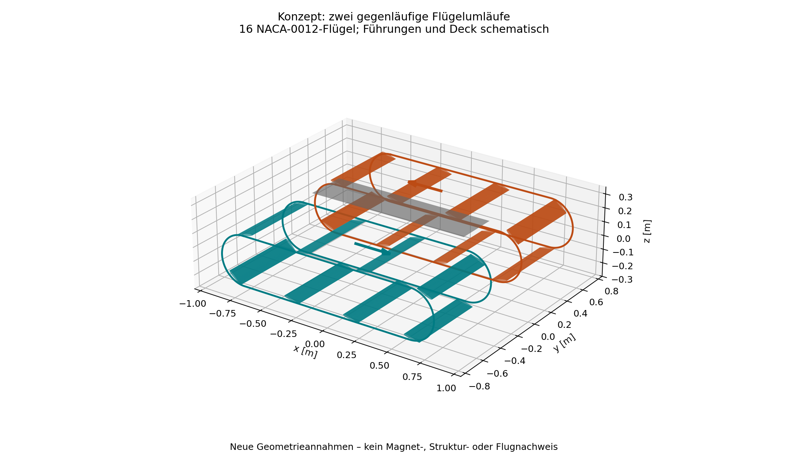
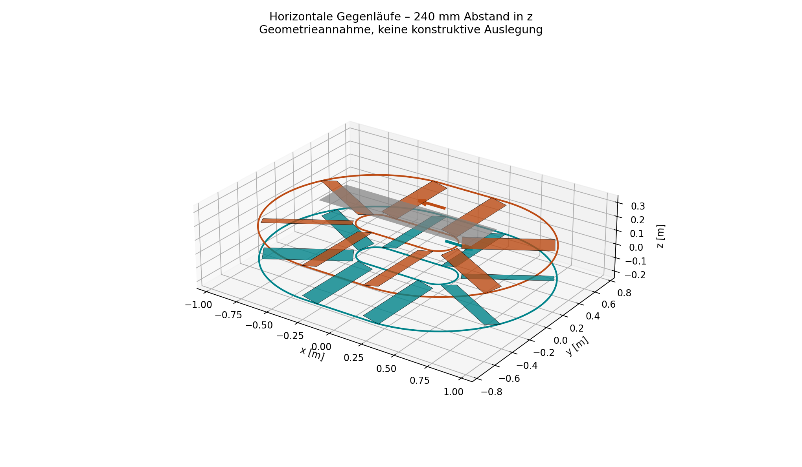
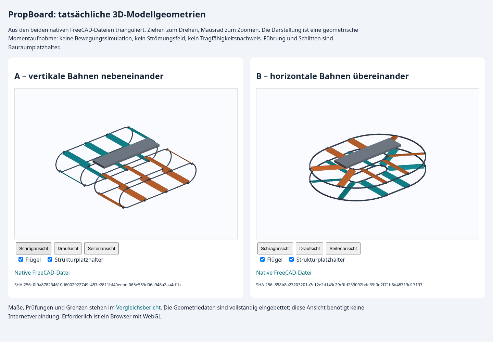
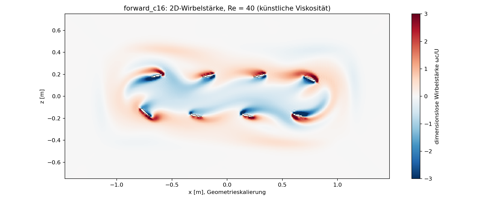
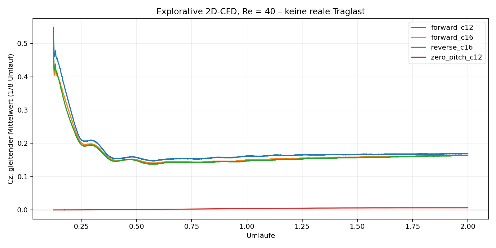
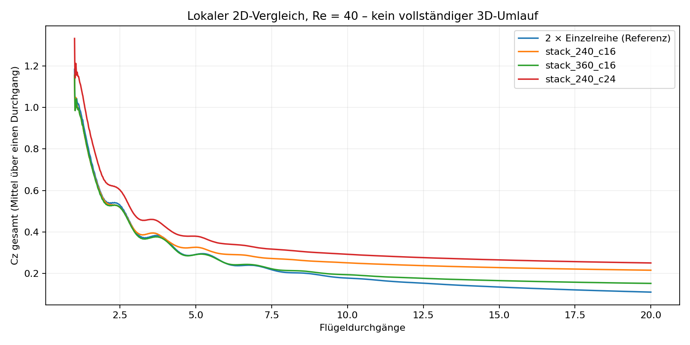

# 1. Ergebnis und Aussagegrenze

**Keine der beiden Varianten ist derzeit als personenflugfähig, energetisch ausreichend oder konstruktiv ausführbar nachgewiesen. Eine belastbare Rangfolge ihrer realen Effizienz ist mit den vorhandenen Daten nicht möglich.**

Untersucht werden A: zwei vertikale Flügelumlaufbahnen nebeneinander und B: zwei horizontale Flügelumlaufbahnen übereinander. Für beide existieren native FreeCAD-Konzeptdateien. Vorhanden sind außerdem selbst entwickelte zweidimensionale Strömungsrechnungen bei Reynolds-Zahl 40. Diese Rechnungen untersuchen unterschiedliche Ausschnitte und sind kein vollständiger CFD-Vergleich der beiden Fahrzeuge.

Der Bericht erfüllt die Anforderung „unter realen Bedingungen“ deshalb durch eine ausdrücklich getrennte Bewertung: Er setzt reale Luftkennwerte für nachvollziehbare Referenzlastfälle ein, analysiert konstruktive Konsequenzen und benennt die dafür fehlenden Nachweise. **Er enthält keine nachträglich behaupteten realmaßstäblichen 3D-CFD-Ergebnisse oder Hardwaremessungen.**

Der derzeit stärkste geometrisch begründete Vorteil von B ist sein größerer mittlerer Umlenkradius bei niedrigerer Bauhöhe. Der derzeit stärkste konstruktive Nachteil von B ist die notwendige Synchronisation unterschiedlicher Innen-/Außenbahngeschwindigkeiten, verbunden mit radial variierenden Flügelgeschwindigkeiten im Bogen. A vermeidet diese radiale Geschwindigkeitsverteilung entlang der Spannweite, hat im aktuellen Entwurf aber wesentlich engere Umlenkungen und eine über die Bahn wechselnde Pitch-Vorgabe.

Beide Konzepte benötigen vor einer Leistungsbewertung eine überarbeitete, mechanisch ausführbare Bewegungsgeometrie. Insbesondere ist der Übergang zwischen Geraden und Kreisabschnitten noch nicht für eine tangential ausgerichtete starre Flügelbewegung geglättet.

# 2. Ziel, Anforderungen und Belegklassen

Das Projektziel bleibt: frei fliegendes Board, bis 100 kg Personengewicht zuzüglich Ausrüstung, höchstens 2100 × 1700 × 600 mm Fahrzeugabmessungen einschließlich Schutz, mindestens 15 Minuten Flugzeit und ungefähr 80 km/h Zielgeschwindigkeit. Die Höhe wird bisher ohne Person verstanden. Selbststabilisierende Winkelregelung und native editierbare FreeCAD-Dateien sind gewünscht.

Nicht festgelegt sind unter anderem tatsächliche Ausrüstungsmasse, vollständiges Missionsprofil, Windbereich, Flughöhe, Temperaturbereich und Einsatzland. Die folgende ruhende Luft auf Meereshöhe ist ein dokumentierter Referenzfall, keine vom Nutzer bestätigte Einsatzgrenze. Eine Bewertung der Zulässigkeit im Luftverkehr erfolgt nicht.

| Klasse | Bedeutung | Was daraus folgt |
| --- | --- | --- |
| G – Geometrie | Gespeicherte CAD-Datei, Formprüfung, Maß- oder Abstandsprüfung | Aussage über die idealisierte Modellgeometrie |
| N – Numerik | Tatsächlich abgeschlossener Lauf des eigenen CFD-Prototyps | Aussage über dieses numerische Modell unter seinen Annahmen |
| R – Rechnung | Explizite physikalische Formel mit genannten Eingaben | Bedingte, nachrechenbare Aussage; keine Messung |
| H – Hypothese | Technisch begründete Erwartung ohne abgeschlossenen Nachweis | Kandidat für einen weiteren Test, kein zugesicherter Vorteil |

Kein vorhandener Beleg gehört zur Klasse „realer Schubprüfstand“, „Magnetlagerprüfung“, „Strukturnachweis“ oder „Flugversuch“. Ein gültiger CAD-Körper ist kein belastbares Bauteil. Eine numerisch stabile Rechnung ist kein Genauigkeitsnachweis.

# 3. Die beiden 3D-Modelle

## 3.1 Variante A: vertikale Bahnen nebeneinander

Zwei spiegelbildliche Ovale liegen in x-z-Ebenen bei y = −500 und +500 mm. Ihre Umlaufrichtungen sind entgegengesetzt. Jedes Modul besitzt acht NACA-0012-Flügel mit 120 mm Sehne und 600 mm Spannweite entlang y. Die geraden Bahnabschnitte sind 1300 mm lang, der mittlere Umlenkradius beträgt 180 mm.

Die Nasenrichtung folgt der Bewegungstangente. Zusätzlich wird der Winkel im x-z-Schnitt als `alpha = 12° × Tangente_x` vorgegeben. Das ist eine neu angenommene Pitch-Strategie, keine optimierte oder geprüfte Steuerung. An oberen und unteren Geraden sollen trotz entgegengesetzter Bewegungsrichtung positive Vertikalkräfte entstehen; die Bogenabschnitte werden anders angeströmt.

## 3.2 Variante B: horizontale Bahnen übereinander

Zwei Ovale liegen in x-y-Ebenen bei z = −120 und +120 mm. Sie laufen entgegengesetzt um die zentrale Boardstruktur. Jedes Band besitzt acht Flügel derselben Profilfamilie, Sehne und Spannweite. Die Spannweiten liegen radial in der Bahnebene. Die geraden Abschnitte sind 500 mm lang; der mittlere Umlenkradius beträgt 450 mm.

Die Flügelnasen zeigen entlang der jeweiligen horizontalen Bewegungsrichtung mit 12° Anstellung nach oben. Die Pitchachsen liegen radial. Diese neue Winkelvorgabe unterscheidet sich von A; B ist deshalb nicht nur eine räumliche Drehung desselben Bewegungsmodells.

## 3.3 Geometrischer Vergleich

| Eigenschaft | Variante A | Variante B |
| --- | --- | --- |
| Bahnebene | x-z | x-y |
| Abstand der Module | 1000 mm entlang y | 240 mm entlang z |
| Flügelzahl | 16 | 16 |
| Sehne / Spannweite | 120 / 600 mm | 120 / 600 mm |
| Summe geometrischer Flügelflächen | 1,152 m² | 1,152 m² |
| Gerade pro Bahnabschnitt | 1300 mm | 500 mm |
| Mittlerer Umlenkradius | 180 mm | 450 mm |
| Modell-Hüllmaße, Momentaufnahme | ca. 1707 × 1664 × 493 mm | ca. 2056 × 1564 × 422 mm |
| Hauptachse des nominellen Umlauf-Drehimpulses | y | z |
| CAD-Ebenenabstand variabel simuliert | nein | CFD-Abstand 240 / 360 mm; CAD nur 240 mm |

Die angegebenen Hüllmaße stammen aus den gespeicherten Prüfberichten. Die Shape-Bounding-Box ist bei komplexen Flächen eine konservative geometrische Einhüllung; die Werte sind keine Fertigungsmaße. Bei beiden Fahrzeugen wurden zusätzliche Strukturdetails neu angenommen. Die unterschiedlichen Ovalmaße waren nötig, um die radialen Spannweiten von B innerhalb der Fahrzeughülle unterzubringen.

Die Fläche 1,152 m² ist die Summe `16 × Sehne × Spannweite`. Sie ist **keine Rotorscheibenfläche**. Die Arbeitsgebiete können sich überlagern; die Fläche darf nicht als unabhängige Schwebefläche in das frühere Rotor-Leistungsmodell eingesetzt werden.

## 3.4 Nachweisumfang der Dateien

Beide FCStd-Dateien wurden gespeichert, erneut geöffnet und ihre vorhandenen Formen auf geometrische Gültigkeit geprüft. Die Dateien enthalten editierbare Extrusionen, Grundkörper und Platzierungen. Profilkonturen und Führungshüllen sind generierte Part-Geometrien. Eine vollständige Neuberechnung erfolgt über die jeweiligen JSON-Parameter und Erzeugungsskripte; die Tabellen in diesen Umlaufmodellen sind keine vollständig verknüpften Steuerungstabellen.

Bei A wurden 360 Phasen je Laufrichtung mit konservativen Flügelquerschnittshüllen geprüft. Bei B wurden 360 Phasen pro Ebene mit konservativen projizierten Flügelrechtecken geprüft. Für B beträgt der kleinste gefundene positive Abstand auf einer geprüften Trennachse rund 41,6 mm. Das ist kein allseitiger Mindestabstand zu Schlitten, Deck oder Führung. Zusätzlich wurden bei B in der gespeicherten Stellung keine Flügel-Volumenüberschneidungen gefunden.

Die unterschiedlichen Prüfmethoden erlauben keinen direkten Vergleich „welches Modell hat mehr Sicherheitsabstand“. Keine Stichprobe ersetzt eine kontinuierliche Kollisionsprüfung mit Verformung, Spiel, Fertigungstoleranzen und Ausfallstellungen.

Nicht ausgelegt sind Magnetkreise, Luftspalte, Linearmotoren, Fangführung, Pitchantriebe, tragfähige Verbindungen, Energieversorgung oder Kühlung. Schlittenkörper überlagern die Führung als Bauraumplatzhalter. Deck und Module besitzen keinen konstruktiven Verbindungsnachweis. Die Dateien sind keine Fertigungszeichnungen.

Die ergänzende [interaktive 3D-Ansicht](Modelle_3D.html) zeigt triangulierte Geometrie direkt aus beiden nativen FCStd-Dateien. Sie lässt sich offline drehen und zoomen. Diese Darstellung enthält keine Animation, Verformung oder berechnete Strömung. Die SHA-256-Zuordnung zu den CAD-Dateien steht in Modelldaten.json.

# 4. Vorhandene CFD: Methode und Grenzen

Verwendet wurde ein eigener D2Q9-Lattice-Boltzmann-Prototyp mit BGK-Kollision, bewegten Halfway-Bounce-back-Rändern, Impulsaustausch an Fluid/Festkörper-Grenzen und einer Impulskorrektur bei überdeckten beziehungsweise freigegebenen Zellen. Die Strömung startet aus Ruhe; eine Anfahrrampe fehlt.

Die äußeren Gebiete sind periodisch und besitzen Dämpfungszonen zur Ruhegleichverteilung. Beim lokalen Versuch für B wird entlang der Flügelbewegung periodisch fortgesetzt und nur an den äußeren z-Rändern gedämpft. Diese Behandlung ist eine Modellannahme und keine nachgewiesene offene Fernfeldrandbedingung. Der langfristige Abstrom kann dadurch beeinflusst werden.

Alle ausgewerteten Bewegungsrechnungen verwenden **Re = 40** und eine Gittergeschwindigkeit von 0,04. Die Auflösung beträgt 12 / 16 Zellen je Sehne für A und 16 / 24 Zellen für B. Ein 12 % dickes Profil ist damit nur wenige Zellen dick; seine bewegte Oberfläche ist treppenförmig angenähert. Das begrenzt die Aussagekraft der Kräfte.

Der Solver wurde nicht quantitativ gegen einen unabhängigen Referenzfall mit bekannter Kraftlösung validiert. Ruhe- und Null-Pitch-Kontrollen sind nützlich, ersetzen aber weder eine solche Validierung noch eine Gitter-, Zeit- und Gebietskonvergenzstudie. Die beobachteten Gitterunterschiede sind keine statistischen Fehlerbalken und keine garantierten Fehlerobergrenzen.

Es gibt keine Turbulenz- oder Transitionsmodellierung für den realen Re-Bereich, keine endlichen Flügelspitzen und keine Strukturbewegung aus tatsächlichen Lagerkräften. Die Bewegung wird vorgeschrieben. Deck, Mensch, Schlitten und Führung fehlen in den Strömungsgebieten.

# 5. CFD-Ergebnisse für Variante A

Hier wurde ein vollständiger Umlauf **eines einzelnen vertikalen Moduls** in der x-z-Schnittebene berechnet. Beide Laufrichtungen wurden separat gerechnet; die Kopplung der nebeneinanderliegenden Module wurde nicht simuliert.

Die Kraftreferenz ist `0,5 × rho × U² × 8 × Sehne` pro Einheitsspannweite. Positive z-Kraft zeigt nach oben. Der Momentenbeiwert verwendet zusätzlich die Sehne als Referenzlänge.

| Lauf | Schritte | Cz, Umlauf 1 | Cz, Umlauf 2 | Momentenbeiwert, Umlauf 2 |
| --- | ---: | ---: | ---: | ---: |
| Vorlauf, 12 Zellen/Sehne | 18 654 | 0,21284 | 0,16690 | 1,02969 |
| Vorlauf, 16 Zellen/Sehne | 24 873 | 0,19741 | 0,15908 | 1,00655 |
| Gegenlauf, 16 Zellen/Sehne | 24 873 | 0,19725 | 0,15746 | −1,01624 |
| Null-Pitch, 12 Zellen/Sehne | 18 654 | 0,00179 | 0,00577 | 0,85430 |

Der Gitterunterschied des mittleren Cz im zweiten Vorlauf beträgt 4,9 %. Die Änderung vom ersten zum zweiten Umlauf im feineren Vorlauf beträgt 19,4 %. Periodisches Einschwingen ist deshalb nicht nachgewiesen.

Die Cz-Werte beider Laufrichtungen unterscheiden sich im zweiten Umlauf um rund 1,0 %. Die Momentenbeiwerte haben entgegengesetzte Vorzeichen. Ihre Summe beträgt −0,00969. Diese getrennten Ergebnisse sind mit einem nominellen Momentenausgleich vereinbar, beweisen aber keinen vollständigen Ausgleich im gekoppelten Fahrzeug, besonders nicht bei Laständerung oder Ausfall.

Der Null-Pitch-Lauf liefert im zweiten Umlauf noch rund 3,45 % des Cz des aktiven groben Laufs. Die Ruhekontrolle über 248 Schritte erhält den Ruhezustand mit maximalem absolutem Kraftbeiwert von etwa 9,48 × 10⁻¹³. Damit reagieren die Rechnungen qualitativ auf Bewegung und Anstellung; die reale Kraftgenauigkeit ist damit nicht bestimmt.

# 6. CFD-Ergebnisse für Variante B

Ein horizontaler Umlauf erzeugt seinen gedachten Auftrieb aus der Bahnebene heraus. Ein bloß in x-y gedrehtes 2D-Modell könnte diese z-Kraft nicht berechnen. Deshalb wurde ein **lokaler x-z-Schnitt gerader Abschnitte** verwendet: eine Flügelreihe als Referenz, zwei gegenläufige Reihen bei 240 mm Abstand, zwei bei 360 mm Abstand und ein feineres Gitter für den 240-mm-Stapel.

Die Periodenlänge beträgt tatsächlich 0,48 m und nähert den mittleren Flügelabstand von 0,47843 m an. Die Rechnung repräsentiert unendlich fortgesetzte gerade Reihen. Sie berechnet weder Ein- und Auslauf eines 500-mm-Geradenstücks noch die radialen Flügelbewegungen in den Kurven.

Die Kraftreferenz ist hier `0,5 × rho × U² × Sehne` pro Einheitsspannweite. Im Stapel wird über beide Profile summiert. Für eine Idealreferenz aus zwei voneinander unabhängigen Reihen wird der Einzelreihenwert verdoppelt. **Diese Normierung unterscheidet sich von derjenigen für A.**

| Lokaler Versuch | Gitterzellen x × z | Schritte | Cz gesamt, letzte 5 von 20 Durchgängen |
| --- | --- | ---: | ---: |
| Einzelreihe, 16 Zellen/Sehne | 64 × 240 | 32 000 | 0,05953 |
| Gegenlauf, 240 mm, 16 Zellen/Sehne | 64 × 240 | 32 000 | 0,22025 |
| Gegenlauf, 360 mm, 16 Zellen/Sehne | 64 × 240 | 32 000 | 0,15689 |
| Gegenlauf, 240 mm, 24 Zellen/Sehne | 96 × 360 | 48 000 | 0,25588 |

Die Quotienten gegenüber zwei unabhängigen Einzelreihen betragen im groben Gitter 1,850 für 240 mm und 1,318 für 360 mm. Das sind **vorläufige Quotienten des numerischen Modells, keine nachgewiesenen Auftriebsgewinne am realen Fahrzeug**. Insbesondere driftet die Referenz selbst noch deutlich.

Der Gitterunterschied des 240-mm-Stapels beträgt 13,9 %, bezogen auf den feineren Cz-Wert. Die Mittelwerte der letzten beiden Fünferblöcke ändern sich um 25,8 % bei der Einzelreihe, 7,2 % beim groben 240-mm-Stapel, 11,4 % bei 360 mm und 7,3 % beim feineren 240-mm-Stapel. Ein stationärer oder periodisch eingeschwungener Vergleichszustand ist damit nicht belegt. Domain- und Zeitschritteinflüsse wurden nicht unabhängig variiert.

Die verbleibenden Zeitänderungen können Einschwingen und andere Effekte der periodischen Reihen und Dämpfungsränder enthalten. Ohne weitere Untersuchungen darf ihr Ursprung nicht eindeutig dem realen Abstrom zugeschrieben werden.

# 7. Was die CFD gemeinsam belegt – und was nicht

| Aussage | Bewertung |
| --- | --- |
| Die vorgeschriebenen Bewegungen erzeugen im jeweiligen Rechenmodell mittlere positive z-Kräfte. | Durch abgeschlossene Läufe belegt, Klasse N |
| Die getrennten vertikalen Laufrichtungen liefern gegensinnige Momente. | Im Einzelmodulmodell belegt; kein Fahrzeugnachweis |
| Übereinanderliegende gegenläufige gerade Reihen beeinflussen sich numerisch. | Im lokalen Modell belegt; Größe und Übertragbarkeit offen |
| B erzeugt real mehr Schub oder benötigt weniger Leistung als A. | Nicht belegt |
| Die berechneten Kraftbeiwerte gelten bei realer Luft und realer Geschwindigkeit. | Nicht belegt; Re-Bereiche unterscheiden sich stark |
| Die beiden Module gleichen sämtliche Momente aus. | Nicht belegt |
| Das Board trägt eine Person oder erreicht 15 Minuten / 80 km/h. | Nicht belegt |

Es wäre fachlich falsch, die Cz-Werte aus den beiden Tabellen direkt zu dividieren: Geometrieausschnitte, Randbedingungen, Bewegungsstrategien und Normierungen unterscheiden sich. Auch eine vereinheitlichte Normierung würde die fehlende 3D- und Betriebsähnlichkeit nicht beheben.

Eine elektrische Leistungsbilanz wurde in keinem Versuch geschlossen. Der ältere ausgegebene `wall_power_proxy` lässt Arbeit beim Freigeben von Gitterzellen unvollständig und ist ausdrücklich kein Wellen- oder elektrischer Leistungswert. Er wird hier nicht für eine Effizienzrangfolge verwendet.

# 8. Reale Referenzbedingungen und Lastfälle

## 8.1 Luft und Lastannahme

Für die analytischen Referenzfälle werden trockene Luft nahe Meereshöhe und 15 °C mit gerundeten Kennwerten `rho = 1,225 kg/m³`, `nu = 1,5 × 10⁻⁵ m²/s` sowie `g = 9,80665 m/s²` angenommen. Dies sind Referenzwerte, keine Messung eines Einsatzortes.

Die Masse 185,32 kg stammt aus dem früheren Rotor-/Tattu-Modell. Für die neuen Umlaufantriebe existiert **kein geschlossener Massennachweis**. Sie wird ausschließlich als illustrative Vergleichslast verwendet. Deren Gewicht beträgt rund 1817,4 N. Eine tatsächliche Umlaufkonstruktion kann eine andere Gesamtmasse besitzen.

Umlaufgeschwindigkeit eines Flügelmittelpunkts, Fluggeschwindigkeit des Boards und lokale Anströmgeschwindigkeit eines Profilabschnitts sind unterschiedliche Größen. Sämtliche folgenden 10 / 30 / 50 m/s sind Umlauf-Referenzgeschwindigkeiten, nicht bestätigte Betriebswerte.

## 8.2 Reynolds-Zahl und Größenordnung des Kraftbedarfs

Es gelten `Re = U × c / nu`, `q = rho × U² / 2` und ein rein definierter Referenzbeiwert `C_Referenz = Gewicht / (q × 1,152 m²)`.

| U am Bahnmittelpunkt | Re bei realer Luft | Dynamischer Druck q | Erforderlicher Referenzbeiwert für 1817,4 N |
| --- | ---: | ---: | ---: |
| 10 m/s | 80 000 | 61,25 Pa | 25,76 |
| 30 m/s | 240 000 | 551,25 Pa | 2,86 |
| 50 m/s | 400 000 | 1531,25 Pa | 1,03 |

Die Tabelle nimmt für die Referenzbildung die gesamte Flügelfläche und einheitliche Geschwindigkeit an. Sie berücksichtigt keine wechselnden Kraftrichtungen, induzierte Geschwindigkeit, lokale Geschwindigkeitsunterschiede, Abschattung, Endlichkeit oder Verlustleistung. Sie ist keine Polarrechnung und sagt nicht voraus, dass die genannten Beiwerte erreichbar sind. Insbesondere darf 50 m/s nicht als bereits geeigneter Betriebspunkt interpretiert werden.

Die CFD bei Re = 40 liegt bereits gegenüber 10 m/s in realer Luft um Faktor 2000 niedriger. Bei derselben Geometrie und Geschwindigkeit entspräche Re = 40 einer künstlichen kinematischen Viskosität von 0,03 m²/s. Das Strömungsverhalten kann deshalb nicht durch eine einfache Kraftskalierung auf reale Luft übertragen werden.

## 8.3 Umlenkbeschleunigung und bewegte Massen

Für den Schwerpunkt auf der mittleren Kreisbahn gilt `a = U² / R`. Pro Kilogramm bewegter Masse entspricht der Zahlenwert von a der erforderlichen radialen Kraft in Newton; aerodynamische, magnetische, Gewichtskräfte und Eigenrotation kommen je nach Freikörpermodell hinzu.

| U | A: a bei R = 0,18 m | A: Vielfaches von g | B: a bei R = 0,45 m | B: Vielfaches von g |
| --- | ---: | ---: | ---: | ---: |
| 10 m/s | 556 m/s² | 56,7 | 222 m/s² | 22,7 |
| 30 m/s | 5000 m/s² | 509,9 | 2000 m/s² | 203,9 |
| 50 m/s | 13 889 m/s² | 1416,3 | 5556 m/s² | 566,5 |

Bei gleicher Schwerpunktgeschwindigkeit ist die mittlere Umlenkbeschleunigung von B damit 60 % kleiner. Das folgt allein aus dem um Faktor 2,5 größeren Radius. Es ist ein belastbarer bedingter Geometrievorteil, kein Nachweis geringerer Gesamtlagerlasten oder leichterer Konstruktion.

Bei beispielsweise 1 kg bewegter Masse wären schon bei 10 m/s allein radial etwa 556 N in A beziehungsweise 222 N in B aufzunehmen. Die tatsächlichen Massen sind nicht bekannt. Magnetführung hebt diese Lasten nicht auf; sie muss sie mit ausreichender Steifigkeit und Reserve übertragen können.

## 8.4 Besonderheit B: radiale Geschwindigkeiten

In der Kreisfahrt eines starren radialen Flügels gilt für die azimutale Bewegung `v(r) = Omega × r`. Die radiale Spannweite von 600 mm erstreckt sich bei R = 450 mm nominell von r = 150 bis 750 mm. Bei 10 m/s am Flügelmittelpunkt ergeben sich daraus etwa 3,33 m/s am inneren und 16,67 m/s am äußeren Spannweitenende. Pitch-Bewegung und induzierte Strömung sind dabei noch nicht berücksichtigt.

Der allein daraus gebildete lokale dynamische Druck variiert gegenüber der Mittellage von ungefähr Faktor 0,111 bis 2,778. Daraus folgt eine potenziell stark ungleichmäßige radiale Belastung. Eine konkrete Auftriebsverteilung folgt daraus nicht, weil die lokalen Anstellwinkel und die Strömung fehlen. Der gerade 2D-Reihenversuch bildet diesen Effekt nicht ab.

In A liegt die Spannweite parallel zur Umlauf-Drehachse. Dieser spezielle radiale Geschwindigkeitsgradient über die Spannweite tritt dort im idealisierten starren Modell nicht auf. Auch A besitzt jedoch lokale Geschwindigkeitsanteile infolge der Profilrotation um seine Pitchachse.

## 8.5 Besonderheit B: Innen-/Außenführung

Die Führungen liegen im Modell 320 mm radial innerhalb und außerhalb der mittleren Bahn. Ihre Bogenradien sind damit 130 und 770 mm. Um einen starren Flügel radial auszurichten, müssen beide Endschlitten in einem Bogen dieselbe Winkelgeschwindigkeit besitzen. Ihre linearen Geschwindigkeiten verhalten sich dann wie `770 / 130`, also ungefähr **5,92 : 1**. Auf einer Geraden müssen sie dagegen gleich schnell fahren.

Zwei starr mit identischer linearer Geschwindigkeit angetriebene Innen-/Außenbänder würden diese Bewegung daher nicht abbilden. Individuell magnetisch angetriebene Schlitten könnten sie prinzipiell koordinieren; dafür fehlen aber eine Synchronisationsarchitektur, Kraftauslegung, Energieversorgung und Ausfallstrategie. Die gezeichneten Führungen sind kein Nachweis dieser Funktion.

## 8.6 Geraden-/Bogenübergänge beider Varianten

Die idealisierten Ovale sind tangentenstetig, besitzen aber einen sprunghaften Krümmungswechsel von null auf `1/R`. Die translatorische Beschleunigung ändert sich dort sprunghaft. Wenn ein starrer Flügel seiner Tangente ohne Verzögerung folgt, springt außerdem seine Orientierungsrate von null auf ungefähr `U/R`. Bei 10 m/s sind das rund 55,6 rad/s in A und 22,2 rad/s in B, bevor weitere Pitch-Anteile betrachtet werden.

Ein solcher idealer Sprung der Orientierungsrate würde eine unbeschränkte Winkelbeschleunigung verlangen. Reale Trägheit, Lager, Führungen und Stellglieder können das nicht exakt ausführen. Erforderlich sind etwa krümmungsstetige Übergänge und eine begrenzte Orientierungs-/Pitch-Trajektorie. Danach müssen Hüllmaße, Abstände und Strömung neu geprüft werden. Dieser Punkt verhindert derzeit, die CAD-Bewegung direkt als baubare Mechanik zu interpretieren.

# 9. Vorwärtsflug, Wind und Umgebungsbedingungen

80 km/h entsprechen 22,22 m/s. Der dynamische Druck der ungestörten Luft beträgt unter den Referenzannahmen ungefähr 302,5 Pa. Das ist noch kein Widerstand des Fahrzeugs; dafür fehlen projizierte Flächen, Widerstandsbeiwerte und die 3D-Strömung um Board und Person.

Die lokale Relativströmung ergibt sich vektoriell aus Flugbewegung, Umlaufbewegung, Wind, Eigenrotation und induziertem Abstrom. Je nach Bahnstelle kann Vorwärtsflug die lokale Anströmung vergrößern, verkleinern oder die resultierende Anströmrichtung stark drehen. Aus einer günstigen Schweberechnung folgt deshalb keine Funktion bei 80 km/h. Beide Varianten benötigen hierfür getrennte Pitch- und Leistungsuntersuchungen.

Seitenwind verändert Kräfte und Momente räumlich. Beim horizontalen Stapel ist zusätzlich die gegenseitige Beeinflussung mit z-Abstand zu untersuchen. Bei A sind die Kopplung der seitlichen Module und die Wirkung des dazwischenstehenden Menschen offen. Keine dieser Wirkungen wurde durch die bisherigen 2D-Rechnungen erfasst.

Geringere Luftdichte erhöht bei unverändertem erforderlichem Auftrieb grundsätzlich die Anforderungen an wirksame Fläche, Geschwindigkeit oder Kraftbeiwerte. Temperatur beeinflusst unter anderem Luftkennwerte, Motoren, Magnetmaterialien, Leistungselektronik und Akku. Regen, Schmutz und Fremdkörper können Profiloberflächen, Führungen und Sensorik beeinträchtigen. Es liegen keine Prüfungen für diese Bedingungen vor; daher wird kein zulässiger Wetterbereich angegeben.

# 10. Vor- und Nachteile von A

| Punkt | Bewertung und Beleg | Grenze |
| --- | --- | --- |
| Kein radialer Spannweiten-Geschwindigkeitsgradient wie in B | Kinematisch begründeter Vorteil, R | Pitch-Rotation und 3D-Abstrom bleiben |
| Gleichartige seitliche Führungsbahnen | Einfachere nominelle Wegkoordination als unterschiedliche Innen-/Außenradien, G/R | Magnetantrieb und Regelung trotzdem nicht ausgelegt |
| Trennung in linkes/rechtes Modul | Ermöglicht als Konzept eine differentielle Auftriebsverteilung für Rollen, H | Keine Flugregelungs- oder Ausfallvalidierung |
| Kürzere Fahrzeuglänge der Momentaufnahme | Im CAD belegt, G | Bewegte Gesamthülle und Schutz fehlen |
| Sehr enger Umlenkradius | Hohe Schwerpunktbeschleunigung bei gegebener Geschwindigkeit, R | Tatsächliche Lasten brauchen Massenmodell |
| Wechselnde Anstellung über den Umlauf | Erhöht den Bedarf an Pitch-Trajektorie und zeitabhängiger Aerodynamik, G/R | Stellleistung und erreichbare Winkelraten fehlen |
| Seitlich ausgedehnte Bewegung | Beansprucht Breite und Nähe zu Person/Umgebung, G | Kein Schutzkonzept ausgelegt |
| Gekoppelte 3D-Strömung unbekannt | Einzeln gerechnete Module reichen nicht aus, N | Keine belastbare Gesamtschub-/Leistungsbilanz |

Ein Wirkungsgradvorteil, geringeres Fahrzeuggewicht oder sichere Beherrschbarkeit bei Modulausfall ist für A nicht belegt.

# 11. Vor- und Nachteile von B

| Punkt | Bewertung und Beleg | Grenze |
| --- | --- | --- |
| Größerer mittlerer Umlenkradius | 60 % geringere Schwerpunktbeschleunigung bei gleicher Geschwindigkeit, R | Kein Nachweis geringerer Gesamtmasse |
| Niedrigere gespeicherte CAD-Hülle | Geometrisch belegt, G | Schutz und tragfähiger Einbau fehlen |
| Positive Nasenanstellung über die horizontale Bahn formulierbar | Einfachere nominelle Winkelvorgabe als die aktuelle A-Strategie, G | Kurvenfahrt und induzierte Strömung verändern den wirksamen Winkel |
| Gegensinniger Drehimpuls um z prinzipiell möglich | Aus symmetrischer Gegenläufigkeit ableitbar, R/H | Keine vollständige Momenten-/Ausfallbilanz |
| Radial stark unterschiedliche Geschwindigkeiten | Direkte Folge starrer radialer Kurvenbewegung, R | Lastverteilung nur durch 3D-Untersuchung bestimmbar |
| Stark unterschiedliche Innen-/Außen-Schlittengeschwindigkeiten | Verhältnis im Bogen ca. 5,92 : 1, R | Antrieb, Synchronisation und Fangsystem ungeklärt |
| Überlagerte Arbeitsbereiche | Gekoppelte Strömung zwischen den Ebenen notwendig, G/N | Lokale Testquotienten kein realer Gewinnnachweis |
| Deck über den Flügeln | Abschattung und zusätzliche Kräfte plausibel, G/H | Deck war in der CFD nicht vorhanden |
| Geringere Längenreserve zur Maximalhülle | Aktuell 2056 mm gegenüber 2100 mm, G | Nominal nur 44 mm Gesamtreserve; nicht als Fertigungstoleranz verfügbar |

Eine hohe numerische Kraft im lokalen Stapelversuch belegt weder einen energetischen Vorteil noch ausreichenden Schub. Die Kosten, Masse und Verluste einer tatsächlich funktionsfähigen Magnetführung könnten einen geometrischen Vorteil aufheben.

# 12. Energie, Magnete und Regelung

Für beide Varianten fehlen Antriebswirkungsgrade, magnetische Führungsverluste, Stellarbeit der Pitchachsen, Leistungsbedarf der Linearmotoren sowie die vollständige aerodynamische Arbeitsbilanz. Ohne diese Größen lässt sich kein geeigneter Akku auswählen und keine Flugzeit berechnen. Die früheren Rotorwerte von ungefähr 64–69 kW sind keine gemessenen Leistungswerte dieser Flügelumlaufkonzepte und werden hier nicht übertragen.

Ein 15-Minuten-Energiebedarf ließe sich erst aus einer zeitabhängigen, bilanzierten elektrischen Gesamtleistung und einem festgelegten Missionsprofil bestimmen. Nutzbare Akkuenergie, Dauerleistung, Reserve und thermische Grenzen müssten gleichzeitig erfüllt sein. Eine größere angenommene Akkuenergie allein schließt das Leistungsbudget nicht.

Magnetführung ist nicht gleichbedeutend mit verlustfreier Führung oder vollständiger passiver Stabilität. Die erforderlichen Freiheitsgrade, Sensoren, Aktoren, Steifigkeiten und Fanglasten hängen von der noch auszuwählenden Lagerarchitektur ab. Der Bericht trifft deshalb keine pauschale Aussage, eine bestimmte Magnetanordnung werde schweben oder die Lasten tragen.

Die Gegenläufigkeit kann bei passenden bewegten Massen, Geschwindigkeiten und Phasen nominelle Drehimpulse verringern. Sie beseitigt weder lokale Umlenkkräfte noch asymmetrische aerodynamische Kräfte. Bei Ausfall einer Bahn fällt der angenommene Ausgleich weg. Eine Winkelregelung im Stil ANGLE MODE ist ein Ziel, kein nachgewiesener Regler für diese Geometrie. Höhen-, Positions-, Nick-, Roll- und Gierautorität müssen separat untersucht werden.

# 13. Entscheidung auf dem heutigen Evidenzstand

**Für eine Flug- oder Beschaffungsentscheidung wird keine Variante empfohlen.** Die Daten reichen weder für einen realen Schubvergleich noch für eine Effizienz- oder Sicherheitsrangfolge.

Für eine nächste konstruktive Teiluntersuchung ist B wegen des größeren mittleren Umlenkradius ein begründeter Kandidat. Diese Priorisierung gilt ausschließlich für die Frage „Kann die Bewegung mechanisch ausführbar gemacht werden?“. Sie ist keine Empfehlung, B als Fluggerät zu bauen. Vor einer weiteren aerodynamischen Optimierung muss gezeigt werden, wie die radialen Geschwindigkeiten, die differenzierten Schlittenwege und die krümmungsstetigen Übergänge umgesetzt werden.

A bleibt als Referenz sinnvoll, weil seine seitlichen Führungen nominell gleichartige Wege besitzen und der radiale Spannweiten-Gradient von B entfällt. Auch A benötigt eine entschärfte Umlenkung und eine ausführbare Pitch-Trajektorie. Seine geringere Gehäuselänge könnte Raum für andere Bahnformen bieten; ob das innerhalb der Gesamthülle hilft, ist noch nicht untersucht.

# 14. Erforderlicher Vergleich unter realistischen Bedingungen

## 14.1 Gemeinsame Eingaben festlegen

Vor der nächsten CFD sind Gesamtmasse, bewegte Flügel-/Schlittenmassen, geometrischer Bauraum einschließlich Schutz, Wind- und Temperaturbereich sowie Schwebe-/Vorwärtsfluganteile festzulegen. Ein reproduzierbarer Vergleich muss dieselbe geforderte Fahrzeugkraft und dieselben Missionsbedingungen verwenden. Gleiche Umlaufgeschwindigkeit allein ist kein fairer Effizienzvergleich, wenn unterschiedliche Kräfte entstehen.

Die Bahnkurven müssen geglättet und zulässige Geschwindigkeits-, Winkelraten- und Beschleunigungsprofile definiert werden. Für B sind azimutale Orientierung und Schlittenkoordination mit der radialen Flügelbewegung zu schließen. Für A ist die Pitch-Strategie vollständig über die Bahn zu definieren.

## 14.2 Verifizierte 3D-CFD

Benötigt wird eine zeitaufgelöste 3D-Rechnung mit bewegter und pitchender Körpergeometrie, realistischen Reynolds-Zahlen und einer für das Problem geeigneten Netz-/Bewegungsbehandlung. Das Verfahren muss gegen unabhängige Profil- und Bewegungsreferenzen überprüft werden. Turbulenz und Transition dürfen nicht ohne begründete Modellwahl behandelt werden.

Die Rechnung muss beide Module gemeinsam, endliche Spannweiten, Kurvenfahrt und die maßgeblichen Störkörper erfassen. Deck und eine definierte Personengeometrie sind mindestens in einem zweiten Integrationsschritt hinzuzunehmen. Für den fairen Vergleich sind auf gleicher Genauigkeitsbasis erforderlich:

1. Räumliche und zeitliche Verfeinerung sowie eine Untersuchung der Gebiets- und Randbedingungseinflüsse.
2. Nachweis eines periodisch eingeschwungenen oder statistisch ausreichend erfassten Zustands, mit offengelegtem Auswertefenster.
3. Kraft- und Momentenhistorien aller Flügel und des Fahrzeugs sowie vollständige aerodynamische Arbeitsbilanz aus Translation und Rotation.
4. Betriebsfälle Schweben, Wind und Vorwärtsflug; anschließend asymmetrische Regel- und Ausfallfälle.
5. Vergleich bei gleicher geforderter mittlerer Vertikalkraft, unter Einbeziehung horizontaler Restkräfte und Stellreserven.

Ergebnisse müssen mit den jeweiligen Geometrie-, Netz-, Solver- und Randbedingungsversionen archiviert werden. Die dafür nötige Rechenzeit und Netzgröße sind erst nach einem Pilotfall seriös abschätzbar; ein angeblich genauer Laufzeitwert wird hier nicht erfunden.

## 14.3 Mechanischer und magnetischer Prüfstand

Zunächst braucht es ein unbemanntes Einzelmodul in gesicherter Prüfumgebung. Messgrößen sind die räumlichen Kräfte und Momente, elektrische Aufnahme, Pitchleistung, Führungsströme, Spalte, Temperaturen und Bewegungsgenauigkeit. Die Bewegungs- und Lastfrequenzen müssen in Struktur- und Ermüdungsnachweise einfließen. Fangführung und Energieausfall sind getrennt zu prüfen.

Der erste Datenabgleich soll die numerischen Kraft-/Leistungshistorien mit dem Prüfstand vergleichen. Erst dann ist eine belastbare energetische Auswahl beider Varianten möglich. Kein bemannter Versuch lässt sich aus den heutigen Unterlagen ableiten.

# 15. Quellen, Dateien und Reproduzierbarkeit

Alle numerischen Ergebniswerte dieses Berichts stammen aus lokalen Projektdateien. Es wurden keine zusätzlichen verifizierten Herstellerkennfelder, Windkanalpolaren oder Flugmessungen als Beleg verwendet. Das Profil ist eine implementierte geometrische NACA-0012-Kontur, keine gemessene Leistungspolare.

| Quelle | Inhalt |
| --- | --- |
| `cad/umlauf_parameter.json` | Eingaben Variante A |
| `cad/Gegenlaeufiger_Fluegelumlauf.FCStd` | Natives 3D-Modell A |
| `cad/Umlauf_Pruefbericht.json` | Speichern, Wiederöffnen, Form-/Hüllmaßprüfung A |
| `cad/Umlauf_Bewegungspruefung.json` | Abgetastete Bewegungsprüfung A |
| `cfd/results/*.json`, ausgewählte Laufnamen im Bericht | Rohzusammenfassungen der vertikalen Versuche |
| `cfd/results/Auswertung.json` | Zusammenfassung der numerischen Diagnostik A |
| `vergleich_horizontal/parameter.json` | Eingaben Variante B |
| `vergleich_horizontal/Horizontal_Z_gegenlaeufig.FCStd` | Natives 3D-Modell B |
| `vergleich_horizontal/CAD_Pruefung.json` | Gespeicherte Geometrieprüfung B |
| `vergleich_horizontal/Bewegungspruefung.json` | Abgetastete Grundrissprüfung B |
| `vergleich_horizontal/results/*.json` | Horizontale lokale Strömungsversuche und Auswertung |
| `bericht/lastfaelle.py`, `Reale_Lastfaelle.json` | Reproduzierbare analytische Referenzlastfälle |
| `bericht/modelle_exportieren.py`, `Modelldaten.json` | Aus den nativen Modellen abgeleitete 3D-Darstellung |

Die vorhandenen CFD wurden für diesen Bericht ausgewertet, nicht durch neue realmaßstäbliche CFD ersetzt. Reproduktionsbefehle stehen in `cfd/README.md` und `vergleich_horizontal/README.md`. Die Erzeugungsskripte und Parameterdateien gehören zum Berichtspaket. Prüfsummen im Paketmanifest dokumentieren genau den archivierten Stand; die SHA-256-Prüfsumme belegt Dateizugehörigkeit, keine technische Richtigkeit.

**Abschließende Bewertung:** Beide 3D-Konzepte und die zugehörigen numerischen Voruntersuchungen sind dokumentiert. Der Vergleich zeigt konkrete geometrische und kinematische Unterschiede sowie die Grenzen der vorhandenen CFD. Die Behauptung, eine Variante erfülle das Personenflugziel unter realen Bedingungen, wäre durch den heutigen Stand nicht gedeckt.
