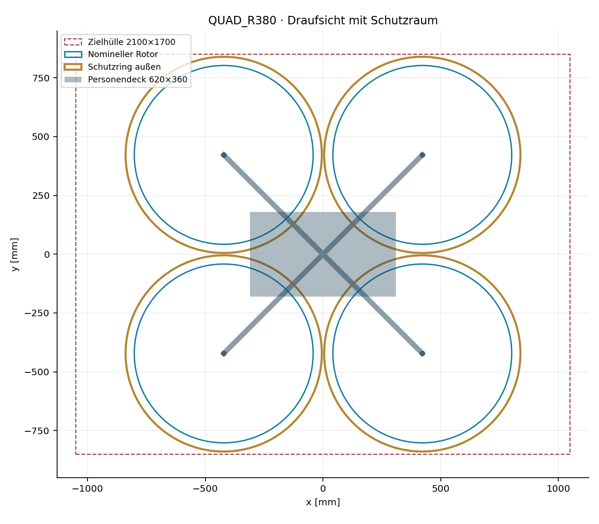
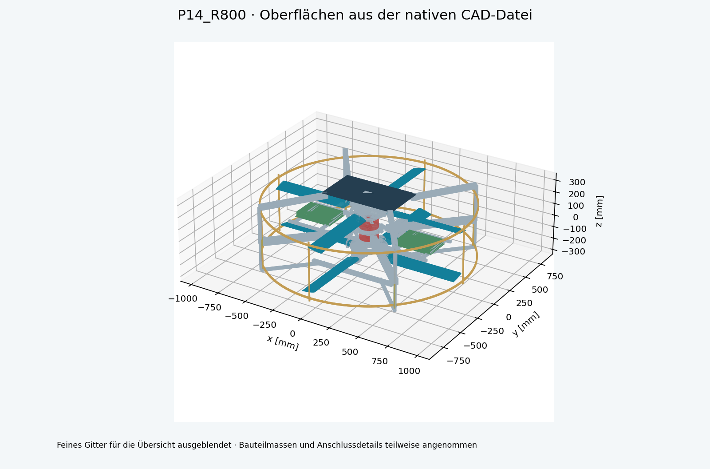
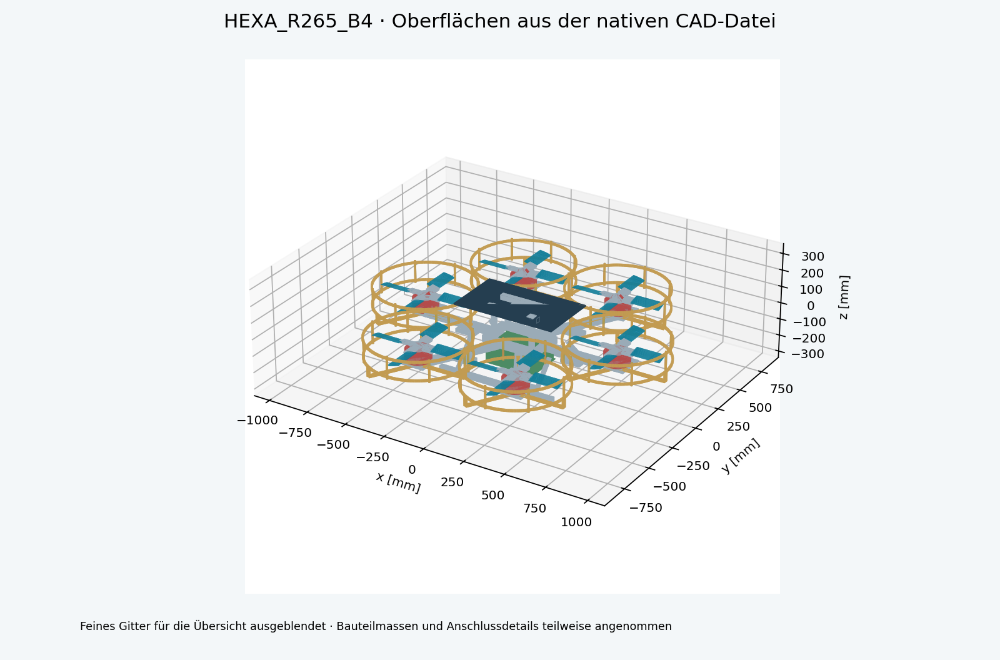
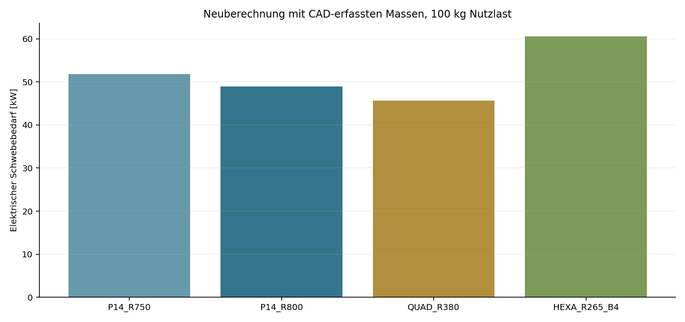

# A/B-Entwicklung: P14-Vierblatt, Quadrokopter und Hexakopter

Stand 2. November 2026. Folgestudie mit nativen FreeCAD-Rahmenentwürfen, Schutzgeometrie, Massenregister und neu berechneten Betriebspunkten. Die bestehende Antriebsstudie und die ursprüngliche P14-Konstruktion bleiben als Vergleich erhalten.

## 1. Ergebnis und Entscheidungen

A ist mit vier Blättern bei 750 und 800 mm Radius als neue integrierte CAD-Variante umgesetzt. B besitzt neue Rahmen für den klassischen Quadrokopter und Hexakopter. Die früheren besten Radien 400/275 mm werden zusätzlich als Vergleichsentwürfe gebaut; mit dem angesetzten Schutzraum überschreiten sie die Zielbreite. Die weitergeführten Radien sind 380 mm beim Quadrokopter und 265 mm beim Hexakopter.

Nach dem Schließen des erfassten Massenumfangs benötigt der 265-mm-Hexakopter mit drei Blättern eine zu hohe Spitzen-Machzahl für die gewählte Grenze 0,65. Eine zusätzliche Vierblattvariante hält diese Grenze ein. Die neuen Massen stammen aus CAD-Volumina für Rahmen und Schutz sowie dokumentierten beziehungsweise ausdrücklich angenommenen Kaufteil-/Blattmassen. Vollständig ausgelegte Verbindungsmittel, Kabel, thermische Hardware und Schutzrückhalt fehlen weiterhin.

| Variante | Blätter je Rotor | Erfasste Masse +100kg [kg] | Elektrisch Schweben [kW] | Hülle / Rotorraum / Aero |
| --- | --- | --- | --- | --- |
| P14_R750 | 4 | 175,3 | 51,9 | ja / ja / ja |
| P14_R800 | 4 | 176,4 | 49,0 | ja / ja / ja |
| QUAD_R380 | 3 | 148,5 | 45,6 | ja / ja / ja |
| HEXA_R265_B4 | 4 | 159,8 | 60,6 | ja / ja / ja |

Unter diesen Annahmen hat der klassische Quadrokopter den niedrigsten Schwebebedarf. P14 bietet die größte kompakte Einzelscheibe, verlangt aber sehr hohe Motormomente und zusätzliche Außenstützen für Deck und Fahrwerk. Der Hexakopter benötigt mehr Leistung und höhere Drehzahl. Keine Variante ist durch die vorliegenden Herstellerdaten als dauerbetriebsfähig belegt; die Rangfolge ist eine bedingte Entwurfsbewertung.

## 2. Schutzraum verändert die Auslegung

| Variante | Radius [mm] | Komplette modellierte Hülle [mm] | Zielhülle eingehalten |
| --- | --- | --- | --- |
| P14_R750 | 750 | 1574 × 1574 × 589 | ja |
| P14_R800 | 800 | 1674 × 1674 × 589 | ja |
| QUAD_R400 | 400 | 1760 × 1758 × 393 | nein |
| QUAD_R380 | 380 | 1680 × 1678 × 393 | ja |
| HEXA_R275 | 275 | 1894 × 1722 × 393 | nein |
| HEXA_R265 | 265 | 1834 × 1667 × 393 | ja |
| HEXA_R265_B4 | 265 | 1834 × 1667 × 393 | ja |

Ziel: 2100 × 1700 × 600 mm ohne Person. Die Schutzringe liegen radial von R+25 bis R+37 mm. Benachbarte Schutzringe besitzen 10 mm nominalen Abstand. Runde Distanzrohre, Drahtgitter, Lastpfade, Personendeck, Batteriebauräume und Kufen sind enthalten. Die zusätzliche Toleranzprüfung erweitert jede Außenkante um 3 mm. Ein positiver Hüllencheck umfasst die modellierten Teile; zusätzliche Serienhardware kann den verbleibenden Raum beanspruchen.

| Variante | Tatsächlicher neutraler Spitzenradius [mm] | Ring innen [mm] | Rest nach 15mm Verformung +3mm Toleranz [mm] |
| --- | --- | --- | --- |
| P14_R750 | 755,15 | 775 | 1,85 |
| P14_R800 | 804,83 | 825 | 2,17 |
| QUAD_R380 | 385,33 | 405 | 1,67 |
| HEXA_R265_B4 | 270,32 | 290 | 1,68 |

Die tatsächliche CAD-Blattkontur reicht seitlich über den nominellen Radius hinaus. Deshalb wird die Restluft nicht einfach aus R+25 minus R berechnet. Die angesetzten 15 mm Verformung sind eine freie Reserve, kein Elastizitätsnachweis. Die verbleibenden etwa 1–2 mm müssen nach einer wirklichen Blatt-/Rahmenverformungsrechnung neu beurteilt werden. Der axiale Hüllraum enthält Pitch bis 20°, Profildicke sowie dieselben 18 mm Reserve; eine vollständige aeroelastische Hülle ist damit nicht bewiesen.

Das Drahtgitter besitzt 1,2 mm Nenndraht und 30 mm Teilung. Daraus folgt für eine ideale rechtwinklige Lage eine geometrische freie Fläche von etwa 92 %. Das ist kein aerodynamischer Wirkungsgrad. Gitterbefestigung, Durchgriff, elastische Auslenkung und Blattfragment-Rückhalt sind nicht nachgewiesen. Insbesondere ist das Gitter kein belegtes Containment.

Quadrokopter: Schutzringe und Deck im vorgegebenen Rechteck.

## 3. A – Lastpfad und Aufbau der P14-Varianten

Die vier M8-Nennanschlüsse am vorhandenen A29-Zentralblock bleiben Bezug für das neue Decktragwerk. Vier 50×50×3-mm-CFK-Unterarme liegen im Zwischenraum der Rotoren bei z=-20 mm. Runde Außenpfosten umgehen die Rotorscheiben. Vier 40×40×2,5-mm-Oberträger tragen das 620×360×8-mm-Deck oberhalb des oberen Rotors. Metallische Adapter besitzen getrennte Massen; CFK wird nicht mit Aluminiumdichte vermischt.

Landebeine bleiben außerhalb des erweiterten Rotorraums und werden erst unter dem unteren Rotor nach innen zu den Kufen geführt. Zwei symmetrische 6-kg-Batteriebauräume liegen bei x=±450 mm zwischen den Rotoren; dadurch entfällt eine Stütze durch einen geschlossenen Motor oder durch eine Rotorscheibe. Die Akkus und Querträger schatten den Nachlauf teilweise ab. Dieser neue Strömungseinfluss ist in der BEMT nicht enthalten und muss vermessen oder dreidimensional berechnet werden.

Die größeren Unterarme wurden gegen die vorhandenen Servo-/Gestängebauteile positioniert. Geprüft werden sowohl der konservative Rotorringraum als auch die tatsächlichen geerbten CAD-Körper. Die Dateien stehen in einer neutralen mechanischen Pose; die berechnete Schwebetrimmung hat andere Kollektivstellungen innerhalb des P14-Stellbereichs. Eine neue bewegte Last-/Kontaktprüfung für alle Posen und elastischen Zustände bleibt offen.

P14 R800: genaue native Oberflächen mit neuen Außenlastpfaden; feines Schutzgitter ausgeblendet.

| P14 | CAD-Kern [kg] | Neue statische Teile [kg] | Akku / Elektronik [kg] |
| --- | --- | --- | --- |
| P14_R750 | 45,3 | 16,0 | 12 / 2 |
| P14_R800 | 45,6 | 16,8 | 12 / 2 |

## 4. B – neue klassische Rahmen

Quadrokopter: vier getrennte Rotoren in X-Anordnung. Hexakopter: sechs Rotoren als regelmäßiger Ring mit wechselnden Drehrichtungen. Zentralrahmen und Ausleger verwenden CFK-Rohrnennquerschnitte 40×40×2,5 mm. Die Motorträger sind 170×170×8-mm-Aluplatten. Vier zentrale Stützen tragen das Personendeck über den Rotorebenen. Batterie und Elektronik sind als eigene Bauraum-/Massenanteile erfasst, das Kufenfahrwerk liegt darunter.

Die Motorbauräume Ø150×66 mm und die 2,75-kg-Masse sind Platzhalter. PCD50 ist eine Anschlussannahme; es wird kein neuer Motor als passend behauptet. Die Naben besitzen geometrische Stege und formgleiche Blattwurzel-Nennsitze, deren Kräfte noch nicht durch Schrauben-, Klemm- oder Laminatnachweise freigegeben sind. Die aerodynamische Blattspannweite beginnt bei 90 mm Radius. Klassische Blätter stehen im CAD bei 14° festem Pitch.

Die Rotorblätter werden als äußere Vollprofilhülle gezeigt. Für ihre Rechenmasse wird stattdessen eine geschätzte 2×1,2-mm-Schale plus Wurzel-/Sparbudget verwendet; sie sind keine massiv gefertigten CFK-Blätter. Die Aluminium-Nabenstege, Träger, Rohre und Schutzteile werden aus ihren tatsächlichen CAD-Volumina gewichtet. Dies wird in jeder Stücklistenposition separat ausgewiesen.

| Variante | Motoren [kg] | Rotoren/Naben [kg] | Rahmen/Schutz statisch [kg] | Akku/Elektronik [kg] |
| --- | --- | --- | --- | --- |
| QUAD_R380 | 11,0 | 5,6 | 18,0 | 12 / 2 |
| HEXA_R265_B4 | 16,5 | 9,4 | 20,0 | 12 / 2 |

Hexakopter R265 mit vier Blättern je Rotor und neuem Rahmen.

## 5. Neue Betriebspunkte und Motorauslegung

| Variante | Drehzahl [1/min] | Welle je Motor [kW] | Moment je Motor [Nm] | Mind. Welle +30% [kW] |
| --- | --- | --- | --- | --- |
| P14_R750 | 2084 | 21,3 | 97,4 | 27,6 |
| P14_R800 | 1868 | 20,1 | 102,7 | 26,1 |
| QUAD_R380 | 4840 | 9,4 | 18,5 | 12,2 |
| HEXA_R265_B4 | 7547 | 8,3 | 10,5 | 10,8 |

Berechnung: vorhandene stationäre Blattelement-Impuls-Theorie mit 32 radialen Elementen, Luftdichte 1,225 kg/m³, angenommener elektrischer Antriebswirkungsgrad 0,82. Koaxialfall mit oberem Nachlauf und Momenttrim des unteren Rotors. Klassische Rotoren werden ohne gegenseitige Strömungsinteraktion gerechnet. Die Geometrie-, Schutz- und Deckeinflüsse verändern die Masse, erzeugen aber in diesem Modell keinen zusätzlichen Strömungswiderstand. Die Daten sind deshalb optimistische Anforderungen für das integrierte Fahrzeug.

30 % Wellenleistungsreserve ergeben unter idealer Ähnlichkeit lediglich rund 19 % Schubreserve. Für 30 % mehr Schub wären rund 48 % mehr Leistung nötig. In Lastpunkte.csv werden die Schubfaktoren 1,00 / 1,19 / 1,30 / 1,50 erneut mit BEMT gerechnet. Dabei werden Drehzahl, Moment, Leistung und Spitzen-Machzahl erfasst. Höhere Lastfälle sind keine erlaubten Betriebszustände.

Vergleich mit dem neuen Massenregister; Nebenverluste der integrierten Schutz-/Deckgeometrie fehlen.

## 6. Warum MN1330 und eine Nennleistung allein nicht genügen

Die vorhandenen MN1330-Daten belegen 2,75 kg Motormasse und eine Prüflinie mit NS52×20 bei etwa 92 V. 3400 W beziehen sich auf 180 s bei ungeklärter Leistungsseite. Höchste dokumentierte Werte: 46,25 Nm und 16,27 kW elektrische Aufnahme ohne Haltedauerangabe. Das ist kein Dauermoment- oder Dauerleistungskennfeld für diese Rotoren.

P14 verlangt im neuen Betriebspunkt mehr Moment als das höchste dokumentierte Prüfmoment. Die klassischen Rotoren verlangen deutlich höhere Drehzahlen als die etwa 3680/min ideale Leerlaufreferenz von KV40 bei 92 V. Für B sind andere Motoren erforderlich. Ein rechnerisch passender kW-Wert ohne Drehzahl, Drehmoment, Masse und Kühlung ist keine Komponentenauswahl.

## 7. Strom, Regler, Batterie und Wärme

| Variante | Gesamtstrom bei 92V [A] | Je Motor bei 92V [A] | Elektrisch minus Welle/Motor [kW] | Energie-Schwebedauer [min] |
| --- | --- | --- | --- | --- |
| P14_R750 | 564 | 282 | 4,7 | 2,4 |
| P14_R800 | 532 | 266 | 4,4 | 2,6 |
| QUAD_R380 | 496 | 124 | 2,1 | 2,8 |
| HEXA_R265_B4 | 659 | 110 | 1,8 | 2,1 |

Die Differenz zwischen elektrischer Aufnahme und Wellenleistung ist ein Verlustleistungsbedarf des angenommenen Antriebsmodells. Ohne Aufteilung von Motor-/ESC-Verlusten, Kühlluft und Temperaturmessung kann daraus keine zulässige Dauerbelastung abgeleitet werden. Regler müssen die tatsächliche Zellzahl, volle Spannung, Einbrüche, Spitzenströme und die Motorinduktivität unterstützen. 92 V sind die Prüfreferenz; 24S mit 4,2 V/Zelle ergibt 100,8 V voll.

Batterieannahme: 12 kg, 220 Wh/kg, 80 % nutzbar, 2,112 kWh nutzbare Energie. Die benötigte Stromabgabe liegt bei hohen C-Raten. Es ist nicht belegt, dass ein reales Pack gleichzeitig diese spezifische Energie und diesen Strom bei zulässiger Temperatur erreicht. Die CAD-Bauraumkästen sind keine vermessenen Serienakkus. Für P14 ist die Batterie außerdem geteilt; Verschaltung und Stromaufteilung fehlen.

Die vollständige Komponenten-Nachweismatrix enthält für jede Variante die Anforderungen an Motor, Rotor, Regler und Akku sowie die verfügbaren Quellen. Alle vier Komponentenarten bleiben für das integrierte Fluggerät unbestätigt. Es werden keine Prüfmaxima in Dauerkennlinien umgedeutet.

| Variante | 15min: Akku kg, Masse eingefroren | Max. min im günstigen Batterie-Ähnlichkeitsmodell |
| --- | --- | --- |
| P14_R750 | 73,7 | 14,2 |
| P14_R800 | 69,6 | 15,2 |
| QUAD_R380 | 64,8 | 13,8 |
| HEXA_R265_B4 | 86,1 | 11,1 |

Die 15-Minuten-Energieumrechnung unterschätzt den eigentlichen Bedarf: ein schwererer Akku verlangt mehr Leistung. Batterie_Rueckkopplung.csv verwendet P=k×m^(3/2) und untersucht 180/220/300 Wh/kg. Sein mathematisches Maximum bei mAkku=2×Trockenmasse ignoriert Motor-, Struktur- und Drehzahlgrenzen und ist keine mögliche Serienkonfiguration. Das Projektziel bleibt in diesen günstigen Rechenfällen deutlich verfehlt.

## 8. Lastpfad, Verformung und Hochlauf

| Variante / Balken | 2g-Kraft [N] | Biegemoment [Nm] | Nennspannung [MPa] | Durchbiegung bei E=70GPa [mm] |
| --- | --- | --- | --- | --- |
| P14_R750 / Unterer Lastarm | 860 | 563,2 | 67,5 | 5,52 |
| P14_R750 / Oberer Deckträger | 505 | 252,3 | 57,2 | 3,40 |
| P14_R800 / Unterer Lastarm | 865 | 610,1 | 73,2 | 6,93 |
| P14_R800 / Oberer Deckträger | 505 | 277,2 | 62,8 | 4,50 |
| QUAD_R380 / Rotorarm | 728 | 336,4 | 76,2 | 3,87 |
| HEXA_R265_B4 / Rotorarm | 523 | 250,3 | 56,7 | 3,10 |

Der Lastscreen nutzt einfache, einseitig eingespannte homogene Balken bei 2g sowie E=70/110 GPa. Er berechnet Nachfragewerte aus den gewählten Querschnitten. Er enthält keine zulässigen Spannungen für das konkrete Laminat, keine Klemmnachgiebigkeit, Schubverformung, Torsion, Beulen, Ermüdung oder Schwingungsresonanzen. Die Unter-/Oberträger von P14 wurden gegenüber der ersten Rahmenannahme auf 50×50×3 beziehungsweise 40×40×2,5 mm vergrößert; der neue Leistungsbedarf enthält deren Masse.

Auch eine kleine Balkendurchbiegung schließt das Tragwerk nicht ab. Die A29-Adapter, CFK-Rohrklemmen, Motorplatten, Deckauflagen, Kufenverbindungen und Blattwurzelanschlüsse benötigen eigene Schrauben-, Kontakt- und Laminatnachweise. Absichtliche geometrische Überlappungen an Rohrknoten sind Verbindungsplatzhalter und keine behaupteten lasttragenden CFK-Schweißnähte.

| Variante | Blatt-Trägheit/Motor [kgm²] | Zusatzmoment für 3s [Nm] | Schweben + Zusatz [Nm] |
| --- | --- | --- | --- |
| P14_R750 | 0,417 | 30,4 | 127,8 |
| P14_R800 | 0,498 | 32,5 | 135,1 |
| QUAD_R380 | 0,041 | 6,9 | 25,4 |
| HEXA_R265_B4 | 0,023 | 6,1 | 16,6 |

Der Hochlaufscreen benutzt die nativen Blade-Geometrien und deren Rechenmassen. Naben, Wellen, Klemmen und Motorrotoren fehlen in dieser Trägheit. Bei gleichmäßiger Beschleunigung gilt zusätzlich Q=I×omega/t. Die Tabelle addiert den Blattanteil zum Endpunkt-Schwebemoment. Sie ist keine dynamische ESC-/Thermikrechnung und beweist keinen realen 3-s-Hochlauf. 5- und 10-s-Fälle liegen in der CSV bei.

## 9. Motor-Ausfallprüfung: 30 % reichen nicht automatisch

| Variante | Statische Kraft-/Momentverteilung nach Ausfall | Erforderlicher Leistungsfaktor gesunder Motoren | Mit 30% Leistungsreserve? |
| --- | --- | --- | --- |
| P14_R750 | nicht möglich | — | nein |
| P14_R800 | nicht möglich | — | nein |
| QUAD_R380 | nicht möglich | — | nein |
| HEXA_R265_B4 | möglich | 1,84 | nein |

Für jeden einzelnen Motorausfall wird eine lineare Optimierung der Schubverteilung gerechnet. Bedingungen: Gewicht ausgleichen, Roll-, Nick- und Giermoment null, nur positive Schübe, ausgefallener Antrieb null. Die Minimierung begrenzt den maximal nötigen Schub eines gesunden Motors. Gleiche Drehmoment-/Schubverhältnisse und starre vertikale Achsen sind Annahmen. Drehzahländerungen verändern dieses Verhältnis in Wirklichkeit; es gibt keine Flugregler- oder Transientensimulation.

P14 mit nur einem verbleibenden Motor besitzt ohne zusätzliches Gegenmomentsystem keinen ausgeglichenen Gierbetrieb. Der konventionelle Quadrokopter löst die vier Gleichgewichtsbedingungen nach einem Ausfall ebenfalls nicht. Der Standardhexakopter kann im idealisierten statischen Modell trimmen, benötigt dabei deutlich mehr Leistung pro belastetem Motor als 30 % Reserve bereitstellen. Damit wird keinem Entwurf Ausfalltoleranz zugesichert.

## 10. Sensitivität und Rangfolge

Die neue Sensitivität verwendet zusätzliche Systemmassen von 0/5/10/20 kg und Wirkungsgrade von 0,75/0,82/0,90. Je Massenzustand wird der Schwebepunkt neu berechnet. Zusätzliche aerodynamische Integrationsverluste werden als separate Faktoren +0/+10/+20 % auf die elektrische Leistung gezeigt; das sind Szenarien, keine gemessenen Gitterkennwerte.

| Variante | Nennbedarf [kW] | +10kg, eta0,82 [kW] | Nennmasse, +20% Integrationsverlust [kW] |
| --- | --- | --- | --- |
| P14_R750 | 51,9 | 56,3 | 62,2 |
| P14_R800 | 49,0 | 53,2 | 58,8 |
| QUAD_R380 | 45,6 | 50,3 | 54,7 |
| HEXA_R265_B4 | 60,6 | 66,4 | 72,8 |

Motor_Massenschluss.csv ersetzt die 2,75 kg durch hypothetische 10/15/20/25/30/40-kW-Motoren mit 1/3/6 kW/kg mechanischer spezifischer Leistung. Der neu berechnete Bedarf entscheidet erneut über die 30-%-Reserve. Diese Kennwerte sind angenommene Klassen, keine am Markt validierten Motoren. Zwischen P14 und Quad können unterschiedliche Integrationsverluste oder reale Motormassen die Rangfolge verschieben.

## 11. Prüfumfang und reproduzierbare Dateien

| Variante | Native Körperobjekte | STEP-Rahmenvolumen Abweichung [%] | Neue Teile im Rotorraum | Neue Teile gegen P14-Kern |
| --- | --- | --- | --- | --- |
| P14_R750 | 994 | 0,00000 | 0 | 0 |
| P14_R800 | 994 | 0,00000 | 0 | 0 |
| QUAD_R380 | 133 | 0,00000 | 0 | 0 |
| HEXA_R265_B4 | 199 | 0,00000 | 0 | 0 |

Alle nativen Körper werden unabhängig auf Gültigkeit geprüft. Die Rahmen-STEPs werden zurückgelesen, Solidzahl und Volumen mit dem Register verglichen. Bei P14 enthält die native Datei den vollständigen übernommenen Kern plus neue Rahmenanteile; der zusätzliche STEP exportiert nur den neuen Rahmen einschließlich Batterie-/Elektronikreserven. Die klassische STEP-Datei enthält alle modellierten Komponenten. Koaxiale und klassische BEMT-Betriebspunkte werden zusätzlich mit 64 Elementen verglichen.

| Variante | Leistungsänderung 32→64 Elemente [%] |
| --- | --- |
| P14_R750 | 0,201 |
| P14_R800 | 0,281 |
| QUAD_R380 | 0,077 |
| HEXA_R265_B4 | 0,071 |

Numerische Übereinstimmung ist keine physikalische Validierung. Nicht geprüft sind neue 3D-CFD, Vorwärtsflug mit 80km/h, reale Regelung, Mensch-/Deckabschattung, Aeroelastik, Akustik, Stromspitzen, Motorkühlung, Batterietemperatur, Materialermüdung, Schutzrückhalt oder die vollständige Montage. Ein positiver Rotorraum-Screen ist kein Nachweis aller zulässigen Bewegungen und Lastfälle.

## 12. Nächste verbindliche Nachweisstufe

Der konkrete reviewbare Stand sind vier weitergeführte native CAD-Entwürfe plus drei Vergleichsvarianten, vollständige Stücklisten für den modellierten Umfang und Betriebspunktanforderungen. Vor der endgültigen Rangfolge werden passende Dauermotoren mit Drehmoment-/Drehzahl-/Temperaturfeld, konkrete Regler, reale Rotorpolaren beziehungsweise Schub-/Momentmessungen und ein stromfähiger Batteriepack benötigt. Mit den vorhandenen MN1330-Prüfpunkten ist dieser Abschluss nicht möglich.

Für A: zuerst A29-Anbindung, Außenlastpfad, Blattwurzel, CFK-Verformung und Nachlaufabschattung durch geteilte Akkus prüfen. Für B: konkrete Motor-/Nabenanschlüsse und Verbindungsdetails des neuen Rahmens ausarbeiten; den Hexakopter in der Vierblattvariante weiterführen. Für beide: vollständige Masse mit realen Kaufteilen schließen und anschließend BEMT/Messabgleich und Antriebs-/Temperaturtests wiederholen. Fertigungs- und Flugfreigaben bleiben offen.

Die interaktive Modelle.html zeigt ausgewählte tatsächliche CAD-Netze. Sie ist ein Geometrieviewer, kein neuer Flugsimulator. Die neutralen P14-Rotoren werden dort nicht animiert. SVG-Draufsichten, CAD-Ansichten, CSV/JSON, native FCStd, Rahmen-STEP, Quellen und ein SHA256-Manifest liegen separat bei. Bestehende P14-Dateien und die erste Studie wurden nicht überschrieben.
