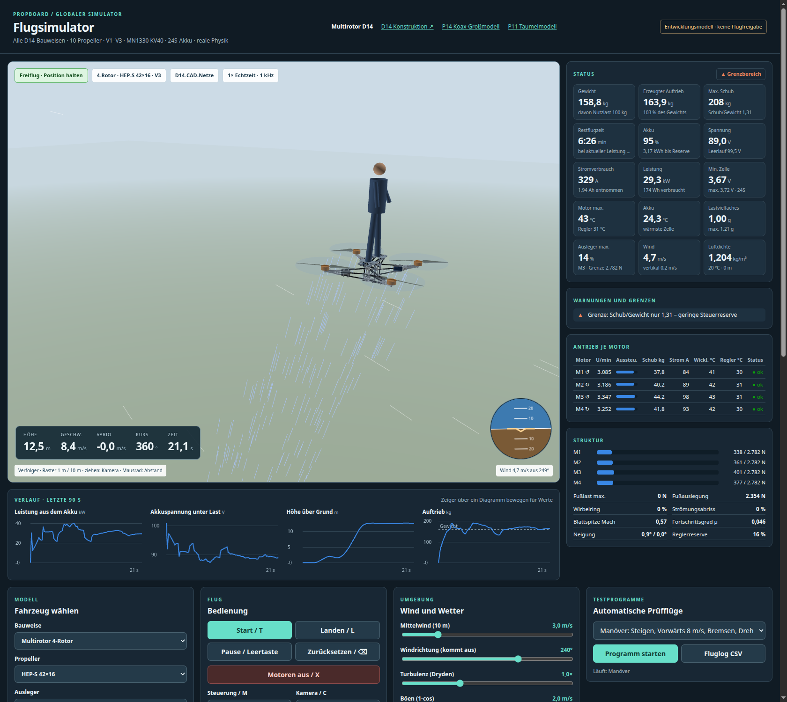

# Globaler Flugsimulator (D14-Multirotoren)

[Flugsimulator öffnen](Flugsimulator.html), direkt als Datei im Browser; kein Server nötig.

Der Simulator fliegt **alle 120 D14-Konfigurationen**: 4 Bauweisen (Quad, Hexa, Okto, Koax X8), 10 HEP-S-Propeller und die Ausleger V1–V3. Er zeigt die echten D14-CAD-Netze aus `../multirotor_d14/Ausgabe/viewer/` mit den D13-Propellern. Fehlen die Netze, erscheint eine Ersatzdarstellung. Aufbau und Bedienung folgen dem [P14-Flugsimulator](../kreis_r04/mn1330_p14/P14_Flugsimulator.html): WASD-/Gamepad-/Touch-Eingabe, Verfolgerkamera und Kopfzeile. Die Physik ist neu und gilt für alle Bauweisen gemeinsam.



## Bedienung

| Taste | Funktion |
|---|---|
| W A S D | vor / links / zurück / rechts (Position halten: 8 m/s max.; Winkelmodus: 25° Neigung) |
| Q E | Drehen |
| R F | Steigen 3 m/s / Sinken 2,5 m/s |
| T L X | Start / Landung / Motoren aus |
| Leertaste, ⌫ | Pause, Zurücksetzen |
| M, C | Steuerungsmodus, Kamera (Verfolger, Orbit, Bodenbeobachter, Draufsicht) |

Weitere Bedienelemente:
- **Fahrzeug wählen:** Bauweise, Propeller, Ausleger, Nutzlast (Person 0–150 kg), Akku 24S mit 1P–4P und 16, 22 oder 30 Ah.
- **Umgebung:** Mittelwind, Windrichtung, Turbulenz, Böen, Temperatur und Standorthöhe.
- **Motorausfall:** schaltet einen beliebigen Motor ab.
- **Zeitraffer:** 0,25× bis 8×.
- **Fluglog:** exportiert den Flug als CSV mit 10 Hz.

Nach dem Laden lässt sich ein Modell auch über die Adresse wählen, z. B. `Flugsimulator.html#b=OKTO&p=HEP_S_42_16&v=V2`. Mit `&auto=vrs` startet zusätzlich ein Testprogramm (`schwebe`, `manoever`, `boe`, `vrs`, `ausfall`, `vollgas`), mit `&kam=orbit` eine andere Kamera.

## Statusdashboard

- **Kennwerte:**
  - Gewicht in kg und erzeugter Auftrieb in kg (Schub ÷ g)
  - Maximaler Schub und Schub/Gewicht; beide sinken mit der Akkuspannung
  - **Restflugzeit:** Restenergie bis zur Reserve ÷ Leistung im 3-s-Mittel. Vor dem Abheben ist es die Schwebeschätzung.
  - Akku in %, Restenergie, Spannung unter Last und im Leerlauf, Strom, Leistung, entnommene Wh/Ah, schwächste Zelle
  - Motor-, Regler- und Akkutemperatur, Lastvielfaches in g, höchste Auslegerauslastung, Wind, Luftdichte
- **Warnungen und Grenzen:**
  - fehlender oder knapper Schub, Auslegerlast, Motoren an der Spannungs- oder Stromgrenze
  - Temperaturen, 20-s-Mittel des Reglerstroms gegen 100 A Dauer
  - Zellspannung, Spannungseinbruch
  - Wirbelringstadium, Strömungsabriss, Blattspitzen-Mach, gesättigte Steuerzuordnung, Bodeneffekt
  - Kippgefahr am Boden, Landestoß
  - offene D14-Prüfungen der gewählten Konstruktion
- **Je Motor:** Drehzahl, Aussteuerung, Schub, Phasenstrom, Wicklungs- und Reglertemperatur, Status.
- **Struktur:** Last je Ausleger gegen seine Grenze, Fußlast, Wirbelring, Abriss, Mach, Fortschrittsgrad, Neigung, Reglerreserve.
- **Verlauf:** Leistung, Spannung, Höhe und Auftrieb mit Gewichtslinie über 90 s. Ein Zeiger über dem Diagramm zeigt die Werte.
- **Alle Modelle:** stationäre Schwebeanalyse aller 120 Konfigurationen mit den eingestellten Werten für Nutzlast, Akku, Temperatur und Höhe. Die Tabelle ist sortierbar; ein Klick lädt das Modell.

## Physikmodell

| Teil | Modell |
|---|---|
| Starrkörper | 6 DOF, Quaternionen, 1 kHz; Trägheitstensor aus D14-CAD-Massen, Motoren 2,75 kg, Propellern, Akku, 2 kg Bordnetz und der Person als Zylinder auf der Fußplattform; Kreiselmomente der Rotoren |
| Rotor | Blattelement-Impuls-Modell, Schub und Zustrom gemeinsam gelöst (Bisektion). Steig- und Sinkflug, Vorwärtsflug (Translationsauftrieb, Blattschlag-Neigung, H-Kraft, Nick- und Rollmoment), Wirbelringstadium (Leishman-Zustromkurve, Schubschwankung je Rotor), Windmühlenzustand, Strömungsabriss ab C<sub>L</sub> 1,25, Bodeneffekt nach Cheeseman–Bennett, Abschattung durch Ausleger und Regler |
| Prop wash | Koax: Der untere Rotor liegt im Nachlauf des oberen, der obere spürt den Sog des unteren; der Nachlauf wandert mit der Fahrt ab. Hintere Rotoren nehmen den Nachlauf der vorderen auf. Der Abwind kühlt Motor und Regler. Das Wirbelring-Kriterium wird beim Koax am Gesamtsystem bewertet. |
| Antrieb | MN1330 KV40; k<sub>t</sub> 0,220 Nm/A, R 38 mΩ und I<sub>0</sub> 4 A gegen die 19 Prüfpunkte angepasst (max. 3,1 % Abweichung). Drehzahlregelung im Regler, Strombegrenzung 177 A, aktives Bremsen bis 40 A, Spannungsgrenze. Thermik in zwei Knoten (Wicklung/Gehäuse) plus Regler, Leistungsreduzierung ab 150 °C bzw. 100 °C. |
| Akku | 24 Einzelzellen mit Leerlaufkennlinie, temperaturabhängigem Innenwiderstand, RC-Polarisation (τ 25 s) und Erwärmung. Streuung von Kapazität (1,5 %), Widerstand und Ladezustand, dazu Messrauschen. Die schwächste Zelle begrenzt die Restenergie. Unterspannung: Warnung, nach 0,5 s Leistungsbegrenzung, nach 2 s unter 3,0 V Abschaltung. |
| Wind | logarithmisches Profil, Dryden-Turbulenz (MIL-F-8785C, Niedrighöhe), räumlicher Vertikalgradient (Roll-/Nickstörung), zufällige 1-cos-Böen; Luftdichte nach ISA |
| Lastgrenzen | zulässiger Schub je Ausleger = Lastfall ÷ höchste Ausnutzung des D14-Screenings bei 3 g. Überschreiten bricht den Ausleger. Bodenkontakt über Feder und Dämpfer an allen Sohlen; Landestoß gegen die Fußauslegung (Warnung, ab 2-fach Bruch). Propellerbodenberührung, Umkippen oder Aufschlag beenden den Versuch. |
| Flugregler | Position → Geschwindigkeit (ruckbegrenzt) → Lage (Wurzelregler mit verfügbarer Winkelbeschleunigung) → Drehrate. Steuerzuordnung als gewichtete Kleinste-Quadrate-Lösung mit Stellgrenzen: Roll/Nick vor Schub vor Gier. Ein Ausfall wird nach 150 ms erkannt und neu verteilt; beim Quad entfällt die Gierachse. |

**Kalibrierung:** Die statischen Schub- und Leistungsbeiwerte entsprechen exakt dem D13-Ersatzmodell, also der NS52×20-Tabelle mit Steigungsskalierung. Daraus folgen je Propeller Blattdichte σ ≈ 0,10, Profilwiderstand und Induktionsfaktor. Ein HEP-S-Kennfeld liegt weiterhin nicht vor.

## Ergebnisse (100 kg Person, 24S2P 22 Ah, 20 °C, Meereshöhe)

Nur 24 von 120 Konfigurationen können mit dem MN1330 KV40 bei 24S schweben. Mit kleineren Propellern reicht die Leerlaufdrehzahl (≈ 4.000 min⁻¹) für 155–190 kg nicht aus.

| Konfiguration | Masse | Schub/Gewicht | Schwebe-U/min | Leistung | Flugzeit |
|---|---|---|---|---|---|
| Okto 42″ V2 | 183,6 kg | 2,87 | 2.490 | 27,4 kW | 7,4 min |
| Hexa 42″ V2 | 169,9 kg | 2,33 | 2.765 | 27,8 kW | 7,3 min |
| Quad 42″ V2 | 156,6 kg | 1,68 | 3.252 | 29,9 kW | 6,8 min |
| Okto 36″ V2 | 181,3 kg | 1,47 | 3.622 | 32,0 kW | 6,4 min |
| Koax 42″ V2 | 175,8 kg | 3,00 | 2.738 | 33,2 kW | 6,1 min |
| Okto 34″ V2 | 180,6 kg | 1,20 | 4.034 | 34,0 kW | 6,0 min |
| Hexa 36″ V2 | 168,4 kg | 1,19 | 4.031 | 32,5 kW | 6,2 min |
| Koax 36″ V2 | 174,0 kg | 1,53 | 3.999 | 39,1 kW | 5,2 min |

Die vollständige Liste steht in [Schwebeanalyse_alle.csv](Ergebnisse/Schwebeanalyse_alle.csv) bzw. [.json](Ergebnisse/Schwebeanalyse_alle.json). Der Koax braucht wegen des Nachlaufs am unteren Rotor rund 29 % mehr Leistung als 8 freie Rotoren (massenbereinigt). Ein Motorausfall wird von Okto und Koax ohne Höhenverlust abgefangen, vom Hexa V2 mit Gierdrehung; der Quad stürzt ab. Bei Okto 42″ V2 erlaubt das Stabwerk-Screening nur das 1,5-Fache des Schwebeschubs. Harte Manöver können dort die Auslegergrenze erreichen.

## Prüfung

```sh
node flugsimulator/pruefen_physik.cjs     # 17 Physikprüfungen + Schwebeanalyse aller 120 Konfigurationen
node flugsimulator/pruefen_browser.cjs    # 13 Browserprüfungen über Chrome DevTools (google-chrome nötig)
python3 flugsimulator/daten_erzeugen.py   # modelle.js aus den D14-Ausgaben neu erzeugen (nach D14-Änderungen)
```

[Physik_Pruefung.json](Ergebnisse/Physik_Pruefung.json) prüft:
- Motorfit
- Rotor gegen das D13-Modell (Schub ±1 %, Leistung ±3 %), Gütegrad < 1
- Steig-, Vorwärts-, Bodeneffekt- und Wirbelringverhalten
- Koax-Mehrleistung, Akku-Ladungsbilanz und Spannungseinbruch
- Schwebeflug im Zeitbereich gegen die stationäre Analyse
- Auslegerbruch und Motorausfall

[Browser_Pruefung.json](Ergebnisse/Browser_Pruefung.json) prüft:
- CAD-Laden, Vergleichstabelle und Dashboard
- Manöverflug mit Landung
- Hexa- und Quad-Motorausfall, Koax-Wirbelring
- Nicht-Abheben bei 26″
- Okto-Ausdauerflug bis zur Reserve: 6,8 min im Zeitbereich gegen 7,1 min in der Analyse
- mobile Breite 390 px ohne horizontales Scrollen, keine Skriptfehler

## Grenzen

- **Propellerbeiwerte:** übertragen von NS52×20 und nicht gemessen. Die Flugzeiten können entsprechend um ±25–35 % abweichen (wie die D13-Empfindlichkeit).
- **Masse:** Person, Akku, Bordnetz und Propeller sind Annahmen; die Struktur stammt aus den D14-CAD-Volumen.
- **Nicht modelliert:** Blatt- und Strukturelastizität, Schwingungen, ESC-Kommutierung, Sensorfehler und Zustandsschätzung (der Regler kennt die Lage ideal), Bewegung oder Ausgleich der Person, Strömungsfeld (keine CFD).
- **Lastgrenzen:** linear aus dem Gelenkstab-Screening skaliert; das ist kein Festigkeitsnachweis.
- **Status:** Entwicklungsmodell. Keine Fertigungs- oder Flugfreigabe.
