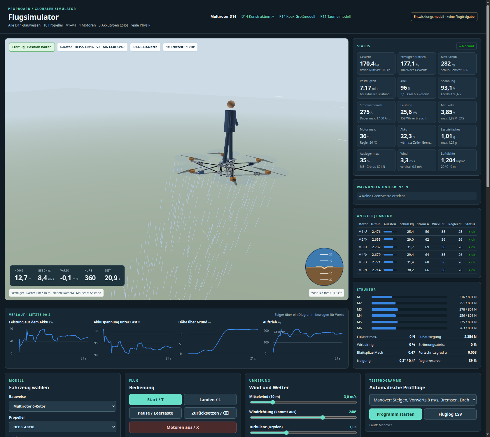

# Globaler Flugsimulator (D14-Multirotoren)

[Flugsimulator öffnen](Flugsimulator.html), direkt als Datei im Browser; kein Server nötig.

Der Simulator fliegt **alle 160 D14-Konfigurationen**: 4 Bauweisen (Quad, Hexa, Okto, Koax X8), 10 HEP-S-Propeller, die Ausleger V1–V4 (V4 = Raumfachwerk durch Umordnung, siehe [Rohrstudie](../multirotor_d14/ROHRSTUDIE.md)) und vier Motoren (siehe [Motorvergleich](#motorvergleich)). Er zeigt die echten D14-CAD-Netze aus `../multirotor_d14/Ausgabe/viewer/` mit den D13-Propellern. Fehlen die Netze, erscheint eine Ersatzdarstellung. Aufbau und Bedienung folgen dem [P14-Flugsimulator](../kreis_r04/mn1330_p14/P14_Flugsimulator.html): WASD-/Gamepad-/Touch-Eingabe, Verfolgerkamera und Kopfzeile. Die Physik ist neu und gilt für alle Bauweisen gemeinsam.



## Bedienung

| Taste | Funktion |
|---|---|
| W A S D | vor / links / zurück / rechts (Position halten: 8 m/s max.; Winkelmodus: 25° Neigung) |
| Q E | Drehen |
| R F | Steigen 3 m/s / Sinken 2,5 m/s |
| T L X | Start / Landung / Motoren aus |
| Leertaste, ⌫ | Pause, Zurücksetzen |
| M, C | Steuerungsmodus, Kamera (Verfolger, Orbit, Bodenbeobachter, Draufsicht) |

Weitere Bedienelemente:
- **Fahrzeug wählen:** Bauweise, Propeller, Ausleger (V1–V4), Motor, Nutzlast (Person 0–150 kg) sowie Akkutyp und Parallelzahl (siehe [Akkutypen](#akkutypen)).
- **Umgebung:** Mittelwind, Windrichtung, Turbulenz, Böen, Temperatur und Standorthöhe.
- **Motorausfall:** schaltet einen beliebigen Motor ab.
- **Zeitraffer:** 0,25× bis 8×.
- **Fluglog:** exportiert den Flug als CSV mit 10 Hz.

Nach dem Laden lässt sich ein Modell auch über die Adresse wählen, z. B. `Flugsimulator.html#b=OKTO&p=HEP_S_42_16&v=V2&m=U15II_KV80&a=LIION_P45B&ap=12` (Motor: `MN1330_KV40`, `U15L_KV43`, `U15II_KV80`, `MAD_M50C35_KV40`; Akku: `LIPO_TATTU22`, `LIION_P45B`, `SEMI_TATTU33`). Mit `&auto=vrs` startet zusätzlich ein Testprogramm (`schwebe`, `manoever`, `boe`, `vrs`, `ausfall`, `vollgas`), mit `&kam=orbit` eine andere Kamera.

## Statusdashboard

- **Kennwerte:**
  - Gewicht in kg und erzeugter Auftrieb in kg (Schub ÷ g)
  - Maximaler Schub und Schub/Gewicht; beide sinken mit der Akkuspannung
  - **Restflugzeit:** Restenergie bis zur Reserve ÷ Leistung im 3-s-Mittel. Vor dem Abheben ist es die Schwebeschätzung.
  - Akku in %, Restenergie, Spannung unter Last und im Leerlauf, Strom, Leistung, entnommene Wh/Ah, schwächste Zelle
  - Motor-, Regler- und Akkutemperatur, Lastvielfaches in g, höchste Auslegerauslastung, Wind, Luftdichte
- **Warnungen und Grenzen:**
  - fehlender oder knapper Schub, Auslegerlast, Motoren an der Spannungs- oder Stromgrenze
  - Temperaturen, 20-s-Mittel des Reglerstroms gegen 100 A Dauer, 30-s-Mittel der Motorleistung gegen die Herstellerangabe
  - Zellspannung, Spannungseinbruch
  - Wirbelringstadium, Strömungsabriss, Blattspitzen-Mach, gesättigte Steuerzuordnung, Bodeneffekt
  - Kippgefahr am Boden, Landestoß
  - offene D14-Prüfungen der gewählten Konstruktion
- **Je Motor:** Drehzahl, Aussteuerung, Schub, Phasenstrom, Wicklungs- und Reglertemperatur, Status.
- **Struktur:** Last je Ausleger gegen seine Grenze, Fußlast, Wirbelring, Abriss, Mach, Fortschrittsgrad, Neigung, Reglerreserve.
- **Verlauf:** Leistung, Spannung, Höhe und Auftrieb mit Gewichtslinie über 90 s. Ein Zeiger über dem Diagramm zeigt die Werte.
- **Motorvergleich:** alle vier Motoren über alle 160 Konfigurationen, mit Leistung je Motor gegen die Nennleistung.
- **Alle Modelle:** stationäre Schwebeanalyse aller 160 Konfigurationen mit den eingestellten Werten für Nutzlast, Akku, Temperatur und Höhe. Die Tabelle ist sortierbar; ein Klick lädt das Modell.

## Physikmodell

| Teil | Modell |
|---|---|
| Starrkörper | 6 DOF, Quaternionen, 1 kHz; Trägheitstensor aus D14-CAD-Massen, Motormasse des gewählten Motors (1,74–4,2 kg), Propellern, Akku, 2 kg Bordnetz und der Person als Zylinder auf der Fußplattform; Kreiselmomente der Rotoren |
| Rotor | Blattelement-Impuls-Modell, Schub und Zustrom gemeinsam gelöst (Bisektion). Steig- und Sinkflug, Vorwärtsflug (Translationsauftrieb, Blattschlag-Neigung, H-Kraft, Nick- und Rollmoment), Wirbelringstadium (Leishman-Zustromkurve, Schubschwankung je Rotor), Windmühlenzustand, Strömungsabriss ab C<sub>L</sub> 1,25, Bodeneffekt nach Cheeseman–Bennett, Abschattung durch Ausleger und Regler |
| Prop wash | Koax: Der untere Rotor liegt im Nachlauf des oberen, der obere spürt den Sog des unteren; der Nachlauf wandert mit der Fahrt ab. Hintere Rotoren nehmen den Nachlauf der vorderen auf. Der Abwind kühlt Motor und Regler. Das Wirbelring-Kriterium wird beim Koax am Gesamtsystem bewertet. |
| Antrieb | Gegen-EMK, Widerstand, Leerlaufstrom und **Phaseninduktivität**: U<sub>eff</sub>² = (k<sub>t</sub>ω + RI)² + (pωLI)². k<sub>t</sub> (±10 % um den KV-Wert), R (≥ Datenblatt) und I<sub>0</sub> sind an die gemessene Eingangsleistung angepasst, L an die Vollgaspunkte. Bei 21 Polpaaren und über 1 kHz elektrischer Frequenz begrenzt die Blindspannung die erreichbare Drehzahl; die gemessenen Vollgasdrehzahlen werden damit auf 0,3 % getroffen. Drehzahlregelung im Regler, Strombegrenzung (Motorgrenze, höchstens 200 A), aktives Bremsen bis 40 A. Thermik in zwei Knoten (Wicklung/Gehäuse, mit der Motormasse skaliert) plus Regler, Leistungsreduzierung ab 150 °C bzw. 100 °C. |
| Akku | 24 Reihenelemente aus P parallelen Einheiten des gewählten Typs mit Leerlaufkennlinie je Zellchemie, temperaturabhängigem Innenwiderstand, RC-Polarisation (R1 = 0,3·R0, τ 25 s) und Erwärmung (Wärmekapazität und Oberfläche je Zelle). Streuung von Kapazität (1,5 %), Widerstand und Ladezustand, dazu Messrauschen. Die schwächste Zelle begrenzt die Restenergie. Unterspannung: Warnung, nach 0,5 s Leistungsbegrenzung, nach 2 s unter dem Entladeschluss des Typs Abschaltung. Über dem Spitzenstrom oder 10 K über der Temperaturgrenze begrenzt der Regler die Leistung. |
| Wind | logarithmisches Profil, Dryden-Turbulenz (MIL-F-8785C, Niedrighöhe), räumlicher Vertikalgradient (Roll-/Nickstörung), zufällige 1-cos-Böen; Luftdichte nach ISA |
| Lastgrenzen | zulässiger Schub je Ausleger = Lastfall ÷ höchste Ausnutzung des D14-Screenings bei 3 g. Überschreiten bricht den Ausleger. Bodenkontakt über Feder und Dämpfer an allen Sohlen; Landestoß gegen die Fußauslegung (Warnung, ab 2-fach Bruch). Propellerbodenberührung, Umkippen oder Aufschlag beenden den Versuch. |
| Flugregler | Position → Geschwindigkeit (ruckbegrenzt) → Lage (Wurzelregler mit verfügbarer Winkelbeschleunigung) → Drehrate. Steuerzuordnung als gewichtete Kleinste-Quadrate-Lösung mit Stellgrenzen: Roll/Nick vor Schub vor Gier. Ein Ausfall wird nach 150 ms erkannt und neu verteilt; beim Quad entfällt die Gierachse. |

**Kalibrierung:** Die statischen Schub- und Leistungsbeiwerte entsprechen exakt dem D13-Ersatzmodell, also der NS52×20-Tabelle mit Steigungsskalierung. Daraus folgen je Propeller Blattdichte σ ≈ 0,10, Profilwiderstand und Induktionsfaktor. Ein HEP-S-Kennfeld liegt weiterhin nicht vor.

## Motorvergleich

Online recherchiert am 5. 11. 2026 und in [Quellen/Motoren_Online.json](Quellen/Motoren_Online.json) mit allen Messpunkten abgelegt. Gesucht waren Motoren für 24S, 150–190 kg Abflugmasse und 26–42″-Propeller.

| Motor | Masse | KV | Max. Strom | Herstellerdaten | Fit k<sub>t</sub> / R / I<sub>0</sub> / L |
|---|---|---|---|---|---|
| MN1330 KV40 (Bestand) | 2,75 kg | 40 | 177 A | 19 Prüfpunkte NS52×20, 92 V | 0,220 Nm/A / 38 mΩ / 4,0 A / 43 µH |
| [T-Motor U15L KV43](https://uav-en.tmotor.com/2019/Manned_Aircraft_0731/274.html) | 3,60 kg | 43 | 135 A (80 s) | 15 Punkte NS47×18, 97–99 V; 20 mΩ; 2,8 kW Nennleistung | 0,244 / 20 / 5,75 / 40 |
| [T-Motor U15 II KV80](https://store.tmotor.com/goods-731-U15_KV80.html) | 1,74 kg | 80 | 143 A (180 s) | 14 Punkte G40×13,1 bei 50 und 60 V; 17 mΩ; 1,93 kW Dauerleistung | 0,113 / 29,5 / 4,25 / 28 |
| [MAD M50C35 PRO EEE 40KV](https://mad-motor.com/products/mad-components-m50c35-pro-eee) | 4,20 kg | 40 | 216,6 A (Händlerangabe) | keine Messtabelle, kein Innenwiderstand; 25 kW Leistungsangabe | 0,239 / 33,5 / 4,24 / 29 (**angenommen**) |

Ergebnis mit 100 kg Person, 24S2P 22 Ah, 20 °C, Meereshöhe ([Motorvergleich.json](Ergebnisse/Motorvergleich.json)):

| Motor | schwebefähig | kleinster Propeller | beste Konfiguration | Flugzeit | Leistung je Motor / Nennleistung |
|---|---|---|---|---|---|
| MN1330 KV40 | 32 / 160 | 34″ | Okto 42″ V2 | 7,4 min | 3,43 / 3,4 kW (180 s) |
| T-Motor U15L KV43 | 20 / 160 | 36″ | Hexa 42″ V2 | 6,9 min | 4,92 / 2,8 kW |
| T-Motor U15 II KV80 | **108 / 160** | **26″** | Okto 42″ V2 | **7,7 min** | 3,31 / 1,93 kW |
| MAD M50C35 40KV | 20 / 160 | 36″ | Hexa 42″ V2 | 6,8 min | 5,00 / 25 kW (Spitze) |

- **U15 II KV80:** der leichteste Motor (8 × 1 kg weniger als MN1330). Mit seiner hohen Drehzahl hebt er auch 26–34″-Propeller, z. B. Okto 30″ V2 mit 5,7 min. An 42″ begrenzt der Strom (143 A) den Schub; Schub/Gewicht liegt nur bei 1,5. Im Schwebeflug liegt die Leistung je Motor deutlich über der veröffentlichten Dauerleistung von 1,93 kW. Das Dashboard warnt, und die Wicklungstemperatur steigt entsprechend.
- **U15L KV43 und MAD 40KV:** ähnliche Kennlinie wie der MN1330, aber 0,85 bzw. 1,45 kg schwerer je Motor. Das kostet Flugzeit; schwebefähig sind nur 36–42″-Konfigurationen. Für die Abmessungen Ø151,5×86 bzw. Ø191×94 mm ist die D14-Motorhülle (Ø150×66) zu klein; die Konstruktion ist dafür nicht nachgeprüft.
- **Für 42″-Propeller passt keiner der drei neuen Motoren klar besser als der MN1330.** Die Hersteller legen U15L und MAD für 47–62″-Propeller aus.

## Akkutypen

Online recherchiert am 5. 11. 2026; alle Werte und Quellen stehen in [Quellen/Akkus_Online.json](Quellen/Akkus_Online.json). Eine Einheit ist ein vollständiger 24S-Strang.

| Typ | Einheit (24S) | Masse je Einheit | Datenblatt | Annahmen |
|---|---|---|---|---|
| LiPo [Tattu Plus 1.0 12S 22 Ah 25C](https://grepow.com/uav-battery/tattu-plus-1-0-12s-22000mah-44-4v-25c-lipo-drone-battery.html) | 2 Packs in Reihe, 22 Ah | 12,12 kg (6.058 g je Pack) | 976,8 Wh je Pack, 25C Dauer / 50C Burst | R<sub>i</sub> 1,5 mΩ je Zelle, Entladeschluss 3,0 V, 60 °C |
| Li-Ion 21700 [Molicel P45B](https://www.molicel.com/inr-21700-p45b/) | 24 Zellen, 4,5 Ah | 1,97 kg (67,35 g je Zelle + 22 % Packaufbau) | 4,5 Ah, 3,6 V, 45 A max., DCIR max. 13,8 mΩ; [Messung](https://www.batterydesign.net/genuine-p45b-tests/): AC 6,2 mΩ, 4,25 Ah bei 40 A | R<sub>i</sub> 10 mΩ, 35 A Dauer (45 A nur temperaturbegrenzt), 2,5 V, 80 °C |
| Semi-Solid [Tattu 350-Wh/kg-Serie](https://gensace.de/blogs/news/tattu-semi-solid-batteries-four-energy-density-levels-and-flexible-customization) 12S 33 Ah | 2 Packs in Reihe, 33 Ah | 13,33 kg (6.664 g je Pack, 220 Wh/kg auf Packebene) | 1–3C Dauer (Hersteller), 10C laut Händler; −40…60 °C | R<sub>i</sub> 3,0 mΩ, 3C Dauer, 10C Spitze, 3,0 V |

Ergebnis Okto 42″ V2 mit MN1330 und 100 kg Person ([Akkuvergleich.json](Ergebnisse/Akkuvergleich.json)):

| Akku | Masse | Flugzeit (Analyse) | Dauerstrom / Schwebestrom | Zeitbereich: Flugzeit, wärmste Zelle |
|---|---|---|---|---|
| LiPo 2P | 24,2 kg | 7,4 min | 1.100 / 272 A | 6,9 min, 54 °C |
| 21700 8P | 15,8 kg | 6,3 min | 280 / 256 A, knapp | 5,8 min, 78 °C (Grenze 80 °C) |
| 21700 12P | 23,7 kg | **8,8 min** | 420 / 272 A | 8,3 min, 65 °C |
| Semi-Solid 2P | 26,7 kg | 10,9 min | **198 / 278 A, Überlast** | 9,8 min, 88 °C (Grenze 60 °C) |
| Semi-Solid 4P | 53,3 kg | 17,9 min | 396 / 337 A | 16,7 min, 67 °C |

- **21700 (P45B, 12P):** bei gleicher Masse wie LiPo 2P etwa 19 % mehr Flugzeit. Der Pack muss selbst gebaut werden (Zellverbinder, BMS) und läuft thermisch nahe an der Grenze.
- **Semi-Solid:** hat die höchste Energie, ist aber für den Strombedarf eines 150–190-kg-Fahrzeugs nur mit 4 Strängen (53 kg) innerhalb der Herstellerangabe von 1–3C. 2P wird überlastet und überhitzt.
- **Flugzeit im Zeitbereich:** etwa 10 % unter der Analyse, weil die Spannung unter Last sinkt und der Strom entsprechend steigt.

## Ergebnisse mit MN1330 KV40 (100 kg Person, 24S2P 22 Ah, 20 °C, Meereshöhe)

Nur 32 von 160 Konfigurationen (24 in V1–V3, 8 in V4) können schweben. Die aus den Vollgaspunkten abgeleitete Spannungsgrenze (Phaseninduktivität) begrenzt die Drehzahl unter Last. Daher sinkt Schub/Gewicht gegenüber dem ersten Simulatorstand, z. B. beim Quad 42″ von 1,68 auf 1,35 (unter Lastspannung ≈ 1,1).

| Konfiguration | Masse | Schub/Gewicht | Schwebe-U/min | Leistung | Flugzeit |
|---|---|---|---|---|---|
| Okto 42″ V2 | 183,6 kg | 2,31 | 2.490 | 27,4 kW | 7,4 min |
| Hexa 42″ V2 | 169,9 kg | 1,87 | 2.765 | 27,8 kW | 7,3 min |
| Quad 42″ V2 | 156,6 kg | 1,35 | 3.252 | 29,9 kW | 6,8 min |
| Okto 36″ V2 | 181,3 kg | 1,35 | 3.622 | 32,0 kW | 6,4 min |
| Hexa 36″ V2 | 168,4 kg | 1,09 | 4.031 | 32,5 kW | 6,2 min |
| Koax 42″ V2 | 175,8 kg | 2,41 | 2.738 | 33,2 kW | 6,1 min |
| Okto 34″ V2 | 180,6 kg | 1,12 | 4.034 | 34,0 kW | 6,0 min |
| Koax 36″ V2 | 174,0 kg | 1,40 | 3.999 | 39,1 kW | 5,2 min |

Die vollständige Liste steht in [Schwebeanalyse_alle.csv](Ergebnisse/Schwebeanalyse_alle.csv) bzw. [.json](Ergebnisse/Schwebeanalyse_alle.json).
- **Koax:** braucht wegen des Nachlaufs am unteren Rotor rund 29 % mehr Leistung als 8 freie Rotoren (massenbereinigt).
- **Motorausfall:** Okto und Koax fangen ihn ohne Höhenverlust ab. Der Hexa 42″ V2 erkennt den Ausfall und verteilt neu, hat mit der Spannungsgrenze aber zu wenig Reserve und stürzt ab. Der Quad verliert die Gierachse und stürzt ab.
- **Quad 42″:** reicht zum Schweben, stürzt aber bei harten Manövern mit Person wegen fehlender Schubreserve ab.
- **Okto 42″ V2:** Das Stabwerk-Screening erlaubt nur das 1,5-Fache des Schwebeschubs; harte Manöver können dort die Auslegergrenze erreichen.

## Prüfung

```sh
node flugsimulator/pruefen_physik.cjs     # 30 Physikprüfungen + Schwebeanalyse, Motor- und Akkuvergleich aller 160 Konfigurationen
node flugsimulator/pruefen_browser.cjs    # 15 Browserprüfungen über Chrome DevTools (google-chrome nötig)
python3 flugsimulator/daten_erzeugen.py   # modelle.js aus den D14-Ausgaben neu erzeugen (nach D14-Änderungen)
```

[Physik_Pruefung.json](Ergebnisse/Physik_Pruefung.json) prüft:
- Motorfits aller vier Motoren (Leistung, Vollgasdrehzahl), MAD als Annahme gekennzeichnet
- Rotor gegen das D13-Modell (Schub ±1 %, Leistung ±3 %), Gütegrad < 1
- Steig-, Vorwärts-, Bodeneffekt- und Wirbelringverhalten
- Koax-Mehrleistung, Akku-Ladungsbilanz und Spannungseinbruch
- Schwebeflug im Zeitbereich gegen die stationäre Analyse
- Auslegerbruch und Motorausfall

[Browser_Pruefung.json](Ergebnisse/Browser_Pruefung.json) prüft:
- CAD-Laden, Vergleichstabelle und Dashboard
- Manöverflug mit Landung (Hexa 42″, MN1330), Motorwahl U15 II KV80 mit Okto 30″, Motorvergleich
- Hexa- und Quad-Motorausfall, Koax-Wirbelring
- Nicht-Abheben bei 26″
- Okto-Ausdauerflug bis zur Reserve: 6,7 min im Zeitbereich gegen 7,1 min in der Analyse
- mobile Breite 390 px ohne horizontales Scrollen, keine Skriptfehler

## Grenzen

- **Propellerbeiwerte:** übertragen von NS52×20 und nicht gemessen. Die Flugzeiten können entsprechend um ±25–35 % abweichen (wie die D13-Empfindlichkeit).
- **Akkudaten:** Innenwiderstände von LiPo und Semi-Solid sowie die Kennlinien je Chemie sind Annahmen; die Semi-Solid-Dauerbelastbarkeit ist widersprüchlich angegeben (1–3C Hersteller, 10C Händler).
- **Motordaten:** Herstellerangaben ungeprüft; beim MAD fehlen Messtabelle und Innenwiderstand. Die T-Motor-Tabellen wurden mit anderen Propellern gemessen als den HEP-S-Propellern.
- **Masse:** Person, Akku, Bordnetz und Propeller sind Annahmen; die Struktur stammt aus den D14-CAD-Volumen.
- **Nicht modelliert:** Blatt- und Strukturelastizität, Schwingungen, ESC-Kommutierung, Sensorfehler und Zustandsschätzung (der Regler kennt die Lage ideal), Bewegung oder Ausgleich der Person, Strömungsfeld (keine CFD).
- **Lastgrenzen:** linear aus dem Gelenkstab-Screening skaliert; das ist kein Festigkeitsnachweis.
- **Status:** Entwicklungsmodell. Keine Fertigungs- oder Flugfreigabe.
