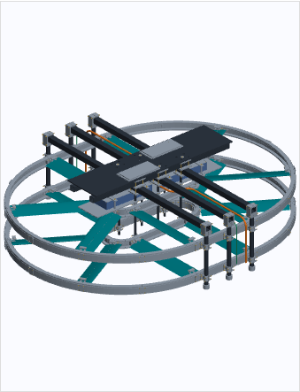
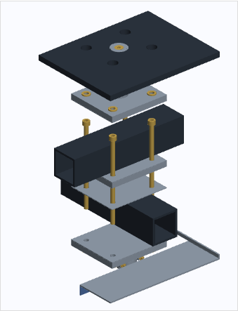
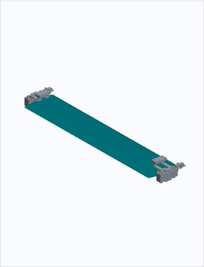

# Ergebnis und Geltungsbereich

Die horizontale Variante mit zwei übereinanderliegenden Umlaufbahnen wurde zu einer deutlich detaillierteren Montagegeometrie ausgearbeitet. Hauptvariante bleibt die stehende Person. Die beiden Bahnebenen liegen bei z = −120 und +120 mm. Acht Flügelbaugruppen je Ebene sind in einer statischen Stellung dargestellt. Die Bewegungsrichtungen sind gegenläufig; diese geometrische Anordnung beweist keinen Momentenausgleich im Betrieb.

Die Hauptbaugruppe umfasst **3.185 Ergebniskörper einschließlich 1.270 Schrauben, 480 Scheiben und 176 Muttern**. Neun Körper stellen die Person schematisch dar. Bauteilzahl bedeutet Anzahl modellierter Ergebniskörper, nicht Anzahl bestellfertiger Positionen. Referenzvolumen, Isolierlagen und die noch nicht ausgewählten Funktionskomponenten sind enthalten. Bearbeitungshistorie und Schneidwerkzeuge werden nicht zusätzlich gezählt.

Das Modell ist ein **Montagevorentwurf ohne Fertigungsfreigabe**. Es enthält konkrete Befestigungsgeometrien und zugängliche Detailauszüge. Ein vollständiger, belastbar ausgelegter Aufbau „bis zur letzten Schraube“ ist ohne ausgewählte Motoren, Lager, Akku, elektrische Komponenten und nachgewiesene Lasten nicht erreichbar. Deren unbekannte Innenkonstruktion wurde nicht erfunden. Insbesondere sind Lagergehäuseanschluss, Wellen-/Flügel-Kraftschluss und Fußpuffer-Rückhaltung weiterhin zu konstruieren beziehungsweise nachzuweisen.

Die frühere Tragfähigkeitsrechnung und die explorativen Strömungsrechnungen wurden für diese Revision nicht neu durchgeführt. Sie sind keine Freigabe dieser geänderten Geometrie. Personentragfähigkeit, 15 Minuten Flugzeit und 80 km/h bleiben unbewiesene Ziele.

# Ansichten aus den gespeicherten CAD-Körpern

Die Bilder wurden aus den triangulierten nativen Modellen dargestellt. Farben unterscheiden Baugruppen und sind keine Werkstoffspezifikation. Befestigungsmittel sind im Viewer separat ein- und ausblendbar.

{height=85mm}

{height=85mm}

{height=65mm}

# Dateien und Bearbeitung

| Datei | Inhalt |
|---|---|
| `00_Horizontal_Z_R02_Montage.FCStd` | Vollständige statische Hauptbaugruppe mit Baugruppen und Bearbeitungshistorie |
| `01a_Rahmenknoten_Detail.FCStd` | Räumlicher Ausschnitt eines gekreuzten Rahmenknotens |
| `01b_Rahmenknoten_Explodiert.FCStd` | Derselbe Ausschnitt mit auseinandergezogenen Ebenen |
| `02_Schlitten_R02_Detail.FCStd` | Ein Flügel mit zwei Schlitten, Fangrollen und Zusatzhaltern |
| `03_Batterie_R02_Detail.FCStd` | Gehäuse, Rückhaltung, Träger und Kabeltrassen |
| `04_Referenzzeichnungen_R02.FCStd` | Vier native TechDraw-Referenzblätter |
| `Modelle_3D.html` | Offline drehbare Ansichten aus den gespeicherten CAD-Körpern |
| `Stueckliste.csv` | Ergebnisinstanzen mit Materialannahme und Status, nach Quelldokument getrennt |
| `Schraubenliste.csv` | Mengen der Befestigungsmittel nur für die Hauptbaugruppe |
| `Verbindungen.json` | Zuordnung der Schrauben zu benannten Gegenstücken |
| `Montagepruefung.json` | Umfang und Ergebnisse der geometrischen Prüfungen |

Zu den fünf räumlichen Modellen liegen STEP-Exporte vor. Die Detailauszüge sind eigenständige Körperkopien. Geschnittene Rohre und Deckflächen im Knotenausschnitt sind **keine Zuschnittzeichnungen**. Die Explosionsabstände dienen ausschließlich der Sichtbarkeit; sie sind keine Montagemaße.

Die Hauptdatei enthält benannte Grundkörper, native boolesche Bearbeitungen und Eigenschaften für Teilekennung, Materialannahme, Prozess und Status. Die wiederholten Flügelbaugruppen sind unabhängige Instanzen. Das Erzeugungsskript erzeugt den definierten Stand reproduzierbar; es ist kein vollständig durchkonstruierter FreeCAD Assembly-Solver. Raster- oder Profiländerungen erfordern erneute Generierung und Prüfung.

# Abmessungen und Änderungen gegenüber dem Vorentwurf

| Größe | R02 |
|---|---:|
| Außenhülle der gespeicherten Stellung, ohne Person | ca. 2.093,8 × 1.695 × 573 mm |
| Vorgabe Fahrzeughülle | 2.100 × 1.700 × 600 mm |
| Unterste Fahrzeuggeometrie | z = −200 mm |
| Oberseite Standbelag | z = +373 mm |
| Deckoberseite | z = +361 mm |
| Abstand der Bahnebenen | 240 mm |
| Flügelsehne / Spannweite | 120 / 600 mm |
| Dargestellter Pitch | 12° |
| Geradenlänge / mittlerer Bahnradius | 500 / 450 mm |
| Schienenradien | 130 und 770 mm |
| Querträger | 1.690 × 40 × 40 mm, Wandreferenz 3 mm |
| Äußere Pfostenachsen | y = ±825 mm |
| Innere Pfostenachsen | y = ±85 mm |

Die obere Rahmen-/Deckstruktur wurde um 15 mm angehoben, damit eine untere Sattelplatte, Scheiben und Muttern zwischen Rahmen und Akkubauraum dargestellt werden können. Die innere Pfostenaufnahme sitzt um 15 mm gegenüber der jeweiligen Knotenmitte versetzt. Diese Exzentrizität muss in der späteren Lastrechnung berücksichtigt werden. Die senkrechte HV-Trasse wurde nach x = 140 mm verlegt, um den äußeren Pfostenbereich zu umgehen.

Die nominalen Hüllmaße lassen nur ungefähr 6,2 mm Länge und 5 mm Breite gegenüber der Vorgabe übrig. Daraus folgt keine Einbautoleranz oder Schutzreserve. Stecker, Fertigungstoleranzen, thermische Ausdehnung, elastische Verformung und sämtliche Bewegungsstellungen sind mit dieser Hüllprüfung nicht abgedeckt.

# CFK-Rahmen und gekreuzter Klemmknoten

Die beiden Längsrohre und drei Querträger besitzen rechteckige Hohlquerschnitte. Runde Pfosten sind ebenfalls als Hohlkörper modelliert. Die Materialangabe „CFK“ ist eine Annahme: Faserrichtung, Laminataufbau, Herstellverfahren, Faser-/Harzsystem, Endbearbeitung und zulässiger Klemmdruck sind nicht festgelegt.

Jeder der sechs Kreuzungsknoten enthält drei 90 × 80 × 8 mm große metallische Platten, vier Isolierlagen und vier M6×120-Schrauben. Das Lochbild beträgt 64 × 52 mm mit nominal Ø6,6 mm. Die untere Platte besitzt eine integrierte, geschlitzte Aufnahme für den inneren Pfosten. Zwei M3×25 klemmen die Aufnahme; die Pfosten werden in dieser Referenz nicht durchbohrt.

Der modellierte M6-Stapel beträgt 108 mm. Zwei Scheiben von je 1,6 mm und eine 5 mm hohe Mutter ergeben bei 120 mm Schraubenlänge einen geometrischen Gewindeüberstand von 3,8 mm. Das prüft ausschließlich die Länge. Zulässige Vorspannung, Setzverhalten, Sicherung und Tragfähigkeit der Verbindung sind nicht bestimmt.

Die äußeren Pfosten sind mit jeweils zweiteiligen T-Knoten an die Querträger angebunden. Vier M4×70 je Knoten durchsetzen die beiden Schalen. Runde und rechteckige Isolierlagen sind getrennt modelliert. Der angenommene Einbauspalt ist kein freigegebenes Passungssystem. Die Fußpuffer am unteren Pfostenende sind weiterhin Funktionsreferenzen; ihre Befestigung und Landelastfähigkeit sind offen.

## Deck und Standposition

Das 1.200 × 300 × 8 mm große Deck enthält Zugangsöffnungen zu den langen Klemmschrauben sowie modellierte metallische Hardpoints. Sechs Distanzkörper zwischen Knoten und Deck besitzen einen unteren M8-Nennansatz und eine obere M6-Aufnahme. Sechs M6×16-Senkschrauben halten die Deck-Hardpoints.

Zwei Fußadapter mit getrennten Belägen sind über acht M6×20-Senkschrauben und modellierte, vergossene Inserts angebunden. Vergussvolumen und Insertgeometrie sind sichtbar. Daraus folgt kein nachgewiesener Lastpfad im Sandwichdeck. Kernmaterial, lokale Decklagen, Vergusssystem, Aushärtung und Auszug-/Durchstanzfestigkeit müssen spezifiziert und geprüft werden. Die Darstellung ersetzt keine ergonomische Untersuchung oder Personensicherung.

# Führung und Antrieb der Flügel

## Stationäre Schienen

Vier geschlossene Führungen bestehen jeweils aus zwei geraden und zwölf gekrümmten Segmenten: insgesamt 56 C-Profile und 56 getrennte Stahlrücken. Jedes gekrümmte Segment umfasst 30°. Nominale Stoßfugen sind geometrisch vorhanden. Die Spulenbereiche wurden als Taschen freigestellt; eine Wicklung im massiven Profilrücken wird nicht als fertig entwickelter Antrieb dargestellt.

56 konturangepasste Stoßlaschen schließen die Segmentstöße. Vier M4×16-Senkschrauben je Lasche ergeben 224 Schrauben für die Schienenstöße. Die Laschen folgen auch am Übergang zwischen Gerade und Bogen der tatsächlichen Kontur. Schraubenkopfsitze, Bohrungen und nominale Gegenbohrungen sind enthalten.

24 Pfostenhalter verbinden die Schienen an den drei Querträgerpositionen mit inneren und äußeren Pfosten. Jede Halterung besitzt geteilte Klemmschalen, Isolierhülse, Brücke und eine getrennte Anbindungsplatte. Je Platte sind vier Schrauben zur Schienenbefestigung und zwei Schrauben zum Anschluss der Brücke vorgesehen. Die zwei Brückenschrauben werden **vor dem Anbau der Schiene** eingesetzt, weil die Schiene später die Zugangsseite verdeckt. Das ist bei der Montagefolge zu berücksichtigen.

Schienenfugen, Steifigkeit der Stöße, thermischer Längenausgleich, Führungsgenauigkeit und Austauschbarkeit sind nicht ausgelegt. Nominale Luftspalte sind keine Funktionsnachweise einer magnetischen Führung. Es liegt kein Ausfall- oder Fanglastnachweis vor.

## Mobile Baugruppe

Die separate Datei enthält ein vollständiges geometrisches Exemplar der wiederholten Flügelbaugruppe, einschließlich zweier Schlitten. Neu ergänzt wurden:

- Senkschrauben und durchbohrte Distanzlagen an den Führungspol-Referenzen.
- Durchbohrte Fangrollen, zugehörige Freiräume und verschraubte Achsreferenzen.
- Taschen für die Magnetreferenzen und verschraubte Rückhalteplatten.
- Halter mit Wurzelbefestigung für zwei Elektronikgehäuse.
- Ausgehöhlte Gehäuse, Deckel, Befestigungsbossen und Deckelschrauben.
- Einfache PCB-Referenzen mit Freistellungen an den Gehäusebossen.
- Halter und verschraubte Bügel für die induktive Energieaufnahme.

Die Permanentmagnet-Referenzquerschnitte wurden verändert, um die dargestellte mechanische Rückhaltung zu ermöglichen. Ihre magnetische Eignung wurde nicht untersucht. Die Rollen sind keine ausgewählten Lagerrollen; die modellierten Schrauben sind kein Nachweis einer geeigneten Lagerachse.

Die Pitchwelle, Lagerreferenzen, Wurzelgabeln, Motor- und Encoderhüllen stammen aus dem bisherigen Konzept. Der Lagergehäuseanschluss, die axiale Sicherung, der drehfeste Wellenanschluss und die Verbindung der Flügelschale zur Wurzel müssen noch konstruiert werden. Die skalierte Innenkontur der CFK-Flügelschale entspricht keinem belastbar spezifizierten Laminat. Tatsächliche Motor-/Encoderschrauben können erst nach einer Produktauswahl korrekt ergänzt werden.

# Batterie und Kabelführung

Zwei generische Gehäuse behalten eine äußere Hülle von jeweils 400 × 140 × 60 mm. Sie wurden in Boden-/Wandkörper und 2 mm starken Deckel aufgeteilt. Vier integrierte Schraubbossen und vier M3×8-Senkschrauben je Deckel sind modelliert. Eine umlaufende Dichtungsreferenz ist enthalten; Schutzart und Kompression sind nicht nachgewiesen. Die Gehäuse sind ausdrücklich keine ausgewählten Akku-Packs.

Vier Rückhaltebrücken von 24 × 200 × 5 mm übergreifen die Gehäuse. Dünne Zwischenlagen, acht Distanzrohre mit 63,5 mm Länge und acht M5×80 mit Scheiben und Muttern verbinden die Brücken mit dem Träger. Das neue Lochbild vermeidet die vorherigen schmalen Randabstände der Platzhalterbügel. Der Träger und seine Schutzplatte enthalten Aussparungen für die inneren Pfosten. Geteilte Klemmringe und Isolierlagen stützen den Träger an diesen Pfosten.

HV- und LV-Trassen sind getrennt und als räumliche Kabelhüllen dargestellt. Sie enthalten keine konkreten Kabel, Stecker oder Abzweige. Außendurchmesser 12 beziehungsweise 6 mm und Biegeradien sind Referenzannahmen. Strombelastbarkeit, Spannungsfestigkeit, Scheuerschutz, Zugentlastung, EMV-Abstand und Wartungszugang sind nicht dimensioniert. Kabelschellen und Steckerdurchführungen müssen nach Wahl der elektrischen Komponenten ergänzt werden.

Es gibt keinen ausgewählten Zellaufbau, keine belegte Kapazität und keine Dauerstromfreigabe. BMS, Kontaktoren, Sicherungen, Ladepfad, Entlüftung, thermische Ausbreitung und mechanischer Zellschutz sind nicht als fertiges System modelliert. Das frühere Tattu-Angebot darf diesem Gehäuse weder geometrisch noch elektrisch ungeprüft zugeordnet werden.

# Schrauben und Fertigungshinweise

Die Schrauben besitzen sichtbare Schäfte, Köpfe und Innensechskantreferenzen. Muttern sind sechseckig und Scheiben als Ringkörper modelliert. Die Eigenschaften nennen Durchmesser, Steigung, Länge und Kopfform. In der großen Baugruppe sind Gewinde als **Nennzylinder ohne Helix** vereinfacht. Das ist eine bewusste Darstellungsvereinfachung; es fehlen keine Schrauben allein deshalb, weil Gewindeflanken nicht tesselliert sind.

Die Kopf- und Sitzformen sind generische Nennformen. Sie sind keine zugesicherte ISO-10642- oder ISO-4762-Kaufteilgeometrie. Innengewindehüllen sind insbesondere **keine Kernlochdurchmesser**. Vor einer Fertigungsableitung müssen konkrete Norm-/Lieferantendaten eingesetzt und Senkungen sowie Gewindegrundtiefe daran angepasst werden. Festigkeitsklasse, Korrosionsschutz, Reibwert, Anzugsmoment und Schraubensicherung sind offen.

Die Fertigungsrichtungen bleiben Referenzen: Rohre zuschneiden und endbearbeiten; metallische Klemm- und Anschlusskörper fräsen beziehungsweise drehen; Schienensegmente herstellen und ausrichten; CFK-Flügel und Sandwichdeck mit lokal ausgelegten Anschlüssen fertigen. Weder Formwerkzeuge noch Vorrichtungen, Prüfmaße oder Prozessfähigkeiten wurden freigegeben. Galvanische Trennung an CFK-/Metallkontakten ist modelliert, aber weder elektrisch noch unter Klemm- und Umwelteinwirkung validiert.

# Vorgesehene Montagefolge

1. Rohrenden und metallische Knoten prüfen; Isolierlagen und geschlitzte Pfostenaufnahmen vormontieren.
2. Quer- und Längsrohre zwischen die Knotenplatten einsetzen. M6-Klemmschrauben mit Scheiben und Muttern bestücken. Das Modell gibt kein Anzugsmoment vor.
3. Äußere Pfosten mit T-Knoten und Isolierlagen verbinden. Innere Pfosten und Trägerklemmringe positionieren.
4. Akku-Träger, Gehäuse, Distanzrohre und Rückhaltebrücken montieren. Für spätere elektrische Bestückung ist eine eigene Arbeitsfolge erforderlich.
5. Führungshalter vormontieren; insbesondere die verdeckten Brückenschrauben vor dem Schienenanbau einsetzen. C- und Rücken-Segmente mit Stoßlaschen verbinden und erst nach Festlegung von Flucht-/Fugenmaßen endgültig ausrichten.
6. Mobile Mechanik montieren und außerhalb eines Personenbetriebs prüfen. Der offene Wellen-/Lager-/Flügelanschluss muss vorher fertig konstruiert sein; diese Revision ist daher keine ausführbare vollständige Montageanweisung.
7. Deck über Hardpoints anschließen, Klemmschraubenzugänge kontrollieren und danach die Fußadapter montieren. Zugänge dürfen durch spätere Verkleidung nicht stillschweigend entfallen.

# Prüfungen und offene Freigaben

Die gespeicherten nativen Dateien wurden erneut geöffnet und die Ergebniskörper auf geometrische Gültigkeit geprüft. Die Geometrieprüfung erfasst keine Werkstofffestigkeit. Die Längenprüfung der definierten Durchsteckstapel verlangt mindestens zwei nominelle Gewindegänge Überstand. Für die Hauptbaugruppe sind alle modellierten Schrauben in der Verbindungsliste enthalten. Die Einträge benennen die modellierten Gegenstücke; sie beweisen keinen vollständigen tragenden Lastpfad.

Die ergänzende Montageprüfung prüft die referenzierten Objekte und schneidet Schrauben einer Stichprobe mit ihren zugeordneten Gegenstücken. Prüfumfang, Volumenschwelle und etwaige Befunde werden in `Montagepruefung.json` sowie `Pruefzusatz.md` dokumentiert. Eine kollisionsfreie Gesamtbaugruppe oder Bewegung darf daraus nicht abgeleitet werden. Die native Gültigkeit eines Körpers schließt beispielsweise einen ungeeigneten Querschnitt oder eine fehlende Befestigung nicht aus.

Vor einer Fertigungsfreigabe fehlen insbesondere ein geschlossener Lastpfad einschließlich aller Funktionsbaugruppen, belastbare Lastfälle, Werkstoff- und Laminatnachweise, passende Kaufteile, eine vollständige Toleranz- und Montageauslegung sowie überprüfte elektrische und thermische Systeme. Es wurden keine neuen CFD-, Festigkeits- oder Hardwaretests durchgeführt.

Der nächste konkrete Konstruktionsschritt ist die Auswahl und Vermessung der Pitch-/Lager-/Antriebskomponenten. Erst damit lassen sich die verbleibenden Anschlüsse mit echten Lochbildern, Wellenverbindungen, Sicherungen und zugehörigen Schrauben fertig zeichnen.
