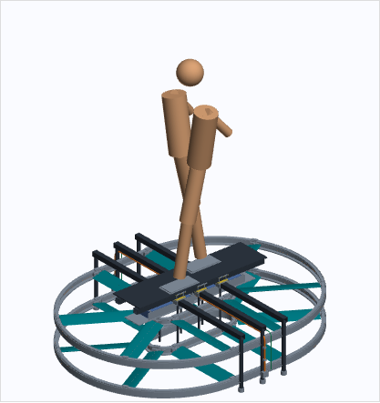
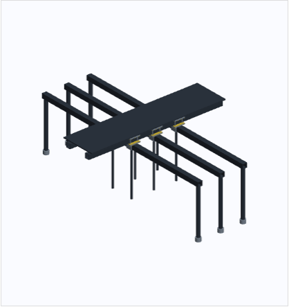
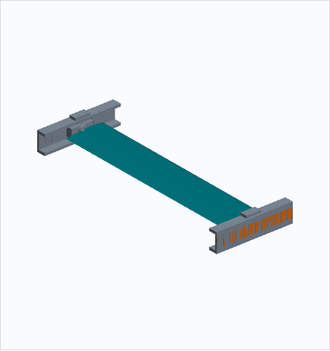
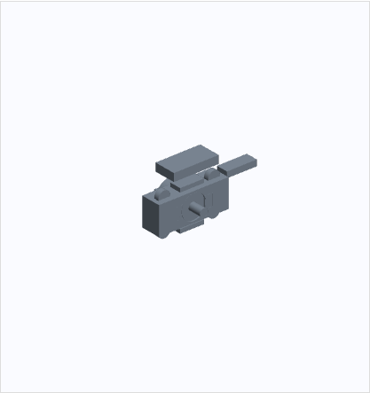
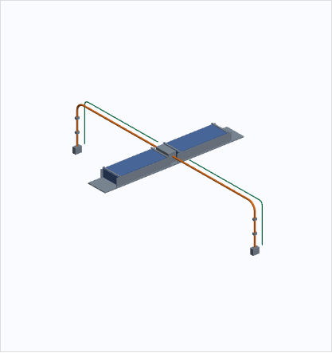
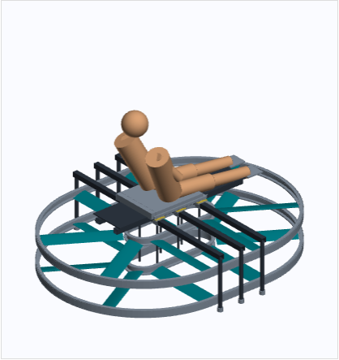
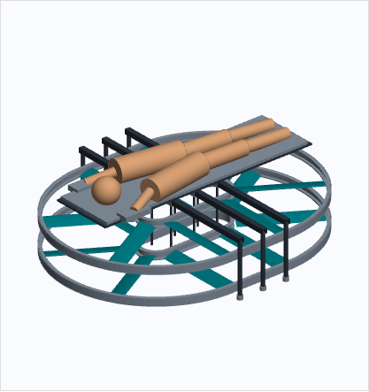

# 1. Status und bestimmungsgemäße Verwendung der Unterlagen

**Dieser Stand ist keine Fertigungsfreigabe und kein personenflugfähiger Entwurf.** Er konkretisiert die bisherige horizontale Vergleichsvariante zu überprüfbaren Baugruppen, Anschlussräumen und nominalen Bauteilgeometrien. Die Dateien eignen sich zur Konstruktionsprüfung und zur Vorbereitung unbemannter Teilversuche. Sie dürfen nicht als vollständig berechnete Stückzeichnungssammlung für ein Fluggerät verstanden werden.

Der Nutzer hat **Stehen als Hauptvariante** gewählt. Niedriger Langsitz und Bauchlage sind getrennte Ergonomiekonzepte. Die Basis bleibt ein horizontaler gegenläufiger Flügelumlauf mit zwei Ebenen bei z = −120 / +120 mm, acht Flügeln je Ebene, 120 mm Sehne, 600 mm Spannweite und 12° Referenz-Pitch. Neue Rahmen-, Führungs- und Einbaugeometrien sind keine durch die frühere CFD validierte Konstruktion.

Die technische Ausarbeitung enthält native FreeCAD-Grundkörper und boolesche Bearbeitungen, benannte Baugruppen, einen detaillierten geraden Mechanismusabschnitt, eine eigenständige Steh-Hauptbaugruppe, Referenzzeichnungen, Instanz- und Familienlisten sowie STEP-Austauschgeometrien. Profilinnenkonturen und Gesamtbahnen sind teilweise generierte Part-Geometrien. Nicht jeder Parameter ist über Expressions verbunden: vollständige Regeneration erfolgt über `parameter.json` und die Skripte.

**Vor Herstellung funktionskritischer Teile fehlen insbesondere:** Lastkollektiv, vollständiges Massenbudget, CFK-Laminatdefinition, strukturelle Auslegung, lager-/magnetische Kraft- und Spaltrechnung, Motor- und Pitchleistungsnachweis, Elektrik-/Akkuauslegung, vollständige Kollisionsprüfung, Schutz- und Ausfallkonzept. Maße wie Luftspalt, Kabeldurchmesser und Bohrungen sind derzeit nominale Geometrieannahmen, keine freigegebenen Betriebswerte.

# 2. Dateien und Baugruppenstruktur

| Datei | Inhalt |
| --- | --- |
| `00_PropBoard_Detail_Stehen.FCStd` | Hauptbaugruppe mit CFK-Rahmen, stationären Führungen, 16 mobilen Flügelbaugruppen, Batterie-/Kabelräumen und Stehkonzept |
| `01_CFK_Rahmen.FCStd` | Rohrrahmen, Klemmpaare, Isolierlagen, Schrauben-/Kopfgeometrien und Deckabstützung |
| `02_Fuehrung_Antrieb_Detail.FCStd` | Gerader Prüf-/Einbauabschnitt mit einem Flügel, zwei Endschlitten, Lager-, Magnet-, Linear- und Pitchantriebsräumen |
| `02a_Schlitten_Detail.FCStd` | Vergrößerbarer Auszug des positiven Endschlittens mit kurzem Wellenstück und stationärem Abschnitt |
| `03_Batterie_Kabel.FCStd` | Zwei Modulräume, Einschub-/Haltegeometrie, zentrale Servicebox, feste HV- und LV-Trassen |
| `04_Ergonomie_Sitzen.FCStd` | Niedriger Langsitz mit Beinauflagen und Haltungsreferenz; vereinfachter Bahnkontext |
| `04_Ergonomie_Liegen.FCStd` | Bauchlage mit längerer Liegefläche und Unterarmauflagen; vereinfachter Bahnkontext |
| `05_Referenzzeichnungen.FCStd` | Vier native TechDraw-Seiten mit Teileprojektionen und nominalen Maßangaben |

STEP-Dateien liegen für die sieben räumlichen Modelle vor. Für die Referenzzeichnungen liegen zusätzlich SVG-Blätter vor. Der [Offline-3D-Viewer](Modelle_3D.html) enthält aus den tatsächlichen Dateien triangulierte Geometrien. Flügel, Struktur und Personenreferenz lassen sich getrennt ein-/ausblenden. Die Ansicht ist keine kinematische oder strukturelle Simulation.



# 3. Hüllmaße und Konsequenzen für den Bauraum

| Modell | Hüllmaße ohne Personenreferenz, mm | Aussage |
| --- | --- | --- |
| Hauptvariante Stehen | 2080 × 1698 × 558 | Modellierte Momentaufnahme innerhalb 2100 × 1700 × 600 |
| Niedriger Langsitz | 2072 × 1664 × 595 | Nur vereinfachte Kontextausstattung; kein vollständiges Alternativfahrzeug |
| Bauchlage | 2072 × 1664 × 598 | Nur vereinfachte Kontextausstattung; kein vollständiges Alternativfahrzeug |

Die Hüllmaße beziehen sich auf die gespeicherte Stellung und die jeweils vorhandenen Körper. **Die Steh-Hauptbaugruppe hat nominell nur 2 mm Gesamtreserve in der Breite.** Diese Reserve ist kein zulässiger Fertigungs- oder Verformungsspielraum. Vollständige Schutzabdeckungen, Verbindungsteile, Toleranzen, zusätzliche Kabelbögen und Wärmeausdehnung sind nicht geschlossen integriert. Die Maximalabmessungen sind deshalb für ein fertiges Fahrzeug noch nicht nachgewiesen.

Die Alternativmodelle enthalten nicht die gesamte Batterie-, Kabel- und Antriebsdetailausstattung der Hauptbaugruppe. Ihre niedrigere Breite darf nicht als belegter Vorteil einer vollständigen Sitz- oder Liegeausführung interpretiert werden. Das Liegekonzept besitzt nominell nur 2 mm Höhenreserve; auch dort sind weitere Schutz-/Komfortbauteile nicht mit einer gesicherten Hülle vereinbar.

Die Fahrzeugunterkante liegt im Referenzrahmen bei z = −200 mm. Die Deckoberseite wurde gegenüber dem früheren groben Modell auf z = 346 mm verlegt, um Querträger, Klemmaufbau, Akku und Kabelwege räumlich zu trennen. Die Stehaufnahmen enden bei z = 358 mm. Eine feste hohe Lenksäule oder hohe Sitzlehne ist nicht Bestandteil des eingehaltenen Fahrzeugbauraums.

# 4. Carbonrahmen und Lastpfade

## 4.1 Rohrkonzept und Zuschnittreferenz

| Bauteilfamilie | Anzahl in Hauptbaugruppe | Nominaler Querschnitt | Nennlänge |
| --- | ---: | --- | ---: |
| CFK-L01, Längsträger | 2 | 40 × 40 mm, Wandreferenz 3 mm | 1200 mm |
| CFK-Q01, Querträger | 3 | 40 × 40 mm, Wandreferenz 3 mm | 1660 mm |
| CFK-S01, äußere Stützen | 6 | außen Ø30 / innen Ø24 mm | 400 mm |
| CFK-S02, innere Stützen | 6 | außen Ø16 / innen Ø10 mm | 400 mm |

Die Querträger liegen bei x = −200, 0, +200 mm und z = 230…270 mm. Die Längsträger liegen bei y = ±100 mm und z = 280…320 mm. Damit sind die Rohrzüge nicht als geometrisch unlösbare Kreuzung auf gleicher Höhe modelliert. Ihr Verbund erfolgt über separate Anschlusszonen.

Die angegebenen Wandstärken sind keine CFK-Auslegung. Es fehlen Fasertyp, Faserorientierungen, Lagenfolge, Fasergehalt, Harzsystem, Herstellverfahren, zulässige Fehler und Eigenschaften der Lastanschlüsse. Die isotrope Interpretation eines CAD-Rohrs wäre unzulässig. Es gibt keine freigegebene Schnittzugabe, Mindestklemmlänge oder Laminatverstärkung.



## 4.2 Klemmknoten und nominale Bearbeitungsdetails

Die Klemmpaare KNOTEN-P01 sind 90 × 80 × 8 mm groß. Vier nominale Durchgangsbohrungen Ø6,6 mm liegen auf einem Raster 64 × 52 mm. Die Lochmitten liegen 13 / 77 mm von der linken und 14 / 66 mm von der unteren Plattenkante entfernt. Die Schraubengeometrie ist als Ø6-Schaft und vereinfachter Kopf dargestellt; Gewinde, Muttern, Scheiben, Sicherung und konkrete Schraubenklasse fehlen.

Die untere Platte liegt bei z = 271…279 mm, der Längsträger bei 280…320 mm und die obere Platte bei 321…329 mm. Isolierlagen sind bei 270…271, 279…280 und 320…321 mm vorgesehen. Ihre Bohrbilder sind in der Geometrie enthalten. Die Positionen der Schraubenschäfte liegen nominell außerhalb des tragenden Rohrquerschnitts; direkte Durchgangsbohrungen in die tragenden CFK-Rohre sind im Konzept nicht vorgesehen.

Die isolierten Kontakte sollen einen kontrollierten Materialübergang zwischen leitfähigem CFK und Metall vorbereiten. Korrosionsschutz, Oberflächenbehandlung, Reibwert, Feuchteverhalten, Kriechen und elektrische Isolation sind nicht geprüft. Die Modellkörper sind kein Nachweis einer dauerhaft wirksamen galvanischen Trennung.

Der beabsichtigte Lastpfad lautet: Fußauflage → Deck-Hardpoints → Distanz-/Klemmknoten → Längs- und Querträger → Stützen/Anschlusslaschen → stationäre Führungen. Dieser Pfad ist nur topologisch beschrieben. Druck in CFK-Querschnitten, lokale Quetschung, Delamination, Schraubenkräfte und Rohrbeulen sind noch nachzuweisen. Die Knoten-Referenzhüllen überlagern Rohrbereiche absichtlich; sie stellen keine fertig ausgearbeiteten Formschlussstücke dar.

## 4.3 Anforderungen vor einem Rahmenprototyp

Ein belastbarer Rahmen benötigt ein definiertes Lastkollektiv aus Pilot, Ausrüstung, Akku, vertikalen Flugkräften, asymmetrischer Regelung, Umlenkkräften, Transport- und Landelasten. Eine pauschale Übernahme der früheren 45-kg-Systemannahme ist nicht möglich. Die großen periodischen Umlenkkräfte müssen mit ihren Frequenzen und Schnittstellenmomenten berücksichtigt werden.

Für erste unbemannte Probeknoten sind insbesondere Klemm-/Verstärkungsgeometrie, Materialpaarung, Endverstärkung, Vorspannung und messbare Prüflasten festzulegen. Die Nenn-Zuschnittliste ist eine Konstruktionsreferenz, kein freigegebener Einkaufs- oder Fertigungsauftrag.

# 5. Führung und Flügelantrieb

## 5.1 Stationäre C-Führung

Jede Ebene besitzt eine innere und eine äußere Führungsbahn. Bei 450 mm mittlerem Radius und 320 mm radialem Versatz ergeben sich im Bogen mittlere Führungsradien von 130 und 770 mm. Die Öffnungen der C-Profile zeigen zum Flügel hin. Die modellierte Querschnittshöhe beträgt 60 mm, die Flanschdicke 8 mm, die Rückwanddicke 6 mm. Rückschluss- und Wicklungsräume liegen auf der statischen Rückseite.

Die Gesamtbahnen sind geometrische Gesamt-Hüllen. Eine fertigbare Segmentierung in gerade Stücke und Bogensegmente, Stoßfugen, Bezugssysteme, Ausrichtung, Austauschbarkeit und Dehnungsausgleich ist noch nicht ausgearbeitet. Der separate 240-mm-Geradabschnitt konkretisiert den Einbauraum; er beweist nicht, dass derselbe starre Schlitten jede Kurve mit konstantem Luftspalt durchfahren kann.



## 5.2 Bewegter Schlitten und Fanggeometrie

Der Schlitten-Grundkörper SCHL-01 ist 70 × 20 × 28 mm groß und besitzt eine quer liegende Referenzbohrung Ø24,4 mm. Bei dieser Geometrie bleiben oberhalb und unterhalb der Bohrung nominell nur 1,8 mm Restwand. Das ist ein offener Auslegungspunkt, kein zulässiger hochbelasteter Querschnitt. Material, lokale Verstärkung und erforderliche Lager-/Motorsitze müssen vor Herstellung festgelegt werden.

Magnetische Führpole und kleine Fangrollen sind getrennt dargestellt. Im geraden Referenzabschnitt ergeben sich nominal 2 mm zwischen Führpolraum und Flansch sowie 1 mm Fangrollenfreiheit. Diese Zahlen sind **keine nachgewiesenen Betriebs- oder Sicherheitsluftspalte**. Es fehlen magnetische Steifigkeit, Sensorauflösung, Toleranzkette, Verformung und die Lastaufnahme im Fangfall. Es gibt keine Freigabe für einen Energieausfall.

Die Führung muss unter anderem Querkräfte, vertikale Kräfte und die aus der Flügelanstellung entstehenden Momente aufnehmen. Gegenläufige Bänder beseitigen diese lokalen Kräfte nicht. Die stationären Aluminium-/Rückschlusskörper, Magnetpole und Wicklungsräume definieren eine zu untersuchende Architektur, keine funktionsfähige Magnetlagerlösung.



## 5.3 Linearantrieb und notwendige Synchronisation

Im Geradabschnitt sind zwölf Stator-Wicklungsräume mit 20 mm geometrischem Raster und symbolischer ABC-Zuordnung angeordnet. Die PM-Bauraumblöcke am Schlitten besitzen eine symbolische N/S-Folge mit 30 mm Polmittenabstand. Diese Raster sind lediglich eine geometrisch konsistente Referenz für eine 60-mm-Folge; Windungszahl, Phasensinn, Magnetgüte, Rückschluss und Kraftkennlinie sind nicht berechnet.

Die Wicklungsräume liegen teilweise innerhalb der statischen Trägerhülle. Taschen, Isolierkörper und die tatsächliche Wicklung sind nicht auskonstruiert. Das orange Volumen ist kein fertiges Vollkupferteil und darf nicht mit einer Kupferdichte zu einer realen Masse umgerechnet werden.

Die Endschlitten müssen innerhalb eines Flügels dieselbe geometrische Orientierung koordinieren, können aber im Bogen nicht mit derselben linearen Geschwindigkeit fahren. Bei den aktuellen Radien ist das Verhältnis äußerer zu innerer Bahngeschwindigkeit etwa 770/130 = 5,92. Auf der Geraden müssen die Geschwindigkeiten dagegen gleich sein. Ein starrer Gleichgeschwindigkeitsriemen für beide Enden löst diese Kinematik nicht.

Für 16 Flügel ergeben sich 32 Endschlitten. Ein gemeinsamer unsegmentierter Dreiphasenstator ist noch kein Nachweis unabhängig regelbarer Schlittenkräfte. Benötigt werden eine geeignete segmentierte Leistungsarchitektur, Positionszuordnung, Kollisionsvermeidung, Stromregelung und Synchronisation der beiden Enden. Diese Funktionen sind nicht implementiert.

## 5.4 Pitchachse, Lager und Stellglied

Die Referenz-Pitchwelle besitzt Ø8 mm und 640 mm Länge. Ihre Lage bleibt bei 50 % der Sehne, um die frühere geometrische Achsenannahme sichtbar zu halten. Sie ist nicht als aerodynamisch oder strukturell optimale Achse ausgewählt. Die Hüllkontur wird in der Hauptbaugruppe mit 12° Pitch dargestellt; die Schlitten bleiben dabei zur Bahn ausgerichtet. Wurzelanschluss und Welle sind getrennt vom Stator modelliert.

Lagerkörper sind als Ringräume mit 8 mm Innen-, 22 mm Außenmaß und 7 mm Breite dargestellt. Das ist keine ausgewählte, lastbewertete Lagerbauart. Der nominale Sitz Ø22,2 mm ist keine freigegebene Passung. Das Pitch-Stellglied ist als koaxialer Direktantriebsraum Ø24 mm mit Ø8,4-mm-Durchlass und 12 mm Länge dargestellt. Ein Encoderraum liegt daneben. Drehmoment, Winkelrate, Regelbandbreite, Verlustleistung und thermische Dauerlast fehlen.

Die CFK-Flügelhülle besitzt eine geometrisch skalierte Innenkontur. **Sie hat keine konstante freigegebene Wandstärke und keine definierte Lagenfolge.** Sie dient zur Prüfung der Wellen-/Wurzelräume. Ein brauchbarer Flügel benötigt einen geschlossenen Strukturaufbau, Wurzelrippen, Lasteinleitung, Oberflächengüte, Massenabgleich sowie Flatter- und Ermüdungsnachweise.

## 5.5 Kurven und Übergänge – weiterhin entscheidend

Eine gerade C-Führung mit starrer Schlittengeometrie ist kein Nachweis für gleichbleibende Magnetspalte im 130-mm-Innenbogen. Unterschiedliche Krümmung an den Kontakt-/Polflächen, Schlittenlänge und Schuhausführung müssen gemeinsam ausgelegt werden. Kurze, gegebenenfalls gelenkig gekoppelte Führungsschuhe sind eine untersuchbare Weiterentwicklung, noch kein ausgewähltes Bauteil.

Die idealisierten Ovale besitzen einen sprunghaften Krümmungswechsel zwischen Gerade und Kreis. Eine exakt tangential ausgerichtete starre Flügelbaugruppe würde dort einen Sprung ihrer Orientierungsrate benötigen. Die Bahn- und Pitchtrajektorien müssen vor einer funktionsfähigen Mechanik geglättet werden. Die native Gesamt-Hülle hält diesen offenen Punkt ausdrücklich fest.

# 6. Batterie und Kabelwege

## 6.1 Modulaufnahme

Zwei generische Module mit je 400 × 140 × 60 mm liegen bei x = ±240 mm, y = 0 und z = 165…225 mm. Diese Bauraumannahme ist **keine Auswahl des früher untersuchten Tattu-Packs** und kein Nachweis ausreichender Energie oder Dauerleistung. Zellchemie, Spannung, Kapazität, Masse, Kurzschlussleistung und thermischer Aufbau bleiben offen.

Eine untere Trennlage liegt bei z = 155…159 mm, der nominale Einschubboden bei 159…162 mm. Seitliche Gleit-/Isolierlagen, obere Rückhaltebügel und die Servicezone zwischen den Modulen sind dargestellt. Der CAD-Rückhalt ist kein nachgewiesenes Verriegelungs- oder Aufprallsystem.

Die schmalen BAT-BUEGEL-Referenzteile besitzen 12 × 160 × 5 mm und zwei Ø6,6-mm-Bohrungen. Die kleinen Randabstände sind ausdrücklich nicht lastvalidiert; diese Referenzteile müssen vor einer Fertigung neu dimensioniert werden. Sie sind nicht als geeignete Batterie-Rückhaltebügel empfohlen.

Die gedachte Entnahmerichtung ist längs x. Eine vollständige Entnahme-/Servicebewegung mit Steckern, Verriegelung, Handschuhbedienung und Kabelbögen wurde nicht geprüft. Feuer-, Gas- und Splitterführung sind nicht durch eine einfache Trennplatte gelöst.



## 6.2 Stationäre HV-/LV-Führung

Die HV-Trassen werden als Ø12-mm-Kabelraum mit nominalem 60-mm-Bogenradius modelliert. Sie laufen aus der zentralen Servicezone nach außen und außerhalb des bewegten Flügelraums zu den stationären Stator-Verteilzonen. LV-/Datenräume sind als separate Ø6-mm-Trassen vorgesehen.

Durchmesser und Bogenradien sind nur Bauraumwerte. Ohne Spannung, Dauer-/Spitzenstrom, Bündelung, Umgebungstemperatur, Kühlung und Kabeldatenblatt lassen sich weder Aderquerschnitt noch Isolationssystem oder zulässiger Mindestbiegeradius festlegen. Räumliche Trennung ist kein EMV- oder elektrischer Sicherheitsnachweis.

Die Leiter sind als feste Trassen modelliert. Es wird **keine Schleppkette um eine endlose Bahn** vorgeschlagen. Bewegte Pitchsteller und Sensorik benötigen eine eigene Energie-/Datenlösung. Dafür sind primäre/sekundäre induktive Bauraumkörper und mobile Elektronik dargestellt. Übertragungsleistung, Frequenz, magnetische Kopplung, Pufferung und störungsfreie Regelung sind noch nicht nachgewiesen. Dies ist kein einsatzfähiges kontaktloses Versorgungssystem.

## 6.3 Elektrische Funktionen – noch kein Schaltplan

Benötigte Funktionskette: Akkumodule → geeignete Modulüberwachung und Schutzfunktionen → definierte Trenn-/Vorlade- und Verteilfunktion → stationäre segmentierte Linearantriebsregler sowie Hilfsversorgung → kontaktlose mobile Versorgung, Pitchregler und Positionssensorik. Eine schematische Servicebox stellt diese Funktionen nur als Einbauraum dar.

Die konkrete Verschaltung, Spannungsdomänen, Sicherungswerte, Leitungsquerschnitte, Steckverbinder, Vorladung, Schutzleiter-/Potentialkonzept und Fehlerreaktion sind offen. Es gibt keine Bestückungsliste einer funktionsfähigen Elektronik. Eine Abschaltung aller Antriebe im Flug ist nicht pauschal als sicherer Notfallmodus vorgesehen oder bewiesen.

# 7. Pilotenergonomie

Die Personen sind **Haltungsreferenzen aus einfachen Körpern**, keine validierten anthropometrischen Menschmodelle und keine biomechanisch konsistenten Varianten desselben Probanden. Aus ihnen folgt kein Nachweis für bestimmte Körpergrößen, Bewegungsräume, Schwerpunktlagen oder Perzentile. Pilotengewicht 100 kg plus Ausrüstung ist weiterhin eine Lastanforderung, keine aus den Referenzvolumina berechnete Masse.

## 7.1 Stehen – gewählte Hauptvariante

Die Fußadapter sind 280 × 130 × 5 mm groß. Vier nominale Ø6,6-mm-Bohrungen liegen auf 200 × 90 mm Raster. Darauf liegen 260 × 120 × 7 mm große Auflageräume. Die Positionen liegen beispielhaft bei x = ±160 mm und y = ∓70 mm. Die Standposition lässt sich im CAD ändern; eine fertige Langloch-/Verstellmechanik ist nicht modelliert. Deck-Hardpoints und das Befestigungssystem bleiben auszulegen.

Die Auflageoberkante liegt bei z = 358 mm. Es sind keine fest verriegelnden Fußbindungen dargestellt. Haftung bei Nässe, sichere Lastübertragung, kontrollierbares Lösen und zulässige Fußbewegungen sind nicht nachgewiesen. Die primäre Bedienidee ist ein am Piloten getragener Geber; ein ausgewähltes Bedienelement oder eine Kommunikations-/Notfallarchitektur ist nicht im CAD ausgearbeitet. Eine feste hohe Lenksäule würde die aktuelle Fahrzeughülle verändern.

Vorteile als Konzept: freie Beinbewegung, variable Gewichtsverlagerung und geringe zusätzliche Fahrzeugaufbauhöhe. Nachteile: hoher Piloten-Schwerpunkt, große Windangriffsfläche, Balance-/Ermüdungsanforderungen und starke Kopplung zwischen Körperbewegung und Fahrzeugregelung. Keine dieser Eigenschaften ist hier durch einen bemannten Versuch quantifiziert.

## 7.2 Niedriger Langsitz – Alternative

Die niedrige Sitzauflage und der Beckenanschlag bleiben innerhalb der nominalen Fahrzeughöhe; eine herkömmliche hohe Rückenlehne fehlt. Die Beine werden nach vorn geführt und über zusätzliche Auslegerauflagen abgestützt. Das ist ein Langsitzkonzept, kein normaler Stuhl mit 90°-Kniehaltung.



Mögliche Vorteile sind eine geringere erforderliche Bein-Balancearbeit und ein niedrigerer Körperschwerpunkt als beim Stehen. Belastbare Werte fehlen. Nachteile sind unzureichend definierte Rücken-/Beckenabstützung, Ausstieg, Rettung, Beinraum und die noch unberechneten Ausleger. Das Konzept ist nicht als 15 Minuten komfortabel, crashsicher oder zulässig nachgewiesen.

## 7.3 Bauchlage – Alternative

Eine 1800 × 500 × 12-mm-Auflage und ein 20-mm-Polsterraum werden durch Unterarmauflagen ergänzt. Dadurch entsteht oberhalb der Flügel eine große neue Fläche. Die bisherige CFD enthielt diese Fläche nicht und kann ihre Abschattung oder Zusatzkräfte nicht bewerten.



Mögliche Vorteile sind eine flache Körperanordnung und großflächige Unterstützung. Offene Nachteile sind Nackenhaltung, Sicht, Atmung, Druckstellen, schnelle Beweglichkeit, Ausstieg und Rückhaltung. Es wird kein ergonomischer Vorteil über 15 Minuten behauptet. Die Liegevarianten-Hülle hat außerdem praktisch keine gesicherte Höhenreserve für weitere Bauteile.

# 8. Tatsächlich ausgeführte Prüfungen

Alle sechs generierten Grundmodelle wurden gespeichert, wieder geöffnet und ihre Ergebnisformen auf geometrische Gültigkeit geprüft. Der separate Schlittenauszug wurde ebenfalls gespeichert und wieder geöffnet. Die TechDraw-Datei enthält vier native Seiten mit Quellgeometrien; die unabhängigen SVG-Projektionen stammen aus diesen realen Teileformen. Die Maßangaben sind Referenzangaben, keine freigegebene Toleranzdefinition.

In der gespeicherten Steh-Hauptbaugruppe wurden zusätzlich folgende Mindestabstände direkt aus den Ergebnisformen ermittelt:

| Prüfung | Geprüfte Paare | Kleinster Abstand |
| --- | ---: | ---: |
| Akkubauraum zu CFK-Längs-/Querträgern | 10 | 5,0 mm |
| Akkubauraum zu HV-/LV-Kabelräumen | 8 | 34,0 mm |
| Flügelhüllen zu HV-/LV-Kabelräumen | 64 | ca. 125,74 mm |
| Flügelhüllen zu stationären C-Profilen | 192 | ca. 9,06 mm |

Diese Werte gelten nur für die ausgewählten Körperpaare in der gespeicherten Stellung. Sie schließen Stecker, Kabelschwingen, Verformungen, Magnetbewegungen, Montage-/Fertigungstoleranzen oder andere Bauteilkontakte nicht ein. Insbesondere ist 5 mm Akkufreiraum kein ausreichend nachgewiesener Bewegungs- oder Brandschutzabstand.

Es gibt **keine globale Aussage „kollisionsfrei“**. Beabsichtigte Bauraumüberlagerungen bestehen unter anderem bei Knotenreferenzen, Wicklungsräumen innerhalb noch nicht getaschter Statorträger, Wurzelanschlüssen und Halterschellen. Die Grundkörper ersetzen dort keine vollständig bearbeiteten Anschlussstücke. Eine kontinuierliche Bewegungs- und Luftspaltprüfung fehlt weiterhin.

Nicht ausgeführt wurden FEA, Laminatberechnung, Magnetfeldrechnung, Motor-/Pitchauslegung, elektrische/thermische Prüfung, Belastungsversuche, neue CFD der Detailgeometrie oder bemannte Versuche. Die früheren lokalen 2D-Strömungsergebnisse bei Re = 40 sind keine Freigabe dieser geänderten Konstruktion.

# 9. Fertigungsrelevante Daten und offene Arbeitspakete

`Stueckliste_Instanzen.csv` dokumentiert Datei, Instanz, Bauteilfamilie, angenommene Materialklasse, Prozess, Referenzstatus und CAD-Volumen. Dieselbe Baugruppe ist in mehreren Betrachtungsdateien vorhanden; die Dateien dürfen nicht zu einer Gesamtstückzahl aufsummiert werden. Die Hauptbaugruppe enthält 712 markierte Instanzen einschließlich der Personenreferenzen.

`Stueckliste_Hauptbaugruppe_Familien.csv` gruppiert ausschließlich die Steh-Hauptbaugruppe nach ID-Familien. Das ist keine bestellfertige Stückliste: etwa innere/äußere Führungen können dieselbe Familie besitzen, obwohl ihre Radien und realen Teile verschieden sind. Die Instanzgeometrie ist maßgebend. CAD-Volumina, besonders Referenz-/Wicklungsvolumina, dürfen nicht als verifizierte Materialmassen verwendet werden.

`CFK_Zuschnitt_Referenz.csv` enthält die oben genannten Nennprofile und Längen. Schnittzugaben, Toleranzen, Werkstoffzustände und Freigaben fehlen. Die TechDraw-/SVG-Blätter behandeln KNOTEN-P01, SCHL-01, ERG-ST-P01 und BAT-BUEGEL. Das sind konkrete Maß-/Projektionsreferenzen für eine Konstruktionsbesprechung, keine vollständigen Werkstattzeichnungen.

Vor einer Herstellentscheidung sind mindestens folgende Schritte nötig:

1. Lastkollektiv, bewegte Massen und Bauraum einschließlich Schutz vollständig schließen.
2. Klemmlasten, CFK-Lagenaufbau, Inserts, Anschlusssteifigkeit, Ermüdung und Fertigungs-/Prüfverfahren festlegen.
3. Kurvenfähige Führungsschuhe, Luftspalte, Fangfunktion und geglättete Bewegungsbahnen auslegen.
4. Linearmotor-/Pitch-/Versorgungsarchitektur mit realen Komponenten und thermischem Dauerbetrieb nachweisen.
5. Akkuenergie, Dauerleistung, Schutzfunktionen, Kabeltypen und Verschaltung gemeinsam auswählen; keine reine Energiebilanz ohne Leistungseignung.
6. Ergonomie zuerst an einem stationären, nicht fliegenden Mock-up untersuchen, mit definierten Personenmaßen und Ein-/Ausstiegsabläufen.
7. Erst danach freigegebene Zeichnungen mit eindeutigen Teilenummern, Material-/Prozessdaten, Bezugsmaßen, Passungen, Toleranzen, Verbindungen und Qualitätsprüfungen erstellen.

# 10. Reproduktion und Datenherkunft

Ausgangspunkt sind die bisherigen lokalen FreeCAD-Konzepte der horizontalen Variante. Sämtliche neuen Profile, Klemmgeometrien, Magnet-/Antriebsräume, Batterieabmessungen und Piloteninterfaces sind neue Auslegungsannahmen. Es wurden keine realen Herstellerkennfelder oder spezifischen Magnet-/Akkuprodukte als geeignet bestätigt.

Im Repository-Verzeichnis:

```sh
/usr/bin/python3 konstruktion/erstellen.py
/usr/bin/python3 konstruktion/detailauszug.py
/usr/bin/python3 konstruktion/zeichnungen_erstellen.py
/usr/bin/python3 konstruktion/geometrie_pruefen.py
python konstruktion/stuecklisten.py
/usr/bin/python3 konstruktion/modelle_exportieren.py
python konstruktion/viewer_erstellen.py
```

Die native Geometrie nutzt FreeCAD 1.0 über die Python-3.13-Schnittstelle dieser Umgebung. Für die interaktive Ansicht sind die Flächen direkt aus den FCStd-Dateien trianguliert. Sie ist keine Ersatzgeometrie aus einer Skizze. Die Dateien sind eigenständig; Quellnamen sind zur Nachverfolgung dokumentiert, ohne beim Öffnen externe CAD-Links zu benötigen.

**Ergebnis:** Ein detaillierter, überprüfbarer Konstruktionsvorentwurf mit Stehen als Hauptvariante liegt vor. Fertigungsrelevante Geometrien und Schnittstellen sind konkretisiert; ihre Eignung zur Herstellung und zum Betrieb muss für die ausdrücklich offenen Punkte erst nachgewiesen werden.
