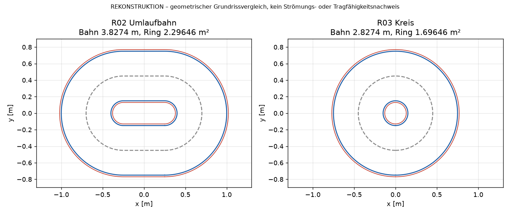

# Kreis R03 – Grundrissvergleich mit der R02-Umlaufbahn

> **REKONSTRUKTION vom 30.10.2026.** Der ursprüngliche R03-Arbeitsstand lag in einer Cloud-Umgebung, die nicht mehr erreichbar war, und wurde nie nach GitHub übertragen. Dieser Vergleich wurde mit `grundriss.py` aus den dokumentierten Geometrieparametern neu berechnet. Er ist rein geometrisch.

## Geometrie

| Parameter | Wert |
|---|---|
| Mittelradius der Kreisbahn | 450 mm |
| Ebenen | z = −120 mm und z = +120 mm |
| Flügel | 8 je Ebene, insgesamt 16, gegenläufig |
| Spannweite (radial) × Flügeltiefe | 600 mm × 120 mm |
| Flügelbereich | r ≈ 150 … 750 mm |
| Führungsbahnen | innen r = 130 mm, außen r = 770 mm |
| Referenz-Pitch | 12° |

## Ergebnis

| Kennwert | R02 Umlaufbahn (2 × 500 mm gerade) | R03 Kreis |
|---|---:|---:|
| Bahnlänge (Mittellinie) | 3,8274 m | 2,8274 m |
| Idealisierte überstrichene Fläche je Ebene | 2,29646 m² | 1,69646 m² |
| Geometrische Flügelfläche gesamt | 1,152 m² | 1,152 m² |
| Grundriss des Flügelbereichs | 2,0 × 1,5 m | 1,5 × 1,5 m |

Damit überstreicht R03 je Ebene etwa **26,1 % weniger** Fläche als R02.

## Einordnung

- Die überstrichenen Flächen sind **idealisierte geometrische Ringflächen**, keine nachgewiesenen wirksamen Strahlflächen.
- Die beiden übereinanderliegenden Ebenen dürfen **nicht** als voneinander unabhängige Rotorflächen doppelt gezählt werden.
- Der Kreis **beseitigt die Zentrifugalkräfte nicht**. Bei gleichem Radius und gleicher Geschwindigkeit wirkt die radiale Belastung jetzt über den gesamten Umlauf statt nur in den Bögen. Bei 40 m/s und r = 450 mm sind das rund 3 560 m/s² (≈ 360 g).
- An der Flügelwurzel (r = 150 mm) wird es eng: Die tangential liegende Sehne ist projiziert 117,4 mm lang, ihre Ecken liegen 21,4° neben der Flügelmitte. Bei 45° Teilung bleiben im Grundriss nur etwa 2,3° (rund 6 mm) zwischen benachbarten Flügeln. Der exakte Abstand wird von `kreis_r04/cad_erstellen.py` geprüft.
- R03 ist ein **Layoutmodell**. Rahmenanbindung, Ringhalter, Schutzmaßnahmen und Kabelwege sind nicht konstruiert.
