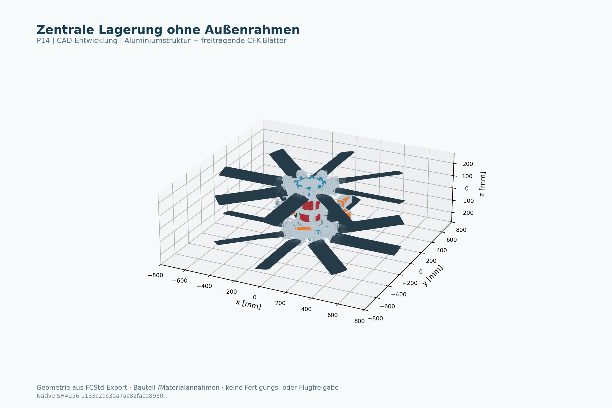

# Ergebnis P14

**Außenrahmen und Spitzenlager entfernt; verstärktes Zentrum, freitragende CFK-Flügel und sechs reale PH54-Servos je Rotorpaar als Entwicklungsstand umgesetzt.** Die native Baugruppe hat 1437 gültige Körper und 102 aktive Teiletypen. Sie ist animierbar und mit CAD-Masse/-Trägheit im separaten parametrischen Entwicklungsprüfstand untersuchbar. **Produktions- und Flugfreigabe fehlen.**

[Prüfstand öffnen](P14_Entwicklungspruefstand.html) · [FreeCAD](Ausgabe/P14_MN1330_Leichtbau.FCStd) · [STEP](Ausgabe/P14_MN1330_Leichtbau.step) · [offene Freigaben](FREIGABESTATUS.md)

## Masse und Umfang

| Erfasster Anteil | P13 | P14 |
|---|---:|---:|
| Zuordenbares Metall / Aluminium-Struktur | 125,65 kg | 31,92 kg |
| CFK bei angenommener Dichte 1.600 kg/m³ | 18,41 kg | 8,84 kg |
| Summe dieser Strukturanteile | 144,06 kg | 40,75 kg |

Die erfassten Strukturanteile sinken um 71,7 %. Der Umfang ist unterschiedlich: P13 enthält unter anderem äußere Führung, Aktoren und Fahrwerk; P14 benötigt noch Personendeck, Schutz-/Landestruktur und weitere Systemteile. **Die Prozentzahl ist kein Nachweis eines entsprechend leichteren vollständigen Fluggeräts.**

Mit dokumentierten Motor-/Servomassen und angenommenen Normlager-/Materialmassen beträgt die erfasste P14-CAD-Masse **60,56 kg**. Die neue XLS-Motormasse 2,75 kg statt 2,00 kg erhöht diesen Wert um 1,50 kg. Mit 100 kg Nutzlast, 12 kg angenommener Batterie und 2 kg Elektronik ergibt sich der Rechenfall **174,56 kg**. Weitere reale Systemmassen fehlen; dies ist keine gewogene Fahrzeugmasse.

Die ausgeführten Gelenke, Deckel, Befestigungen und größeren Freiräume erhöhen die erfasste CAD-Masse gegenüber dem früheren P14-Nennstangenstand von 53,15kg um 7,41kg. Der zusätzliche Umfang ist in den neuen Massendaten und Flugrechenfällen enthalten.

## Geometrie, Bewegung und Export

- Alle 1437 installierten Körper sind gültige Einzelvolumina.
- Alle 102 aktiven Einzel-STEPs und das Gesamt-STEP mit 1437 Volumina bestehen den Rücklesetest. Relative Gesamtvolumenabweichung: 4.8e-06.
- Bei 3 Einzelteilen weicht die numerische Volumenintegration nach STEP-Reparametrisierung ab. Die zusätzliche beidseitige Material-Differenzprüfung ergibt maximal 0mm³; Hüllkästen und gültige Volumina stimmen innerhalb der protokollierten Prüfgrenzen überein.
- 2160 Kinematikzustände für 4/6/8/10/12 Blätter und 360/440 mm Ebenenabstand: numerischer Gestängeschluss unter 10⁻⁶ mm; Hebelpitch 5,47–18,77°.
- Die Gestängedurchführungen haben in der abgetasteten Hüllkreisabschätzung mindestens 2,46 mm Reserve; das ist kein vollständiger Fertigungs-/Elastizitätsnachweis.
- Native Animation: alle Körper in fünf Stellungen gültig, Rückstellung ohne Verschiebungsfehler. 18 ausgewählte kritische Paare einschließlich benachbarter Gelenkaugen zeigen keine Volumenüberschneidung. Eine vollständige dynamische Hüllvolumenprüfung steht aus.

Die vollständige statische Prüfung zählt **0 Überschneidungen** über0,1mm³. Die früheren28 Anschlussbefunde sind konstruktiv geschlossen. Alle 1437 Körper sind einbezogen; es gibt keine pauschalen Kontakt-Ausnahmen. Identische Bauteilpaare mit identischer relativer Starrkörperlage werden zwischengespeichert.

## Gelenke und Montage

44 Endgelenke je Rotorpaar sind mit separaten Augen, Lagern/Buchsen, Distanzhülsen, Kopfbolzen, Scheiben, Splinten und DIN472-Sicherungen modelliert. M6-RH/LH-Einstellhülsen ersetzen die durchgehenden Nennstangen. Die Aluminiumteile sind Sonderteile in Norm-Konturfamilien; die GE8E-Innenprofile sind Nennmodelle, keine behaupteten OEM-Dateien.

75 Montage-/Werkzeugfälle bestehen: kontinuierliche Bolzen-Auszugshüllen, die benannten Lager-/Baugruppenwege und30-mm-Bitzugänge für 14 Schraubenfamilien. Der minimale modellierte M6-Gestängeeingriff beträgt 11,40mm. Über2160 Kinematikzustände benötigt das GE-Nennmodell maximal 2,99° Schwenkwinkel bei einem12°-Geometriescreen. Im nativen Fünf-Posen-Test bleiben die inneren Gelenkprofile überschneidungsfrei.

Der Hauptflansch ist abnehmbar, die äußeren Blattlagersitze sind offen, Kugelpfanne/Liner und Taumellagerdeckel sind geteilt. Die Pitchwelle besitzt Integralflansch und Wurzelmandrel; vier von außen erreichbareM6 ersetzen separate Innenplatte/Einsatz und die verdeckte Endschraube. [Montagefolge, Prüfbedingungen und Restpunkte](MONTAGE.md) · [Gelenk-Explosionsansicht](Ansichten/P14_Gelenk_Explodiert.png).

Die Montageprüfung gilt für die8-Blatt-Standardkonfiguration und die ausdrücklich benannten Montagestufen. OEM-Servobefestigung/Horn, Fertigungstoleranzen, vollständige Hand-/Werkzeughüllen und Tragfähigkeit bleiben offen. Die Prüfungen sind keine Produktionsfreigabe.

## Servo und Strukturbeanspruchung

Ausgewählt ist ROBOTIS PH54-200-S500-R. Der XH540 wurde nach dem Lastscreen verworfen. PH54-Herstellerangabe: 44,7 Nm, 24 V, 855 g; die Dauerangabe basiert laut OEM-Fußnote auf einer Berechnung des Grundmotors und muss für diese Anwendung bestätigt werden. Originales Montage-/Horn-CAD fehlt. [Quellen und Grenzen](SERVO.md).

Der aktuelle 2-g-Rechenfall fordert 214,1 N Schub je Blatt, 81,6 Nm am letzten Wellenlager und etwa 2.331 N Lagerpaar-Reaktion. Bei 2.100/min ergibt der Screen rund 14,62 kN Wurzelfliehkraft und 28,2 Nm konservativen Servo-Momentbedarf.

Das homogene Ersatz-Balkenmodell liefert bei angenommenem E = 70–110 GPa eine Spitzendurchbiegung von etwa 1,65–2,60 mm. Orthotropes Laminat, Kerben, Flanschbohrungen, Alu-Schrauben, Lagertragzahlen, Wurzelstern-Verformung und Ermüdung sind damit nicht freigegeben.

## MN1330-Daten und Flugbedarf

Die 19 NS52×20-Prüfpunkte, 2,75-kg-Motormasse und ca.92V/24S wurden übernommen. **3.400 W beziehen sich auf höchstens180s.** Der 16.270-W-Prüfwert hat keine angegebene Haltedauer. Das sind unterschiedliche Zeitbezüge; keine der Angaben wird als Dauerleistung oder als freigegebene Sonderrotor-Kennlinie behandelt. Die NS52×20-Zugkraft wird nicht auf P14 übertragen. [Ausführliche Dateninterpretation](MOTOR_DATEN.md).

Für die Standardkonfiguration mit 100 kg Nutzlast ergibt die vereinfachte Aerorechnung:

| Rechnerischer Schwebebedarf | Wert |
|---|---:|
| Drehzahl | 2.144/min |
| Wellenleistung gesamt | 45,9 kW |
| Drehmoment je Motor | 102,3 / 102,3 Nm |
| Elektrisch bei angenommener η = 0,82 | 56,0 kW |
| Höchster dokumentierter Prüfmomentwert | 46,25 Nm je Motor |
| Höchste dokumentierte elektrische Aufnahme beider Motoren | 32,54 kW |

Der berechnete Wellenbedarf ist bereits höher als die gesamte dokumentierte elektrische Aufnahme beider Motoren. Die vorliegenden Betriebswerte decken diesen Sonderrotor-Schwebepunkt deshalb nicht ab. Bei 850/min entstehen getrimmt nur etwa 270 N Gesamtschub, rund27,5 kg Kraftäquivalent. Im voreingestellten zeitgebundenen Motorfall bleibt das Modell am Boden. Die Flugrechnung erzeugt keine zusätzliche Leistung, um Schweben zu erzwingen.

Der konservative 3,4-kW-Rechenfall beendet die Zeitrechnung nach180s. Ein Vergleich mit den Prüfmaxima weist deren unbekannte Haltedauer aus. Freie Motorannahmen sind separat sichtbar; sie werden nicht als bestätigter Hardwarebetrieb ausgegeben. Ein thermisches Dauermodell fehlt.

## Parametrische Fälle

| Blätter je Rotor | Erfasste Masse eines Rotorpaars | Körper |
|---|---:|---:|
| 4 | 45,13 kg | 949 |
| 6 | 51,67 kg | 1193 |
| 8 | 60,56 kg | 1437 |
| 10 | 70,79 kg | 1681 |
| 12 | 81,75 kg | 1925 |

Die Geometrien und Trägheiten wurden für alle fünf Blattzahlen neu aus CAD erzeugt. 1–4 Rotorpaare lassen sich mit geänderter Gesamtmasse, Schwerpunktlage und Trägheit im Prüfstand untersuchen. Bei mehreren Paaren fehlt der Verbindungsrahmen; diese Anordnungen sind konstruktiv unvollständig und können das Zielmaß überschreiten.

Die 19 Physik-/Datenprüfungen und 9 Browserprüfungen bestehen, einschließlich Gegenmomenten, Leistungsgrenzen,180s-Zeitgrenze, Parameterwechsel, Export und mobiler Darstellung. Die bisherigen BEMT-Standardfälle bleiben numerisch unverändert. Das bestehende H01-Modell wird erst nach den offenen Freigaben als produktionsnahes Großmodell ergänzt.

Native SHA256: `1133c2ac3aa7ac82faca89303635fb2c1914e8d9de3b080e94a0a3c7cf4d7970`.
