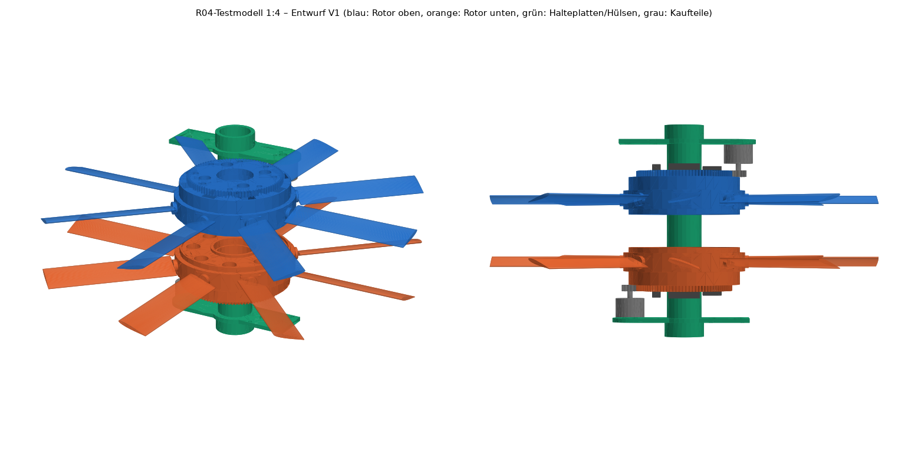

# R04-Testmodell 1:4 – CAD, Phase 2, Entwurf V1

**Entwurf ohne Festigkeits-, Toleranz- oder Fertigungsfreigabe.** Erzeugt mit FreeCAD 1.0.2 aus `parameter.json`:

```sh
FREECAD_LIB=.cfd-tools/freecad/usr/lib .cfd-tools/freecad/usr/bin/python modell_r04/cad/erstellen.py   # ~2 min
python modell_r04/cad/vorschau.py                                                                      # Vorschaubilder (matplotlib)
node modell_r04/auslegung/nachrechnung_cad.js                                                          # Betriebspunkte mit CAD-Masse
```



## Konstruktion

- **Achse:** feststehendes Aluminiumrohr Ø 30 × 1 mm. Je Rotor zwei Lager 6806-2RS, axial über gedruckte Hülsen zwischen den Halteplatten geklemmt.
- **Nabe:** Trommel Ø 118 × 36 mm (PA-CF) mit 8 radialen Servotaschen. Die **Servowelle liegt auf der Pitchachse** (Direktkopplung ohne Gestänge). Die Servos werden von oben eingesetzt; die Fliehkraft des Servos trägt die Außenwand.
- **Flügel:** NACA 0012, Sehne 30 mm, Profil r = 62…187,5 mm, Hinterkante 0,6 mm (druckbar), Pitchachse bei 50 % Sehne. Der Wurzelzapfen Ø 12 mm läuft in der Trommelwand. **Zwei Stahlstifte Ø 2 × 20 mm** greifen tangential in eine Nut des Zapfens und nehmen die Fliehkraft auf. Ein gedruckter **Mitnehmer** auf dem Servohorn greift in einen Schlitz des Zapfens und überträgt nur das Drehmoment; radial kann er gleiten.
- **Zahnkranz:** 91 Z, Modul 1, Evolvente 20°, Zahnbreite 6 mm, 0,15 mm Flankenspiel, mit 8 Schrauben M2,5 auf der Trommel. Er ist zugleich Deckel der Servotaschen und Träger der Rotorelektronik (ESP32-C3, 2 × 1S-Zelle, Schalter).
- **Antrieb:** Motor ECO II 2306 auf einer Halteplatte über bzw. unter dem Rotor, Stahlritzel 14 Z (Kaufteil), Achsabstand 52,6 mm (+0,1 mm). Das Ritzel läuft 0,5 mm über der Nabenoberseite (5,5 mm wirksame Zahnbreite). Oberer Motor bei 0°, unterer bei 180°.
- **Unterer Rotor:** dieselben Teile, um 180° gekippt. Dank symmetrischem Profil sind die Flügel identisch; der Pitch des unteren Rotors wird mit umgekehrtem Vorzeichen kommandiert.
- **Halteplatte** (2 ×, identisch, PETG): Rohrschelle mit Klemmschlitz, Motorpad (4 × M3 auf Ø 16 mm), Gegenarm mit Lochbild 30,5 × 30,5 mm (FC-Stack, oben) und 2 × M5 im Abstand 20 mm (Prüfstand 2020, unten).

## Prüfergebnisse (`Pruefbericht.json`)

| Prüfung | Ergebnis |
|---|---|
| Kollisionen bei 6 Rotorwinkeln (0…37,5°, Ritzel synchron) | **keine** |
| Verzahnung Zahnkranz/Ritzel | keine Überdeckung, Mindestabstand ≈ 0,18 mm an allen Winkeln |
| Pitch-Endlagen −2° / 21° | frei gegenüber Nabe; Abstand zum Nachbarflügel ≥ 19,8 mm |
| Mindestabstände | Flügel zu Motor/Platte 29,5 mm; Flügel oben zu unten 48 mm; Rotorelektronik zu Motor 4,0 mm; Naben 32 mm |
| Druckbett 200 × 148 × 150 mm | alle Teile passen (Nabe 118 × 118 × 36, Flügel 135 × 30 × 12, Halteplatte 133 × 46 × 18) |
| Formgültigkeit | alle Druckteile gültig |
| Statische Unwucht je Rotor | ≈ 27 g·mm (ESP32 gegenüber Schalter) → Wuchtgewicht ≈ 1 g bei r = 27 mm gegenüber dem ESP32 vorsehen |

## Masse

| | CAD V1 | Phase 1 (Schätzung) |
|---|---:|---:|
| Rotor oben / unten | 342 / 342 g | 244 / 244 g |
| Feststehend (Rohr, Platten, Hülsen, Motoren, Ritzel) | 174 g | – |
| Akku, FC/ESC, Empfänger, Bridge, Kabel | 337 g | – |
| **Gesamt** | **≈ 1 195 g** | 1 097 g |

Die größten Posten sind die Naben (2 × 111 g bei angenommenem Füllgrad 0,5) und die Servos (16 × 9 g Platzhalter). Druckteilmassen beruhen auf angenommenen effektiven Füllgraden und sind **mit dem Slicer zu prüfen**.

**Nachrechnung mit CAD-Masse** (`../auslegung/Nachrechnung_CAD.json`, Modellwerte):
- Schweben bei 2 316 U/min (Pitch 14°/16,7°), 8,2 A je Motor, 37 % Tastgrad, ≈ 147 W, ≈ 11,6 min.
- Schub/Gewicht 2 bei 3 273 U/min mit 15,3 A, am Flugende 57 % Tastgrad; machbar.
- Schleudertest bei 3 930 U/min: 167 N Fliehkraft je Flügel (7,9 g), ≈ 640 g an den Servos.

## Druckhinweise

- **Flügel** liegend drucken, Bahnen längs der Spannweite, Stützen unter dem Profil am Zapfen. Nach dem Druck auf ±0,05 g gleich wiegen.
- **Nabe** stehend (Taschen oben offen). Zapfenbohrungen Ø 12,4 und Stiftbohrungen Ø 2 aufreiben bzw. nachbohren.
- **Zahnkranz** liegend, möglichst feine Schicht (≤ 0,12 mm), 4+ Perimeter. Zahnflanken nicht schleifen, sondern fetten.
- **Werkstoffe:** Nabe, Flügel, Zahnkranz und Mitnehmer aus PA-CF bzw. PETG-CF; Halteplatten und Hülsen aus PETG.

## Offene Punkte für V2

1. **Servomodell wählen.** Das Platzhalter-Hüllmaß (22,8 × 12,2 × 22,5 mm, 9 g) in `parameter.json` durch die echten Maße ersetzen. Kleinere Servos verkleinern Nabe und Masse deutlich.
2. **Masse senken:** Topologie der Nabenstege, ggf. ein Lager je Rotor (Kippsteifigkeit dann prüfen), dünnere Zahnkranzscheibe.
3. **Festigkeit:** Wurzelzapfen mit Nut, Stiftsitze (Lochleibung im Druckteil), Zahnkranzverschraubung und Servotaschen bei 167 N bzw. 640 g; Kriechen von PA-CF bei Dauerlast. Bewertung über die Schleudertests in Phase 3a.
4. **Details:** Servohorn-Schnittstelle (Zahnung des gewählten Servos), Kabelführung von den Servos zum ESP32, Akkuhalter gegen Fliehkraft, Wuchtgewichtstaschen, Schutzring und Füße für die Flugphase, Prüfstandsadapter auf 2020-Profil.
