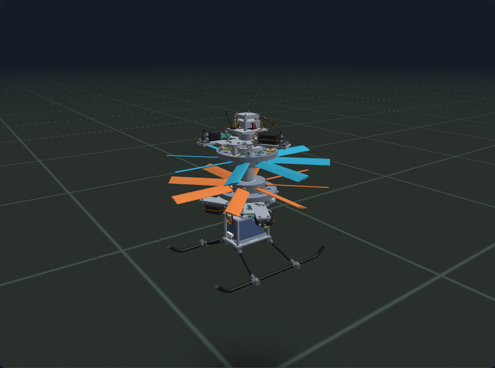
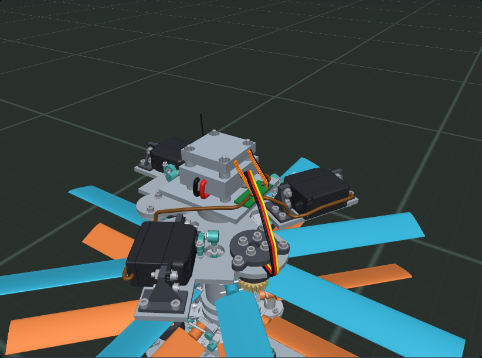
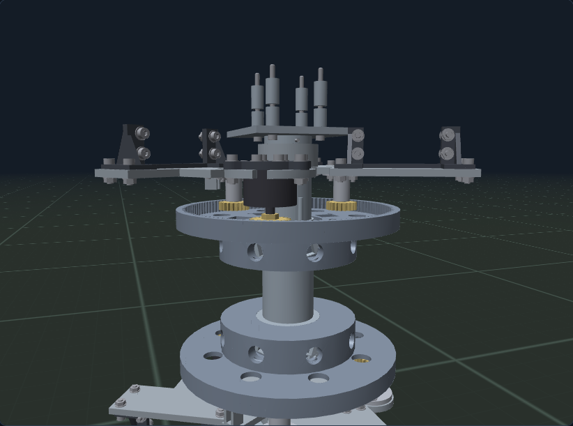
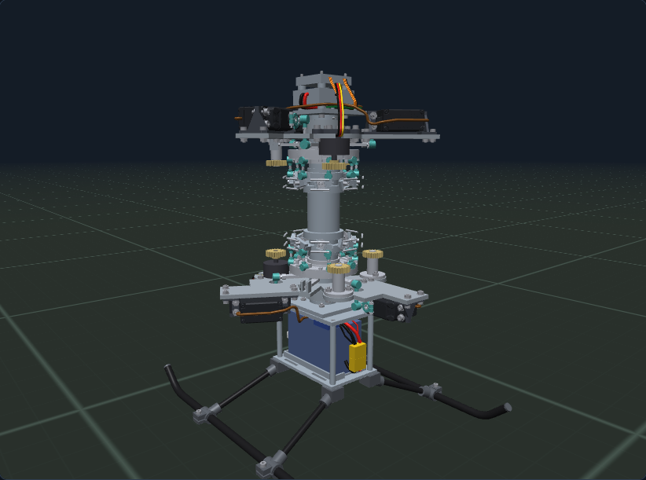
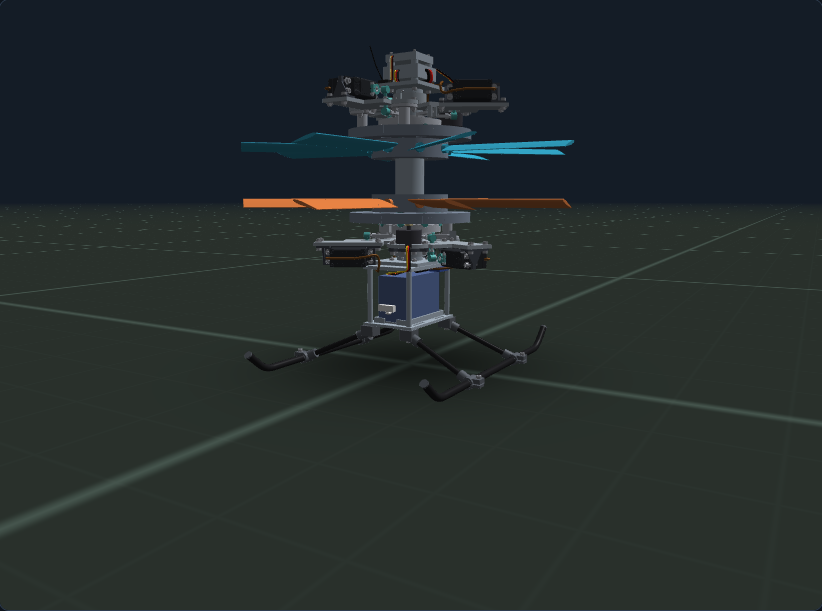

# P10 – Servohalter mit Lastpfad, Planetenstufe, Kabelbaum, Landegestell

**Konstruktionsentwurf, keine Fertigungs-, Festigkeits-, Elektro- oder Flugfreigabe.** P10 baut auf der durchgängigen P09-Baugruppe (Servo bis Rotorblatt) auf und schließt vier offene Punkte konstruktiv:

1. Die sechs Savöx-SB-2270SG+-Servos hingen bisher ohne Halter in der Baugruppe. Jetzt sitzen sie in **Servohaltern mit Lastpfad zur Halteplatte**.
2. Die **Verkabelung** ist mit konkreten Leitungswegen modelliert (34 Leitungen).
3. Ein **Kufenlandegestell** trägt das Fahrzeug am Boden.
4. Der Antrieb Motor → Rotor läuft über eine **Planetenstufe** mit innenverzahntem Hohlrad statt über einen einseitigen Außeneingriff.

Die Ergebnisse der Prüfung stehen in `Ausgabe/Pruefbericht_P10.json`, die Erzeugungsdaten in `Ausgabe/Aufbau_P10.json`.

`pruefen.py` prüft vier Dinge:

- **Lastpfad-Kontakte:** Servolasche ↔ Halter ↔ Platte, Motor ↔ Brücke ↔ Platte, Bolzenträger ↔ Platte, Fahrwerk ↔ Akkuverschraubung.
- **Neutralstellung:** alle neuen und geänderten Teile gegen alle übrigen Körper.
- **Bewegung:** 10 Stellungen der Gestänge, Taumelscheiben, Blätter und Planeten gegen alle neuen festen Teile.
- **Zahneingriff:** an der echten Hohlradverzahnung über eine volle Zahnteilung.

Ausgenommen sind nur konstruktiv gewollte Paarungen: Normteil in Bohrung, Leitungsende am Anschluss, Rohr in Steckung, Lager im Zahnrad. Für das weiterhin ungültige Servo-STEP rechnet die Prüfung mit einem gültigen Ersatzkörper aus den vermessenen Maßen.



## 1. Servohalter und Lastpfad



Die Anschlussmaße stammen aus der gelieferten STEP:

- Laschenunterseite bei Quell-Y = 0, Laschendicke 2,2 mm.
- Bohrungen Ø4,68 mit 3-mm-Randschlitz bei X = −14,15 / 33,85 und Z = ±5. Das ergibt ein Lochbild von 48,0 × 10,0 mm.
- Gehäuse 40,3 × 20,1 mm.

Der Halter `P10-SERVOHALTER` ist aus PA-CF gedruckt. Ein 4-mm-Steg liegt an der Laschenunterseite an und hat einen Durchtritt für das Gehäuse mit ≥ 0,7 mm Luft. Dazu kommen zwei Fußflansche und vier Rippen. Der Steg endet 0,5 mm unter der Akku-Anschlussplatte H04 (unten) bzw. dem Stack-Adapter H01 (oben).

Lastpfad:

- Lasche → 4 × ISO 4762 M3×12 mit Scheibe Ø7 über der Ø4,68-Bohrung → Steg → Mutter.
- Fuß → 4 × M3×10 → Servoausleger der neuen Halteplatte → Kragen → Mittelrohr.

Die **Halteplatte P10** (`TM-HALTEPLATTE`, neu erzeugt) hat dazu je Servo einen Ausleger von 77,5 × 31 mm.

Nebenbefund: In P09 berührten die unteren Servogehäuse die Akku-Anschlussplatte H04 (Abstand 0). H04 erhält deshalb eine 1-mm-Freistellung. Statt durchgehender Schrauben mit Mutter sitzen dort jetzt M3-Gewindeeinsätze, sodass oberhalb von H04 kein Schraubenende mehr in den Servobauraum ragt.

## 2. Planetenstufe (Hohlrad + 3 Planeten)



Das Hohlrad sitzt im Rotordeckel (`TM-DECKEL-HOHLRAD-130`):

- Innenverzahnung Z130, m = 1, Eingriffswinkel 20°, erzeugt mit dem FreeCAD-Evolventengenerator `fcgear`.
- Kopfhöhe 0,6 m nach Maitra, Kranz Ø140, Breite 8 mm.
- Der innere Deckel mit Fenstern, Schlitzen, Mitnehmer und Schrauben bleibt unverändert.

Die drei Planeten:

- **Angetriebener Planet** = das vorhandene P05-Gewinderitzel Z20 auf der Motorwelle bei 330°.
- **Zwei Stützplaneten** Z20 aus POM auf je 2 × MR85ZZ bei 115° und 205°. Ihre Bolzen Ø5 stecken in Alu-Bolzenträgern unter der Halteplatte.

Achsabstand und Übersetzung:

- Achsabstand 54,8 mm statt nominal 55,0 mm. Das ergibt rechnerisch etwa 0,15 mm Flankenspiel.
- Geprüft: Bei 41 Stellungen gibt es keine Überschneidung zwischen Planet und Hohlrad. Der Mindestabstand steht im Prüfbericht.
- Übersetzung unverändert **6,5 : 1**. Motor-, ESC- und Akkudaten bleiben gültig. Der Motor dreht jetzt **gleichsinnig** mit dem Rotor; das ist eine Software-Umstellung am ESC.

Gründe für die Lagewahl:

- **Lage 330°:** Auf r = 54,8 mm würde der Motor bei 0° den Fuß des Servohalters bei 60° schneiden. 330° liegt im freien Sektor zwischen dem Servo bei 300° und dem Halter bei 60°.
- **Lagen 115°/205°:** Ein symmetrischer Entwurf mit ±135° (105°/195°) wurde von der Kollisionsprüfung verworfen: Der Trägerflansch bei 195° schnitt die untere Kugelpfanne des Servogestänges bei 180°. Bei 115°/205° bleiben ≥ 6,5 mm Abstand zu allen bewegten Gestängeteilen. Die Summe der Stützrichtungen liegt 10° neben der Gegenrichtung des Antriebseingriffs.

Weitere Änderungen:

- **Nebenbefund P09:** Der Boss des Pitchhebels berührte bei Schwebepitch die Deckelunterseite (oben 0,65 mm, unten 1,1 mm tief, 2,7 bzw. 6,5 mm³). Im P10-Deckel sind die Gestängeschlitze deshalb bis r = 24,5 mm verlängert und für −6…25° Pitch frei.
- Der Motor hängt jetzt an einer **Motorbrücke** (`P10-MOTORBRUECKE`) über der Platte, 4 mm höher.
  - Grund: Das Wellenende darf die drehende Deckelscheibe nicht berühren.
  - Der P05-Schraubstapel bleibt gleich: M3×7, 0,5-mm-Scheibe, 4 mm Bauteil, 2,5 mm Einschraubtiefe.
- Die Motorlitzen laufen durch eine Nut in der Platte nach außen.

**Grenzen:**

- Ohne Sonnenrad gibt es keine Momentenaufteilung. Mittelrohr und Blattgestänge belegen die Achse.
- Die Stützplaneten zentrieren das Hohlrad und nehmen die Radialkraft des Antriebseingriffs auf. Das Moment geht weiter über einen Eingriff.
- Verzahnungsqualität, Zahnfußfestigkeit des gedruckten Hohlrads, Lagerlebensdauer und Biegung der Bolzenträger sind nicht nachgewiesen.

## 3. Kabelbaum



Das Mittelrohr ist die einzige Durchführung durch beide drehenden Rotoren. H01 erhält dafür eine zentrale Durchführung Ø16. Im Rohr liegen vier Leitungen; alle halten Abstand zum M2-Querbolzen:

- Hauptleitung 2 × 14 AWG
- Motor unten 3 × 20 AWG
- Stammkabel der unteren Servos (5-adrig)

Leitungen (Einzelheiten in `Ausgabe/Kabelliste_P10.csv`):

- **Hauptstrom:** Akku → XT60-Paar im reservierten Zugang → Raum unter H04 → Rohr → ESC-Batteriepads im reservierten ESC-Kabelraum.
- **Servostrom:** XT60-Buchse → UBEC 7,4 V unter H04 → unterer Servo-Sammelpunkt. UBEC und Sammelpunkt liegen außerhalb der M3-Schraubenköpfe der H01/H04-Verbindung.
  - Die drei unteren Servos laufen dort zusammen und gehen mit dem Stammkabel nach oben.
  - Die drei oberen Servos gehen direkt zum Servoverteiler auf H01.
  - Vom Verteiler läuft ein Signalband (6 Signale + GND) zu den FC-Pads.
- **Motoren:** je 3 Litzen zu den ESC-Ausgängen M1 (+x-Kante) und M2 (−x-Kante). Die 120-mm-Motorlitzen müssen verlängert werden.
- **ELRS-Empfänger:** auf H01, 4 Adern zum FC.

Gesamtlänge und Masse stehen in `Aufbau_P10.json`, etwa 3,6 m und 44 g. Sie ersetzen das bisherige pauschale 45-g-Kabelbudget.

**Annahmen:**

- Pad- und Steckerlagen an FC/ESC, Kabelaustritt am Servo und die UBEC-Bauform sind Annahmen. Die SB-2270-STEP enthält kein Kabel.
- Mehradrige Leitungen sind mit flächengleichem Rundquerschnitt dargestellt.
- Strombelastbarkeit, Spannungsabfall, Zugentlastung und Abriebschutz sind nicht ausgelegt.

## 4. Landegestell



Aufbau:

- Vier Fahrwerksknoten aus PA-CF sitzen unter der Akkuwanne.
  - Sie werden von der verlängerten Akkuverschraubung geklemmt: ISO 4762 M3×80 in Gewindeeinsätze von H04.
  - Lastpfad: Knoten → Wanne → Distanz H06 → H04 → H01 → Mittelrohr.
- Vier CFK-Streben 6 × 4 führen zu Ringschellen. Die Klemmlasche zeigt nach außen und liegt über Bodenniveau; sie wird mit M3×8 in einen Gewindeeinsatz geklemmt.
- Zwei CFK-Kufen 8 × 6 in y = ±110 mm, Länge 317 mm, Enden um 40° aufgebogen, mit TPU-Stopfen.

Kenngrößen (Werte im Prüfbericht):

- Bodenkontakt über die vier Schellenringe bei z = −220,5 mm (CAD), wie bei RC-Hubschraubern üblich. Die Kufe liegt 2,5 mm darüber und trägt bei Neigung oder Einfederung mit. Alle übrigen Teile haben Bodenfreiheit.
- Die untere Rotorebene liegt 190,5 mm über dem Boden, also gut 1 Rotorradius.
- Standsicherheit (Kippwinkel um den Schwerpunkt) und Bodenfreiheit aller übrigen Teile sind berechnet.

**Grenzen:** Landestoß, Klebeverbindung Rohr ↔ Knoten und Dauerfestigkeit sind nicht nachgewiesen.

## Masse

Mit allen P10-Teilen, Servos zu 69 g (Annahme wie im Savöx-Flugfall) und POM-Stützplaneten steigt die Fahrzeugmasse auf etwa 1,93 kg (Schwebedrehzahl im Modell ≈ 2950 statt ≈ 2680 U/min im H01-Savöx-Fall). Bisher waren es 1,58 kg ohne Halter und BEC.

Größte Zuwächse:

- Halteplatten mit Auslegern
- Hohlrad-Deckel
- Stahl-M3-Verbindungselemente (≈ 110 g gesamt; Alu-Schrauben wären eine Option)
- Planetenträger
- Landegestell und UBEC

Die Massen sind aus CAD-Volumen × angenommenem Füllgrad bzw. Richtwerten berechnet (`Ausgabe/Massen_P10.json`). Gewogen ist nichts.

## Animation und Simulator

- **FreeCAD 1.0.2:** `P10_oeffnen.FCMacro` ausführen. Die P09-Bewegung (Servo → Taumelscheibe → Blatt) läuft zusammen mit den Planeten (`p10_runtime.py`).
- **Browser:** Der [Flugsimulator](../simulation/H01_Flugsimulator.html) zeigt die native P10-Baugruppe. Die Animation folgt live dem Physikzustand: Servohebel, Gestänge, Taumelscheiben, Blattwinkel, Rotoren und Planeten. Dazu kommen Strömungspartikel und Bodenstart/Landung.

## Erzeugen und Prüfen

Aus dem Repository-Stamm mit offiziellem FreeCAD 1.0.2 (AppImage entpackt nach `.cfd-tools/freecad`):

```sh
.cfd-tools/freecad/usr/bin/python modell_r04_taumel/integration_p10/erstellen.py
.cfd-tools/freecad/usr/bin/python modell_r04_taumel/integration_p10/browser_export.py
.cfd-tools/freecad/usr/bin/python modell_r04_taumel/integration_p10/pruefen.py
node modell_r04_taumel/integration_p10/vorschau.cjs
```

`browser_export.py` schreibt `simulation/p10_mesh.js`, `p10_massen.js` und die FreeCAD-Referenzrahmen für den JavaScript-Kinematikabgleich.

## Dateien

- `Ausgabe/P10_Gesamtbaugruppe.FCStd`: native Gesamtbaugruppe. Alle neuen Teile liegen in der Gruppe *P10 Integration*. Jedes Teil hat die Eigenschaften `BauteilID`, `P10_Werkstoff`, `P10_Hinweis` und `P10_Masse_g`.
- `Ausgabe/STEP/`: Einzelteile (Servohalter, Halteplatte, Hohlrad-Deckel, Stützplanet, Bolzenträger, Planetenbolzen, Motorbrücke, H01/H04 P10, Knoten, Schelle, Strebe, Kufe).
- `Ausgabe/Stueckliste_P10.csv`, `Ausgabe/Kabelliste_P10.csv`, `Ausgabe/Massen_P10.json`.
- `geometrie_p10.py`, `kabel_p10.py`, `p10_runtime.py`: Geometrie, Leitungswege, Kinematik.

## Offen

- Festigkeit von Haltern, Auslegern, Bolzenträgern und Landegestell
- Verzahnungs- und Lagerauslegung
- Toleranzen und Passungen
- Anzugsmomente und Schraubensicherung
- Elektrische Auslegung (Querschnitte, BEC-Strom, Sicherung)
- Echte Pad-Lagen an FC/ESC
- Gültige Servo-Gesamt-STEP (weiterhin ungültig)
- Messung von Masse, Schwerpunkt und Trägheit
