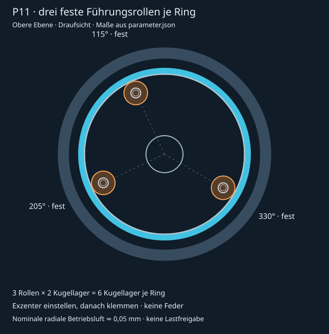

# P11 – Direktantrieb 1:1 und kugelgelagerte Führungsrollen

Aktuelle Revision des 1:4-Taumelmodells. [FreeCAD-Baugruppe](Ausgabe/P11_Gesamtbaugruppe.FCStd), [Animation](P11_oeffnen.FCMacro), [Stückliste](Ausgabe/Stueckliste_P11.csv), [Massenbudget](Ausgabe/Massen_P11.json) und [Kollisionsprüfung](Ausgabe/Pruefbericht_P11.json).

Der Rotordeckel trägt den Motorrotor unmittelbar. Ritzel, Hohlradverzahnung und passive Stützplaneten entfallen. Drei feste Führungsrollen je Ebene laufen auf einer glatten, austauschbaren Stahl-Innenlaufbahn. Die zentrale Lagerung und die geschlossene Servo–Taumelscheibe–Blatt-Kinematik bleiben erhalten. Die Rollen führen radial; sie ersetzen kein Axiallager. Insgesamt sind sechs Rollen mit zwölf MR85-Lagerhüllen modelliert. Die Baugruppe enthält jetzt 778 Teile; die Stückliste erfasst auch die zusätzliche verschraubte Aufnahme je Ebene.

## Motor und Grenzen

EMAX ECO II 2306 KV1900 bleibt die unveränderte **elektrische Vergleichsreferenz**. Sein vorhandener Wellenmotor lässt sich wegen des durchgehenden 30-mm-Mittelrohrs nicht einfach koaxial auf den Ring setzen. Deshalb enthält P11 einen ringförmigen **Motorbauraum**, keinen ausgewählten oder fertig konstruierten Motor. Stator, Magnetring und Träger sind getrennt modelliert; Wicklung, Magnetbefestigung, Kommutierung und Kühlung sind offen. Außendurchmesser des Trägers: 184 mm. Dieses Teil passt nicht auf das bisherige 148-mm-Druckbett und benötigt ein anderes Fertigungsverfahren oder eine neue, gesondert geprüfte Teilung.

1:1 reduziert Übertragungsteile, erhöht aber das erforderliche Motordrehmoment. Unterspannung oder eine andere PWM-Frequenz lösen diesen Bedarf nicht: weniger Drehmomentkonstante bedeutet mehr Strom für dasselbe Drehmoment; Wicklungsverluste wachsen mit I²R. Der Simulator begrenzt den tatsächlichen EMAX-Strom weiterhin. Eine vorgegebene Prüfdrehzahl ist kein Nachweis, dass dieser Motor sie unter Last erreicht. Die automatischen P11-Flugfälle melden deshalb ausdrücklich `ANTRIEBSGRENZE_REFERENZMOTOR`.

Die angenommenen Motorbauraummassen betragen je Ebene 200 g Stator und 80 g rotierender Motoranteil. Zusammen mit Trägern und Führung ergibt sich derzeit ungefähr **2,583 kg Modellbudget**, mehr als P10. Weniger Einzelteile bedeuten hier keine belegte Gewichtsersparnis. Einige bereits in P10 nicht separat erfasste Altschrauben erhalten beim Entfernen keine erfundene Massengutschrift; sie stehen im Massenprotokoll unter `unbudgeted_legacy_removals`.

## Führung einstellen



Die drei Rollen sitzen in den vorhandenen Einbaubereichen bei **115°, 205° und 330°**; die Winkelabstände sind 90°, 125° und 145°. Die dritte Aufnahme nutzt den früheren Motorplatz und erhält eine neue verschraubte Halteplattenbrücke. Alle drei Aufnahmen sind starr, ohne Feder. Die Exzenter werden nur für Montage und Nachstellung verwendet und anschließend geklemmt. Die bestehende zentrale Lagerung bleibt erhalten; alle drei Rollen dürfen deshalb nicht blind gleichzeitig vorgespannt werden. Rundlauf und Betriebsluft müssen am realen Ring eingestellt werden. Eine gleichmäßige Lastverteilung auf drei Rollen wird nicht vorausgesetzt.

Die POM-Rolle hat nominell R = 9,55 mm, die Stahl-Innenlaufbahn R = 64,4 mm. Der exzentrische Lagerzapfen besitzt 0,25 mm Versatz. Die modellierte Einstellung ergibt rund **0,050 mm radialen Abstand**, keine kraftschlüssige Vorspannung. Rolle für Rolle einstellen, den Ring vollständig durchdrehen und anschließend den Exzenter mit der radialen M3-Klemmschraube sichern. Der Exzenter dient zum Einstellen; er wird im Betrieb nicht verstellt. Die endgültige Einstellung muss Fertigungstoleranzen, Rundlauf und thermische Ausdehnung berücksichtigen.

Bei 3000 Ring-U/min drehen die Rollen ungefähr 20.230 U/min. Das Verhältnis 6,743 gehört ausschließlich zur Rollenkinematik; die Motorübersetzung bleibt 1:1. Lager-Drehzahlgrenze, Schmierung, Dichtung, Lagerpassungen, Tragzahlen, Kontaktpressung und POM-Kriechen sind mit konkreten Kaufteilen zu prüfen. Die zwölf MR85 sind nominale Geometriehüllen ohne Herstellerfreigabe. Die Simulation erfasst die Rollenträgheit und eine pauschale Lager-Rotationsträgheit; der Lagerinnenaufbau wird nicht einzeln animiert. Ein austauschbarer Stahl-Laufbahneinsatz und einzeln wechselbare Rollen konzentrieren den verbleibenden Verschleiß auf wartbare Teile.

Der Motorluftspalt beträgt nominell 0,5 mm. Die CAD-Abstandsprüfung ersetzt keinen Rundlauf-, Biege-, Temperatur- oder Magnetkraftnachweis. Auch die neue Statorverschraubung benötigt einen Festigkeits- und Gewindenachweis.

## Visueller Physik-Prüfstand

[Physik_Pruefstand.html](../simulation/Physik_Pruefstand.html) zeigt nach jeder Parameteränderung die Rotoren, Schubpfeile, radiale Blattlasten und Änderungskurven. Einstellbar sind Durchmesser, Innenradius, Blatttiefe, Blattzahl, Profildicke, Zuspitzung, Verwindung, Ebenenabstand, Drehzahl und beide Pitchwerte.

Angezeigt werden Schub in N und kg-Äquivalent, Schubreserve zur Modellmasse, Akkustrom, elektrische und mechanische Leistung, Wh/min, Antriebswirkungsgrad, Schub pro kW und Wicklungsverluste. Ein Vergleichspunkt hält die Ausgangswerte fest; CSV exportiert die aufeinanderfolgenden Parameterstände. „Im Flugsimulator prüfen“ überträgt die Geometrie.

Das ist ein stationärer Prüfstand auf Basis desselben Blattelement-/Zustrommodells wie der Flugsimulator, **keine gemessene Realphysik und keine CFD**. Die vereinfachte Polare und Wechselwirkung beider Ebenen müssen experimentell validiert werden. Strukturmasse und Trägheit werden beim Variieren der Blätter nicht automatisch neu konstruiert. Zusatzlast beeinflusst hier die Reserve. Verluste sind Rechenwerte; eine reale Motortemperatur erfordert einen thermischen Ansatz mit Messdaten. Die angenommene mechanische Effizienz von 98 % ist keine gemessene Lagerreibung.

Die [Top-10-Parametersuche](../simulation/Ergebnisse/P11/Top10_Kandidaten.md) variiert alle elf Designparameter innerhalb der dokumentierten Bereiche und verfeinert die besten Treffer. Ranglisten sind im visuellen Prüfstand auswählbar; Strukturmasse bleibt dabei konstant. Suchmethode, Energie-Plausibilitätsprüfung und Grenzen stehen in der [Simulationsdokumentation](../simulation/README.md).

## Reproduzieren und prüfen

Aus dem Repository-Stamm, mit FreeCAD-Pythonbibliothek unter `/usr/lib/freecad-python3/lib`:

```sh
/usr/bin/python3 modell_r04_taumel/integration_p11/erstellen.py
/usr/bin/python3 modell_r04_taumel/integration_p11/pruefen.py
/usr/bin/python3 modell_r04_taumel/integration_p11/browser_export.py
node modell_r04_taumel/simulation/p11_pruefen.cjs
node modell_r04_taumel/integration_p11/anforderungen.cjs
node modell_r04_taumel/simulation/physik_pruefstand_pruefen.cjs
node modell_r04_taumel/simulation/testflug.js
```

Die Kollisionsprüfung untersucht alle neuen oder geänderten Teile gegen die gesamte Baugruppe in 14 Stellungen. Verschraubungs- und elektrische Anschlusskontakte werden einzeln benannt. Sechs bereits im gelieferten Servo-STEP ungültige Gehäuse werden für diese Prüfung durch dieselben dokumentierten Messhüllen wie in P10 ersetzt; die Originalteile werden dadurch nicht als gültig zertifiziert. Die Prüfung deckt weder alle Zwischenstellungen noch Festigkeit, Lebensdauer oder Erwärmung ab. Frühere Prüfberichte gelten weiterhin ausschließlich für ihre jeweiligen historischen Revisionen.

## Ergebnis dieses Projektstands

Die [BRep-Prüfung](Ausgabe/Pruefbericht_P11.json) besteht in allen 14 Stellungen ohne unbeabsichtigte Überschneidung. Die sechs radialen Abstände betragen rund 0,049795 mm. Beide geänderten Halteplatten und beide zusätzlichen Rollenträger sind jeweils gültige, zusammenhängende Festkörper. Schraubkontakte sind im Prüfbericht einzeln benannt. Paarungen innerhalb desselben starren Bewegungsrahmens werden nach der ersten Prüfung nicht erneut berechnet, da ihre relative Lage gleich bleibt.

Der [Simulationsabgleich](Ausgabe/Simulationspruefung_P11.json) bestätigt Masse/Trägheit, FreeCAD-/Browserkinematik, drei Rollen je Rotor, sechs Rollen und zwölf Kugellager insgesamt sowie die unveränderte 1:1-Motorübersetzung. Browserprüfungen für Flugsimulator und [visuellen Prüfstand](../simulation/Ergebnisse/P11/Physik_Pruefstand_Pruefung.json) bestehen. Das Modellbudget steigt gegenüber der Zweierführung um rund 44 g auf **2,583 kg**. Die EMAX-Referenz bleibt am erforderlichen Arbeitspunkt unzureichend; beide aktuellen Flugfälle weisen dies aus.

Historische Firmwaretests im Verzeichnis gelten für den vorherigen Stand. Ein laufender Betaflight-Dienst muss nach der Geometrieänderung neu gestartet werden, damit sein nominaler Mischer erneut berechnet wird. Tragfähigkeit, Lebensdauer, thermische Betriebsluft und gleichmäßige Lastverteilung der drei festen Rollen sind nicht durch die Kollisionsprüfung nachgewiesen.
