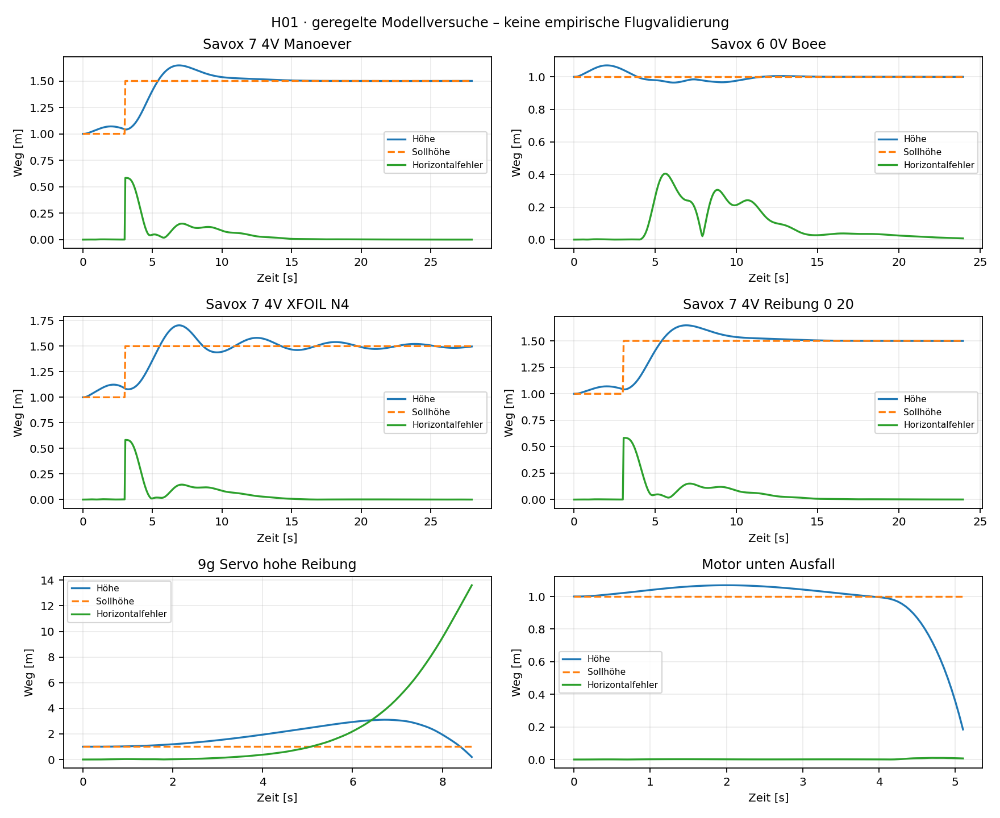
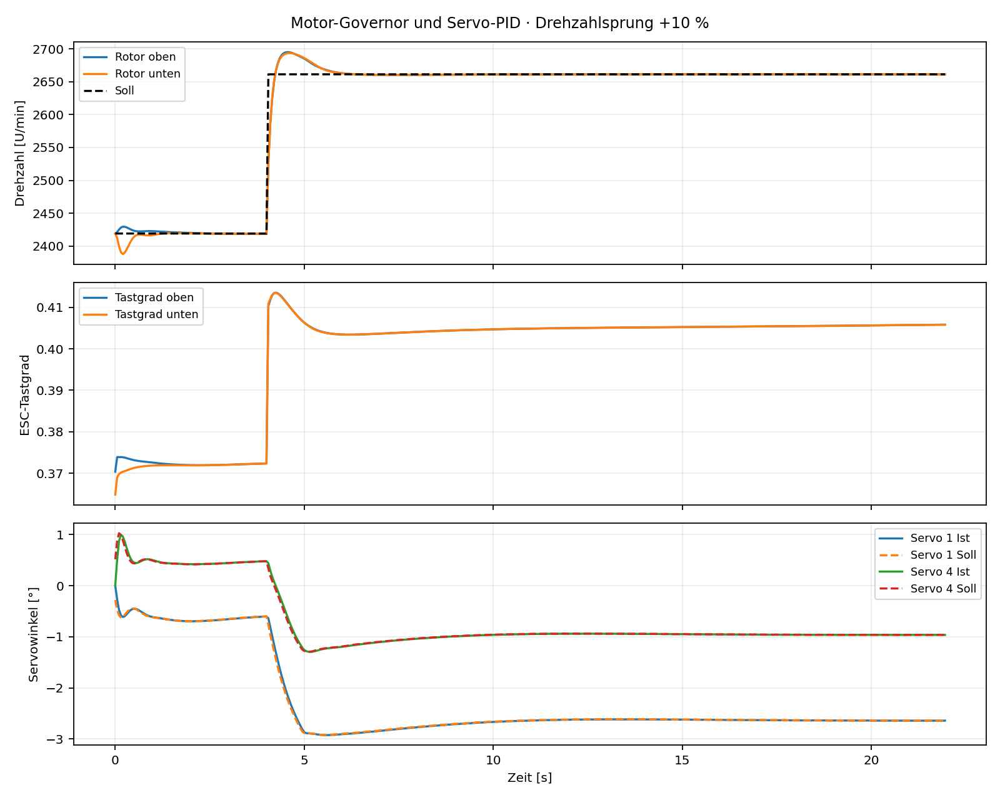

# H01 – Ergebnisse der Flugsimulation

**Unvalidiertes Modell; keine Flugfreigabe.**

| Fall | Ergebnis | Test-/Abbruchzeit [s] | RMS letzte 5 s [m] |
|---|---|---:|---:|
| Schweben | STABIL_IM_MODELL | 20.00 | 0.0003 |
| Versetztes_Schweben | STABIL_IM_MODELL | 25.00 | 0.0004 |
| Steigen_und_Translation | STABIL_IM_MODELL | 28.00 | 0.0005 |
| Motor_Drehzahlsprung_10Prozent | STABIL_IM_MODELL | 22.00 | 0.0188 |
| Boee_3ms | STABIL_IM_MODELL | 24.00 | 0.0219 |
| Massenvariante_60g_Servos | STABIL_IM_MODELL | 20.00 | 0.0003 |
| Reibung_hoch_starkes_Servo | STABIL_IM_MODELL | 20.00 | 0.0003 |
| 9g_Servo_hohe_Reibung | ABSTURZ_IM_MODELL | 8.66 | – |
| Phase_30_Grad_falsch | STABIL_IM_MODELL | 20.00 | 0.0009 |
| Phase_90_Grad_falsch | ABSTURZ_IM_MODELL | 2.17 | – |
| Servo_blockiert | ABSTURZ_IM_MODELL | 3.92 | – |
| Motor_unten_Ausfall | ABSTURZ_IM_MODELL | 5.11 | – |
| Aerodynamik_minus25 | STABIL_IM_MODELL | 24.00 | 0.0006 |
| Akku_20_Prozent | STABIL_IM_MODELL | 20.00 | 0.0003 |
| Savox_7_4V_Manoever | STABIL_IM_MODELL | 28.00 | 0.0005 |
| Savox_6_0V_Boee | STABIL_IM_MODELL | 24.00 | 0.0193 |
| Savox_7_4V_Reibung_0_20 | STABIL_IM_MODELL | 24.00 | 0.0016 |
| Savox_7_4V_XFOIL_N4 | STABIL_IM_MODELL | 28.00 | 0.0144 |
| Ohne_Regelung | ABSTURZ_IM_MODELL | 2.53 | – |

14/19 Szenarien stabil im Modell. Fehlerfälle sind absichtlich Teil der Serie. 12/12 kombinierte Annahmen stabil; keine Zuverlässigkeitsstatistik.

10 numerische Prüfungen bestanden. Quellen und Annahmen: [README](../README.md).

