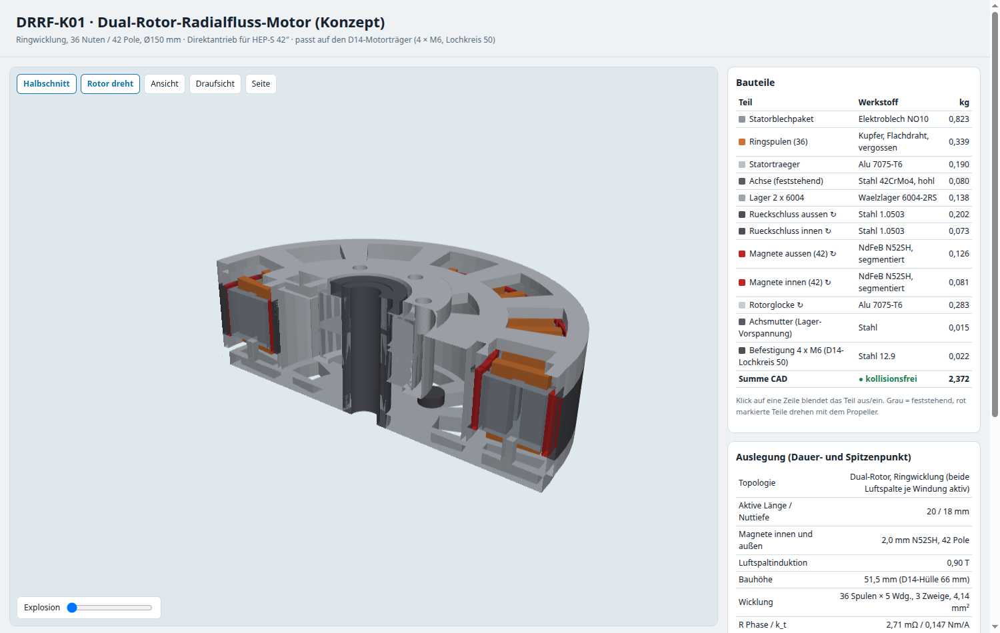

# DRRF – eigener Dual-Rotor-Radialfluss-Motor

Eigener Entwicklungsbereich für einen Direktantrieb nach dem Dual-Rotor-Radialfluss-Prinzip (wie DeepDrive), zugeschnitten auf die D14-Multirotoren mit HEP-S-42″-Propellern.

**Stand: DRRF-K01, erstes Konzept.** Auslegung analytisch, CAD als Konzeptmodell, keine Feldberechnung (FEM), kein Prototyp.



[3D-Ansicht öffnen](Projekt.html): Halbschnitt, Explosionsdarstellung, drehender Rotor, Bauteilliste mit Massen, Auslegungsdaten.

## Anforderungen (aus dem Flugsimulator)

| Kennwert | Wert | Herkunft |
|---|---|---|
| Dauer | 20 Nm bei 3.300 min⁻¹ | Quad 42″ V4 schwebt mit 19,7 Nm bei 3.276 min⁻¹; Hexa, Okto und Koax brauchen 12–14 Nm |
| Spitze | 40 Nm bei 3.700 min⁻¹ für 30 s | Steuerreserve, etwa doppelter Schwebeschub |
| Spannung | 84–100,8 V (24S), Aussteuerung ≤ 95 % | Akkutypen im Simulator |
| Regler | V200A: 100 A Dauer, 200 A Spitze (Phasen-Effektivwert) | D14-Reglerhalter |
| Bauraum | Ø150 × 66 mm, Flansch 4 × M6 auf Lochkreis 50, Zentrierung Ø16 | D14-Motorhülle und -träger |
| Masse | möglichst unter 2,75 kg | MN1330 KV40 |

## Topologievergleich

[`auslegung.py`](auslegung.py) rechnet drei Bauarten mit demselben Modell und optimiert jeweils auf minimale Masse. Grenzen: Stromdichte ≤ 8 A/mm² Dauer und ≤ 22 A/mm² Spitze, Spannung, Reglerstrom, Bauraum, Wirkungsgrad ≥ 93 %. Das Modell umfasst:
- Magnetkreis mit Carterfaktor und Streuung, Grundwelle der Luftspaltinduktion
- Flussverkettung, Zahn-, Joch- und Rückschlussbreiten aus der zulässigen Induktion
- Nutflächen, Windungslängen, Kupfer- und Eisenverluste, Massen

| Bauart | Ergebnis |
|---|---|
| **DR-NN: Dual-Rotor, Statorjoch mit Ringwicklung** | **2,40 kg**, 7,8 A/mm², η 98,4 % im Dauerpunkt, 8,4 Nm/kg |
| DR-NS: Dual-Rotor, jochlose Zähne mit Zahnspulen (Fluss geht durch) | im Bauraum nicht erreichbar; nächste Lösung 3,36 kg bei 8,0 A/mm² |
| Referenz: Außenläufer mit Zahnspulen (MN1330-Bauart) | im Bauraum nicht erreichbar; nächste Lösung 3,19 kg bei 8,9 A/mm² |

- **Ringwicklung:** Jede Windung liegt mit einer Seite in einer äußeren und mit der anderen in einer inneren Nut. Damit trägt sie in **beiden** Luftspalten zum Drehmoment bei, und die Wicklungsköpfe sind nur kurze radiale Brücken. Die Motorkonstante je Windung ist deshalb fast doppelt so groß wie beim Außenläufer.
- **Jochloser Dual-Rotor (DR-NS):** Er hat keinen solchen Vorteil. Der Fluss läuft durch den Zahn von Magnet zu Magnet, beide Luftspalte führen also denselben Fluss. Der zweite Magnetring macht ihn schwerer, ohne die Flussverkettung zu erhöhen.
- **Außenläufer:** Erreicht 20 Nm Dauer in diesem Bauraum nur mit höherer Stromdichte. Das passt zur Beobachtung, dass der MN1330 im Quad-Schwebeflug an seiner Leistungsgrenze läuft.

## Konzept DRRF-K01 (DR-NN)

| | |
|---|---|
| Aufbau | Außenrotor und Innenrotor als gemeinsame Rotorglocke (oben geschlossen, unten offen); feststehender Stator dazwischen auf einem Statorträger mit Stützen unter dem Joch |
| Elektromagnetik | 36 Nuten außen und innen, 42 Pole je Rotor, Magnete N52SH 2 mm (segmentiert), Luftspalt 0,6 mm, 0,90 T |
| Radien | Rückschluss außen 72,5–75, Magnete außen 70,5–72,5, Stator 47,7–69,9 (Joch 56,7–60,9), Magnete innen 45,1–47,1, Rückschluss innen 43,6–45,1 mm |
| Wicklung | 36 Ringspulen um das Joch, je 5 Windungen Flachdraht 4,1 mm², 3 parallele Zweige; R<sub>Phase</sub> 2,7 mΩ, k<sub>t</sub> 0,147 Nm/A (Scheitel), etwa 56 min⁻¹/V |
| Dauerpunkt 20 Nm / 3.300 min⁻¹ | 96 A eff, Kupfer 75 W, Eisen 37 W, η 98,4 %, geschätzte Übertemperatur Stator ≈ 40 K |
| Spitze 40 Nm / 3.700 min⁻¹ | 193 A eff (V200A-Grenze 200 A), 15,5 A/mm², 67 V Strang-Strang |
| Lagerung | feststehende Hohlachse Ø20 im Statorträger, 2 × 6004-2RS in der Rotornabe, Wellenmutter zur Vorspannung |
| Kühlung | Fenster im Statorträger unter den Spulen und im Rotordeckel; die Rotation fördert Luft durch die Nuten (Konzept, nicht berechnet) |
| Schnittstellen | 4 × M6 auf Lochkreis 50 und Zentrierbund Ø16 wie MN1330; Propelleraufnahme 6 × M5 auf Lochkreis 44 (Annahme), mittig Platz für die Achsmutter |
| Bauhöhe / Masse | **51,5 mm** (14,5 mm unter der D14-Hülle), **2,37 kg** im CAD (Auslegung 2,40 kg) gegenüber 2,75 kg MN1330 |

Prüfung ([Pruefung.json](Ausgabe/Pruefung.json)):
- alle 12 Bauteile gültige Volumenkörper
- 48 Paarprüfungen ohne Überschneidung
- gemessener Luftspalt zwischen Rotor und Stator 0,6 mm
- Abstand zu den Spulen 2,4 mm, zum Statorträger und zur Achsmutter 1,5 mm

Dateien: [DRRF_K01.FCStd](Ausgabe/DRRF_K01.FCStd), [DRRF_K01.step](Ausgabe/DRRF_K01.step), [Auslegung.json](Ausgabe/Auslegung.json).

## Offene Punkte (Reihenfolge der nächsten Schritte)

1. **Feldberechnung** (FEMM oder pyleecan): Luftspaltinduktion, Sättigung im dünnen Joch (4,2 mm), Rastmoment, Drehmomentwelligkeit, Streuung. Das analytische Modell überschätzt vermutlich Drehmoment und Wirkungsgrad.
2. **Verluste bei 1,15–1,3 kHz:**
   - Stromverdrängung im Flachdraht (Leiter gegebenenfalls unterteilen)
   - Wirbelströme in Magneten und Rückschluss (Segmentierung)
   - Eisenverluste NO10 nach Datenblatt
3. **Thermik:** vergossener Stator zwischen zwei Rotoren. Wärmepfad über Statorträger und Luftführung berechnen; Wärmeleitwert und Übertemperatur sind bisher Annahmen.
4. **Mechanik:**
   - Steifigkeit der einseitigen Statorhalterung (12 Stützen) unter Drehmoment und Magnetzug
   - Rundlauf und Toleranzen der beiden 0,6-mm-Luftspalte
   - Montagevorrichtung für die Magnetringe
   - Auswuchten mit dem 42″-Propeller
5. **Regler:** Induktivität und Wicklungsauslegung mit dem V200A abstimmen (Stromripple, Feldschwächung).
6. **Simulator:** DRRF-K01 als fünften Motor eintragen. Dann Prüfstand, zuerst mit einem Statorsegment.
7. **Schutzrechte:** DeepDrive hat Patente auf seine Bauformen. Versuch und Entwicklung sind nach § 11 PatG in der Regel frei; vor Verkauf oder kommerzieller Nutzung ist eine Patentrecherche nötig (keine Rechtsberatung).

## Reproduktion

```sh
python3 motor_drrf/auslegung.py                                   # Topologievergleich und Auslegung
FC=~/Programme/squashfs-root/usr; LD_LIBRARY_PATH=$FC/lib $FC/bin/python motor_drrf/bauen.py   # CAD, Prüfung, STEP, 3D-Daten
```

Alle Kennwerte stehen in [`parameter.json`](parameter.json). Werkstoffkennwerte für Verluste, Füllfaktor und Wärmeabgabe sind Annahmen der Konzeptphase.
