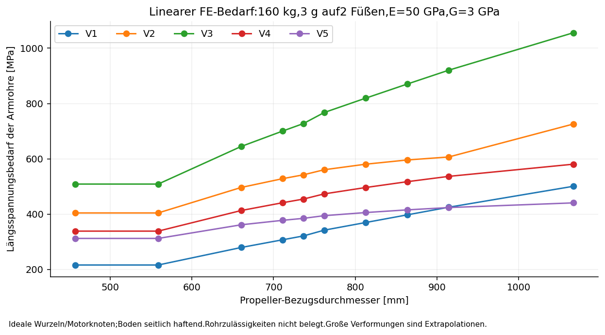
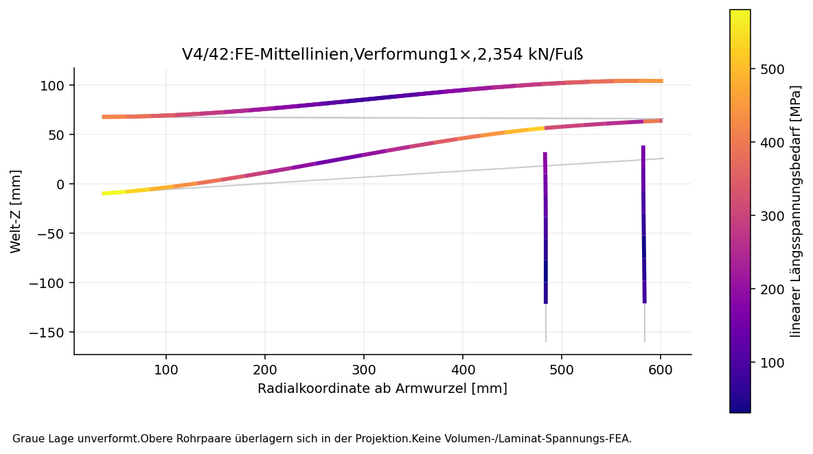
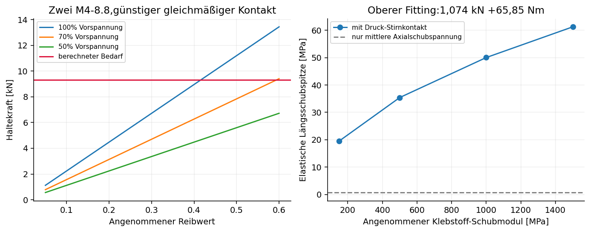
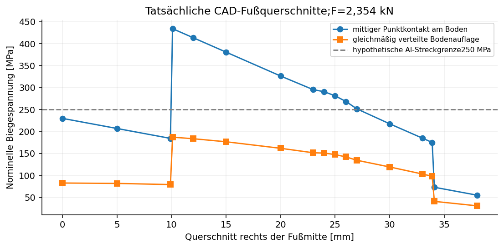
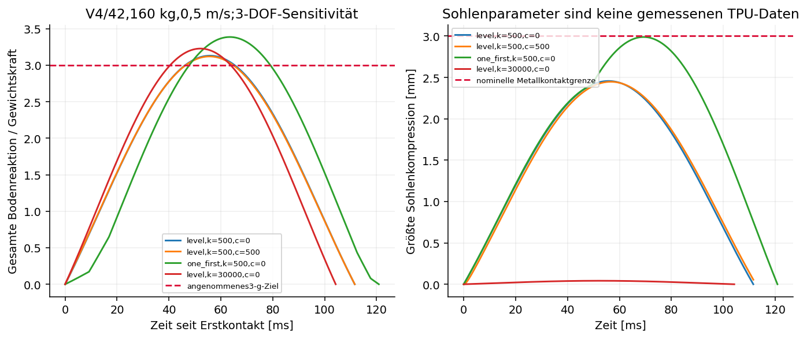

# D12 – Festigkeits- und Landestoßuntersuchung

Stand 04.11.2026. Unveränderte CAD-Basis: `Quad_Reglerhalter_Landefuesse.FCStd`, SHA-256 `23478d47053133dacca31e4ffcfead23af2fe1c7aad34f8ae371195ffa0a58c0`.

## Ergebnis und Bedeutung

Unter den ausgewiesenen Studienannahmen ergibt sich **kein positiver Tragfähigkeits- oder Landefreigabenachweis für D12**. Die Rechnung zeigt konkrete Nachweisdefizite bei Armrohren, axialer Klemmkraftübertragung, biegemomentbelasteten Klebefittings und ungünstiger Bodenauflage. Fehlende Werkstoff-/Kontaktkennwerte kommen zu diesen Rechenbefunden hinzu. Die CAD-Geometrie wurde für diese Untersuchung nicht geändert.

V4/42 Zoll, 160 kg, 3 g auf zwei Füßen: 2354 N je Fuß, 38.5 mm linearer Weg und rund 581 MPa Längsspannungsbedarf in den Armrohren. Mit dem vorgeschlagenen Studienfaktor 1,5 wären dafür rund 871 MPa entsprechende Projektzulässigkeit nötig; diese ist für das vorhandene Rohr nicht belegt. Das ist eine Anforderungsrechnung, keine Behauptung einer gemessenen Rohrspannung oder eines bekannten Bruchwertes.

Die kritische Wurzelverbindung muss 9.32 kN Zug halten. Zwei angenommene M4-8.8 mit je 3565 N Vorspannung und Reibwert 0,2 liefern selbst bei günstiger gleichmäßiger Ringpressung nur 4.48 kN. Dieses ausdrücklich bedingte Verbindungskriterium ist schon ohne Faktor 1,5 um etwa Faktor 2.08 unterdeckt.

Die obere Stützenverbindung erfährt neben etwa 1,07 kN Druck und 0,54 kN Querkraft ein Biegemoment von 65,85 Nm. Daher ersetzt die frühere mittlere Klebschubspannung von etwa 0,76 MPa keinen Klebfugennachweis. Das verfeinerte reduzierte Kontaktmodell liefert bei den Referenz-Steifigkeiten rund 50 MPa elastische Längsschubspitze und rund 105 MPa ideale Endauflagepressung. Auch hierfür fehlen zulässige Werte und eine Prozessqualifikation.

## 1. Gegebene Daten, Annahmen und Quellenqualität

Belegt sind die D12-BREP-Geometrie, die nominellen Rohre 20/17 mm, die vom Nutzer genannte Außentoleranz±0,2 mm, die 0°/90°-Faserorientierungen und 100 kg Nutzlast. Die 50 CAD-Konfigurationen enthalten 1,2,2,3 oder 4 Armrohre. Das V1-Rohr 35/32 mm ist weiterhin eine nicht beschaffungsbestätigte Annahme. Motoren, Akku und Regler sind nicht vollständig über einen tatsächlichen Gesamtmassen-/Schwerpunktbericht geschlossen.

160 kg Gesamtmasse, 0,2–1,0 m/s Sinkgeschwindigkeit, E_L=30/50/70 GPa, G=2/3/5 GPa, Schubkorrekturfaktor 0,5,Kontakt-/Klebstoffsteifigkeiten und Reibwerte sind ausdrücklich Rechenannahmen beziehungsweise Sensitivitäten. Es wurden keine Herstellerzulässigkeiten für CFK, Laminat, Querdruck, GFK-Endringe, Aluminium oder Klebstoff erfunden. Die frühere lokale Beschaffungsnotiz enthält keine verifizierten CFK-E-/Festigkeitswerte und keinen Original-Nachweis für den Faseranteil 80/20; dieser Anteil wurde nicht als gesicherter Laminataufbau verwendet.

M4-Eigenschaftsklassen 8.8/10.9/12.9 werden als hypothetische Normklassen mit nominalen Prüfspannungen 580/830/970 MPa untersucht. Das belegt nicht die tatsächlich eingebauten Schrauben. Der Studienfaktor 1,5 ist ein offen vorgeschlagener Projektfaktor, keine behauptete Luftfahrt-/Zulassungsanforderung. Aluminium-Streckgrenze 250 MPa wird nur als Beispiel für einzelne Querschnittsscreens verwendet; es liegt kein Abnahmezeugnis vor.

## 2. Modellaufbau und Rückverfolgbarkeit

Die Achsen, Außen-/Innenradien und Endpunkte sämtlicher 120 Armrohre und 100 Landestützen wurden aus den tatsächlichen zylindrischen BREP-Flächen ausgelesen. Alle 50 Konfigurationen stimmen mit dem Generator bis maximal 1.03e-12 mm überein. Die Rechnung verwendet also die reale D12-Geometrie als Mittellinienmodell.

Räumliche 12-DOF-Timoshenko-Balken bilden Zug/Druck, zwei Biegerichtungen, Querkraft und Torsion ab. E_L und G sind unabhängige äquivalente Querschnittskennwerte; es handelt sich nicht um plyweise Laminat-FEA oder Tsai-Wu-/Hashin-Auswertung. Die 35-mm-Armklemmzonen werden an ihren inneren freien Rohrenden ideal eingespannt; der gemeinsame Motorknoten ist zunächst starr. Die 32-mm-Landeklemmungen sitzen an ihren tatsächlichen Rohrpositionen. Starre Exzentrizitäten verbinden Armmitte, Fittings, CFK-Stützen und Fuß; die Querkräfte und Momente werden dadurch mitgerechnet.

Der Zentralrahmen und der Pilot werden nicht als deformierbare Struktur modelliert. Die ideale Wurzelfixierung ist eine günstige Annahme für den lokalen Arm; zusätzliche Wurzel-Drehfedern zeigen die Empfindlichkeit. Die Stützen-Fittingrotation wird ebenfalls variiert. Lokale Kontaktspannungen, Schraubenprying, Laminatablösung, Fatigue und Fertigungsfehler sind nicht aus einer Volumen-/Kontakt-FEA berechnet.

Drei Boden-Grenzfälle werden getrennt behandelt: point=freie Fußverschiebung/-rotation unter vorgeschriebener Vertikalkraft; stick=seitlich haftender, rotatorisch freier Fuß; flat=zusätzlich ideal festgehaltene Fußrotation. Die Haftreaktionen müssen durch Bodenreibung und positive Sohlenpressung möglich sein. Beispielsweise benötigt V4/stick nur etwa 0,009 Bodenreibwert, V1/stick etwa 1,03. Flat-Fälle mit erforderlichem Druckmittelpunkt außerhalb±64/±14 mm sind bereits geometrisch keine zulässige vollflächige Auflage. Eine günstige Randbedingung darf daher nicht pauschal als reale Bodenlage angenommen werden.

## 3. Numerische Verifikation

Axialstab, Kragbalken mit Schubanteil, Torsion, einfach gelagerter Balken, starre Körperbewegung und schubweiches Säulenknicken wurden gegen unabhängige geschlossene Lösungen geprüft. Für den D12-Referenzfall wurden 50/25/12,5-mm-Netze verglichen. Verschiebung und Nennspannungen sind praktisch identisch; der letzte Knickfaktorunterschied liegt unter 0,001 %. Die Kraftbilanzfehler der 150 statischen Hauptbedingungen liegen höchstens bei 2.27e-11,die Momentenbilanzfehler bei 2.18e-11.

Der Landestoßsolver wurde gegen den analytischen Spitzenwert eines ungedämpften symmetrischen Feder-Masse-Systems geprüft. Der Unterschied beträgt etwa 0,00066 %. Die Zeitschrittverfeinerung 0,4 auf 0,1 ms ändert die ausgewerteten Spitzen um weniger 0,002 %. Der größte relative Energiebilanzfehler aller 425 eindeutigen Kontakt-Simulationen beträgt 1.20e-05. Die Klebfugenrechnung besitzt eigene Kraft-/Momentenbilanzen, Netzverfeinerung und einen unabhängigen Volkersen-Vergleich.

**Diese Prüfungen verifizieren die numerische Implementierung. Sie validieren weder die Materialannahmen noch das reale Fahrzeug.**

## 4. Carbonarme:Ergebnisse für 42-Zoll-Bezugsrotoren

Referenz:3 g auf zwei Füßen, je 2354 N, E_L 50 GPa, G3 GPa, ideale Wurzel/Motorknoten, Bodenmodus stick.

| Variante | Weg mm | max.Längsbedarf MPa | linearer Knickfaktor | Boden-µ benötigt |
| --- | --- | --- | --- | --- |
| V1 | 29.4 | 501 | 1.95 | 1.033 |
| V2 | 42.1 | 726 | 0.70 | 0.242 |
| V3 | 84.4 | 1056 | 2.96 | 1.020 |
| V4 | 38.5 | 581 | 3.23 | 0.009 |
| V5 | 31.1 | 441 | 3.28 | 0.113 |

Der lineare Knickfaktor bezieht sich auf genau den gewählten Kontakt-/Verbindungsfall und den aktuellen proportionalen Lastvektor. Er ist kein genereller Rohr-Sicherheitsfaktor. Bei V4 fällt er im seitlich freien point-Fall auf etwa 0,47; im haftenden Fall beträgt er etwa 3,23. Diese starke Abhängigkeit erfordert die reale Boden-/Lagerbedingungenklärung. Ein Faktor kleiner 1 im freien Modell ist ein Instabilitätsindikator, dessen Modell über diese Grenze hinaus nicht als reale Nachknickantwort fortgesetzt werden darf.

Bei vielen hoch belasteten Fällen werden 5° Rotation, 5 % Spannweitenweg oder 0,5 % berechnete Längsdehnung überschritten. Diese Markierungen sind Modellwarnungen, keine erfundenen CFK-Bruchgrenzen. Die Zahlen bleiben lineare Anforderungs-/Extrapolationswerte; ein geometrisch nichtlinearer Laminat- und Verbindungsnachweis fehlt.

Die Datei Lastfallmatrix_linear.csv enthält 600 proportional abgeleitete Kombinationen:alle 50 Geometrien, je drei Bodenmodi und 1 g/vier Füße, 3 g/vier Füße, 3 g/zwei Füße sowie 3 g/ein Fuß. Ein Ein-Fuß-Fall ist ein äquivalenter kurzzeitiger Lastfall eines Arms, keine Aussage, dass das ganze Fahrzeug auf einem Fuß statisch im Gleichgewicht bleibt.

## 5. Einfluss unsicherer Steifigkeiten und Toleranzen

| Sensitivität | Weg mm | max.Arm-MPa | Knickfaktor |
| --- | --- | --- | --- |
| E30 | 63.8 | 581 | 1.97 |
| E50 | 38.5 | 581 | 3.23 |
| E70 | 27.2 | 582 | 4.65 |
| root1e5 | 81.0 | 969 | 0.84 |
| root1e6 | 56.9 | 641 | 1.66 |
| bond1e4 | 40.3 | 562 | 0.37 |
| bond1e6 | 39.7 | 571 | 3.26 |
| grip_EI10 | 36.9 | 592 | 3.34 |
| OD_minus0p2 | 41.8 | 626 | 2.96 |
| OD_plus0p2 | 35.6 | 541 | 3.50 |

Die Variante root1e5 bedeutet eine angenommene Drehsteifigkeit 100000 Nmm/rad an jeder Wurzelrotation. Weiche Wurzeln verschlechtern die Ergebnisse stark. Eine zehnfach erhöhte lokale Biegesteifigkeit der Landeklemmzone beseitigt den hohen Gesamtbedarf nicht. Weiche Fittinggelenke können Biegemomente reduzieren, führen hier aber zu einem Instabilitätsproblem. Ihre Nachgiebigkeit ist keine alleinige Reparatur.

Die bekannte Rohrtoleranz passt nicht automatisch zur nominellen Zwischenlage:20,6-mm-Schellenbohrung minus zweimal 0,3-mm-GFK ergibt 20,0 mm effektive Bohrung. Ein 20,2-mm-Rohr hat 0,2 mm diametrales Übermaß. Für rein geometrischen Nullspalt wären bei Rohren 19,8/20,0/20,2 mm Zwischenlagen 0,4/0,3/0,2 mm nötig. Tatsächliche Toleranzen, Kompressibilität und Vorspannung müssen gemeinsam geschlossen werden; eine starre 0,3-mm-Zwischenlage darf nicht als toleranzunempfindlich gelten.

## 6. Klemmverbindungen und Schrauben

Für die notwendige Reibübertragung wird die Kombination aus axialem Zug und Torsion angesetzt: F_slip=sqrt(N_Zug²+(T/R)²). Axialdruck kann an vorhandenen Endanschlägen anliegen; deren Stirndrucktragfähigkeit ist separat offen. Für Biegung/Querkraft wird ein projektierter Pressungsscreen V/(D L)+6 M_b/(D L²) ausgewiesen. Er ist keine Kontaktspannungs-Lösung.

Zwei M4-8.8 bei 70 % der angenommenen Prüfbelastbarkeit liefern je etwa 3565 N Vorspannung. Im günstigen Modell gleichmäßiger Ringpressung beträgt das integrierte Normalkraftmaß pi mal der Summe der beiden Schraubenkräfte. Beiµ0,2 entstehen deshalb nur etwa 4,48 kN axiale Haltekraft gegenüber 9,32 kN Bedarf an der unteren Wurzelklemmung. Ohne Setzverlust ist mindestensµ≈0,416 erforderlich; mit 30 % Vorspannverlust bereits etwa 0,595. Ein Studienfaktor 1,5 erhöht diese Anforderungen weiter.

Am kritischen Wurzelport beträgt der projektierte äußere Pressungsbedarf etwa 44,6 MPa, zuzüglich etwa 10,2 MPa mittlerem Vorspann-Pressungsanteil im Beispiel. Das ist ein Kontaktmodell-Indikator, kein exakt bestimmter CFK-Druckspitzenwert. Die zulässige lokale Rohrpressung und die tatsächliche Verteilung sind unbekannt.

Höhere Schraubenklasse erhöht die mögliche Vorspannung, zugleich aber Rohrpressung, Laschenbiegung und Setz-/Schädigungsrisiko. Schraubenklasse allein stellt deshalb keine Lösung dar. Die Tabellen untersuchen 70-%-Vorspannungen, 50/70/100-%-Erhalt, µ0,1/0,2/0,35/0,5 sowie Laschen-Hebelannahmen 2/4/6 mm. Schraubenprying, Gewindetragfähigkeit, Innengewindetiefe und tatsächliche Schraubenklasse sind nicht freigegeben.

## 7. Klebeverbindungen mit Biegung und Stirnauflage

Das einfache mittlere Schubmodell wird durch elastischen zylindrischen Shear-Lag für Axialkraft, Biegung und Torsion ersetzt. Zusätzlich wurde ein reduziertes gekoppeltes N/M-Modell mit unterschiedlichen CFK-/Al-EA/EI und einseitig drückender Stirnauflage über 64 Winkelsektoren gerechnet. Klebstoff-Schubmodul und GFK-Endsteifigkeit sind dabei Sensitivitäten. Die Rechnung verteilt Kräfte/Momente zwischen Klebfuge und Stirnfläche; radiale Randablösung, Kohäsivbruch und Delamination werden dadurch noch nicht berechnet.

Am kritischen oberen Fitting liegt das Biegemoment 65,85 Nm. Die Exzentrizität M/N beträgt 61,3 mm und ist deutlich größer als der 10-mm-Rohraußenradius. Reiner axialer Druckkontakt an der Stirnfläche kann diese Kombination deshalb nicht allein übertragen. Die Klebung beziehungsweise eine andere zugfähige Verbindung muss wesentlich am Momententransfer teilnehmen.

| Ga MPa | DeltaT K | Klebschubspitze MPa | Endpressung MPa | Zapfenlängsbedarf MPa |
| --- | --- | --- | --- | --- |
| 150 | 0 | 19.5 | 154 | 160 |
| 500 | 0 | 35.4 | 120 | 166 |
| 1000 | 0 | 50.0 | 105 | 168 |
| 1500 | 0 | 61.3 | 97 | 169 |
| 1000 | 40 | 62.7 | 93 | 174 |
| 1000 | -40 | 54.9 | 114 | 163 |

Referenz mit Ga 1000 MPa und angenommener GFK-E 10 GPa:etwa 50 MPa elastische Klebschubspitze, 105 MPa ideale Endauflagepressung und 168 MPa maximaler nominaler Längsspannungsbedarf im Aluminiumzapfen. Der schwächere/stärkere Endkontakt verändert insbesondere die Auflagepressung und die Lastaufteilung. Die allbond-Querschnittshülle und die reduzierte Kontaktrechnung dürfen nicht als identische physische Lastpfade addiert werden.

Die alten allbond-Spitzen können über 60 MPa erreichen. Das ist ein elastischer Bedarfswert, kein mit einer pauschalen Datenblatt-Lap-Shear-Zahl direkt vergleichbarer freigegebener Klebfugenwert. Plastische Umverteilung, Bruchenergie, Schälfestigkeit, Laminatablösung, Klebefugenporen und Prozessstreuung fehlen. Für±40 K wurden hypothetisch 20e-6/K CTE-Differenz angesetzt; dies verschärft beziehungsweise verschiebt die Schubspitzen. Die freie radiale Fehlpassung beträgt dabei etwa 6,6 µm, bezogen auf die 0,2-mm-Klebfuge etwa 3,3 %.

## 8. Aluminiumfittings und Aufsetzfuß

Die nominale Hohlzapfen-Geometrie 16,6/12,6 mm wurde mit den tatsächlichen FE-Endkräften untersucht. Wenn die gesamten Resultierenden über den dünnen Zapfen laufen, erfordert der obere Zapfen einschließlich Studienfaktor 1,5 eine hypothetische Streckgrenze von bis 348 MPa. Druck-Stirnauflage kann diesen Lastpfad deutlich entlasten; im reduzierten Referenz-Kontaktmodell verbleiben etwa 168 MPa Längsbedarf vor Kerben, Querkraft und Faktor. Keine dieser Varianten ist ein vollständiger 3D-Kontaktnachweis oder ein Werkstoffzeugnis.

Die 17 maßgeblichen Alufuß-Querschnitte wurden direkt aus dem BREP geschnitten; auch Taschen und Sohlen-Mutternbohrungen sind enthalten. Bei symmetrischen Endkräften liefern zwei idealisierte Bodenauflagen unterschiedliche Ergebnisse:gleichmäßige Auflage maximal etwa 187 MPa Nennbiegespannung; mittiger Punktkontakt maximal etwa 434 MPa. Gegenüber einer nur hypothetischen 250-MPa-Streckgrenze würde der Punktkontaktfall bereits ohne Faktor 1,5 versagen. Lokale Kerben und die tatsächlich unsymmetrischen Stützenmomente sind in diesem einfachen Fußbalkenscreen noch nicht enthalten.

Die tatsächliche anfängliche Sohlenkontaktfläche beträgt etwa 3103 mm². Im 2354-N-Fall ergibt das etwa 0.76 MPa mittlere Sohlenpressung. Nennhärte TPU95A und Dichte bestimmen keine Kraft-Weg-Kennlinie.

## 9. Landestoßsimulation

Es wurden 425 eindeutige Kontaktfälle gerechnet. Das Modell besitzt Hub/Nick/Roll eines starren Körpers auf vier einseitigen Kontakten. Die CAD-basierten Arm-/Stützenfedern liegen jeweils in Reihe mit einer hypothetischen Kelvin-Voigt-Sohle. Untersucht wurden 0,2–1,0 m/s, 120–200 kg, Trägheitsradien 0,35/0,5/0,65 m, Schwerpunktversatz 0/100 mm, ebener Erstkontakt sowie ein/zwei Füße zuerst mit bis 10 mm Bodenhöhenunterschied. Seitenbewegung, Haft-/Gleit-Dynamik, verteilte Fersenauflage, Arm-Eigenträgheit und ein deformierbarer Zentralrahmen fehlen. Das ist ein verifiziert integriertes Sensitivitätsmodell, kein experimentell validierter 6-DOF-Fahrzeugnachweis.

Sohlensteifigkeiten 100–30000 N/mm und Dämpfung 0/500 Ns/m sind Hypothesen. Die weichen Fälle sind keine Behauptung über solides TPU95A. Insbesondere werden auch steife Sohlenfälle berücksichtigt; es gibt keine Abstützung auf einen günstig ausgewählten Einzelwert. Im Grundfall sind Rotoren entlastet beziehungsweise ohne Restschub angenommen.

| v m/s | k N/mm | Erstkontakt | beob.n | max.Fuß N | Sohle mm | Auswertung |
| --- | --- | --- | --- | --- | --- | --- |
| 0.5 | 500 | level | 3.13 | 1228 | 2.46 | vollständig |
| 0.5 | 30000 | level | 3.23 | 1267 | 0.04 | vollständig |
| 0.5 | 500 | one_first | 3.39 | 1494 | 2.99 | vollständig |
| 0.5 | 30000 | one_first | 3.50 | 1554 | 0.05 | vollständig |
| 1 | 500 | level | 3.82 | 1500 | 3.00 | Abbruch vor Spitze |
| 1 | 30000 | one_first | 5.26 | 2187 | 0.07 | vollständig |

Bei 3 mm Sohlenkompression wird wegen der nominellen Schraubenkopflage abgebrochen; ebenso bei Zentralrahmenkontakt, 5° Modellwinkel oder dem jeweiligen linearen Instabilitätsindikator. Abgebrochene Fälle zeigen nur die bis zum Abbruch beobachteten Kräfte, **keine vollständige Lastspitze**. Die Lastfaktoren sind gesamte Bodenreaktion geteilt durch Gewichtskraft; die vertikale Schwerpunktbeschleunigung in g ist n-1.

425 unterschiedliche Parameterkombinationen ersetzen nicht die fehlenden Materialmessungen. Die zeitlich aufgelösten Referenzspuren und alle Abbruchgründe sind in den JSON-/CSV-Dateien enthalten. Bei 0,5 m/s erfordert das gewählte 3-g-Ziel bereits eine Anpassung der Kraft-Weg-Kennlinie oder der zulässigen Landegeschwindigkeit; die Annahme 3 g darf nicht einfach als nachgewiesene reale Lastspitze übernommen werden.

## 10. Konkrete Änderungshebel ohne CAD-Änderung

Ein rein rechnerischer Querschnittsvergleich zeigt folgende Hebel für V4/42 unter demselben Lastfall. Die großen Rohre passen **nicht** in die vorhandenen 20-mm-Knoten; Aluminiummassen und neue Passungen/Freiräume sind in diesen Referenzmassen nicht enthalten.

| Arm-OD/ID mm | max.Arm-MPa | Wurzelzug kN | zus.CFK/4Arme kg |
| --- | --- | --- | --- |
| 20/17 | 581 | 9.32 | -0.000 |
| 22/19 | 486 | 8.72 | 0.116 |
| 25/21 | 302 | 8.16 | 0.703 |
| 30/26 | 214 | 7.45 | 1.089 |

25/21 mm senkt den Bedarf auf etwa 302 MPa, erhöht aber die reine Arm-CFK-Masse um etwa 0,70 kg und beseitigt das Zughalteproblem der bestehenden Klemmen nicht. Ein einfacher Lastangriff am Motorknoten statt zwischen den Knoten senkt den Referenzbedarf nur auf etwa 523 MPa. Diese Einzelmaßnahmen erzeugen noch keinen positiven Gesamtnachweis.

Eine ideal gelenkige A-Abstützung zwischen Rahmenknoten, Motorknoten und Aufsetzfuß wurde als Lastpfad-Referenz gerechnet. Die beiden CFK-Stäbe wären etwa 597/302 mm lang, trügen etwa 1090/2104 N axial und erhöhten die CFK-Masse der vier Füße um etwa 327 g ohne Gelenke. Der Armspannungsbedarf bliebe in dieser Referenz etwa 417 MPa. Seitenstabilität, Ankerknoten, Gelenke, Schrauben, Klebungen und Freiräume sind dabei nicht nachgewiesen; es wurde kein neuer sicherer Rahmen behauptet oder stillschweigend in D12 eingebaut.

Die Priorität liegt deshalb auf einer geschlossenen Lastpfad-Neukonstruktion:zugfeste Endanschlüsse statt ausschließlich ungesicherter Reibhaltung, beherrschte Fittingmomente, qualifizierte Sohlen-/Dämpfungskennlinie und eine Fußbasis für Teilauflage. Größere Rohre allein oder höherfeste M4-Schrauben schließen diese Punkte nicht gemeinsam.

## 11. Prüfauftrag mit konkreten Belastungen

Vor einer positiven Freigabe sind mindestens folgende Ergebnisse nötig. Der Faktor 1,5 bleibt ein zu bestätigender Projektvorschlag.

- Rohr-/Laminatwerte an der tatsächlich beschafften Charge:Axialzug/-druck, Biegung, Schub, Umfangs-/Querdruck und Ermüdungsdaten mit Temperatur/Feuchte-Knockdowns. Innendurchmesser, Wandstärke, Ovalität und Rohraußendurchmesser sind zu vermessen. Kein aus Faserwinkeln geschätzter Wert ersetzt diese Daten.
- Untere Arm-Endklemmung mit tatsächlicher Beschichtung, Isolierung und Schraubencharge:Zuglast 9,32 kN im Limitfall, vorläufig 13,98 kN bei Faktor 1,5,zusammen mit den ausgewiesenen Querkräften/Momenten. Vorspannstreuung, Setz-/Temperaturverlust, Schlupfbeginn und Rohrquetschung sind zu erfassen. Ein vorgeschlagenes messbares Schlupfkriterium unter 0,1 mm ist mit Funktionsanforderungen abzugleichen und kein Herstellergrenzwert.
- Kritischer oberer Stützenfitting:Kombinationslast etwa 1,074 kN axial, 0,536 kN quer und 65,85 Nm Biegung; bei Faktor 1,5 etwa 1,611 kN, 0,804 kN und 98,77 Nm. Erforderlich sind echte CFK/Al/GFK/Klebstoff-Proben mit definiertem Oberflächenprozess, Aushärtung, Fugendicke und Einsatztemperaturen. Abziehen, Biegung, Schälen, Heiß-/Feuchtzustand und Ermüdung sind zu prüfen; ein reiner axialer Zugversuch reicht nicht.
- Instrumentierter Landestoßversuch nach bestandenem statischem Aufbau:160-kg-Dummy, anfangs 0,2/0,3 m/s, dann Ziel 0,5 m/s; ebene und versetzte Auflagen.0,5 m/s entspricht ohne Luft-/Antriebswirkung etwa 12,7 mm freier Fallhöhe. Kraftmessung an allen Füßen, Beschleunigung, Rohrdehnungen, Klemmschlupf, Sohlenhub und Rahmenbodenfreiheit sind gemeinsam aufzuzeichnen. Ein vorgeschlagener Abtastwert mindestens 10 kHz ist auf die tatsächlichen Impulszeiten abzustimmen. Diese Versuche wurden nicht durchgeführt.
- Zulässige Sinkgeschwindigkeit, Gesamtmasse, Schwerpunkt, Bodenarten, Einsatztemperaturen und Lastkollektiv sind als Anforderungen festzulegen. Ein positiver Einzellastnachweis wäre noch kein Lebensdauer- oder Produktionsnachweis.

## 12. Dateien und Reproduktion

CAD_Geometrie.json enthält die BREP-Geometrie; Statik_Uebersicht.json/.csv die 150 FE-Hauptbedingungen; Lastfallmatrix_linear.csv 600 linear skalierte Lastkombinationen; Verbindungen.json die 50 Verbindungssätze; Klebung_Stirnkontakt.json 36 verfeinerte Lastaufteilungsfälle; Querschnitt_Verbindung_Details.json die echten Fußschnitte und hypothetischen Schrauben-/Passungssweeps; Landestoss_Simulation.json und Landestoss_Uebersicht.csv die 425 Kontaktfälle. Solver_Validierung.json und die eingebetteten Dynamik-/Klebungsprüfungen dokumentieren Implementierungsverifikation.

Die Skripte liegen unter nachweise/. Reihenfolge:cad_geometrie.py mit FreeCAD-Python, danach validieren.py, statisch.py, landestoss.py, querschnitte.py mit FreeCAD-Python, klebkontakt.py, optionen.py und bericht.py. NumPy, SciPy, Matplotlib und ReportLab werden verwendet. Kein Solverlauf ändert die native CAD-Datei.

Methodische Grundlage sind die lineare 3D-Timoshenko-Balkenformulierung, konsistente geometrische Steifigkeit, virtuelle Arbeit für starre Exzentrizitäten, Volkersen-Shear-Lag und die Energie-/Impulsbilanz der einseitigen Federkontakte. Die zylindrischen und N/M-Kontakt-Erweiterungen sind hier explizit implementierte Reduktionsmodelle. Normklassenannahmen und Literaturformeln ersetzen keine Werkstoffzeugnisse oder Versuchsvalidierung.
