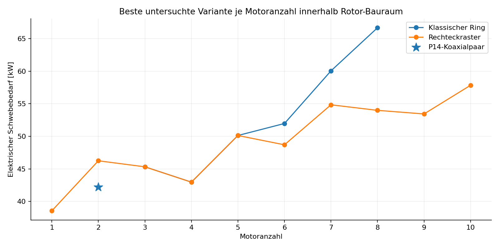
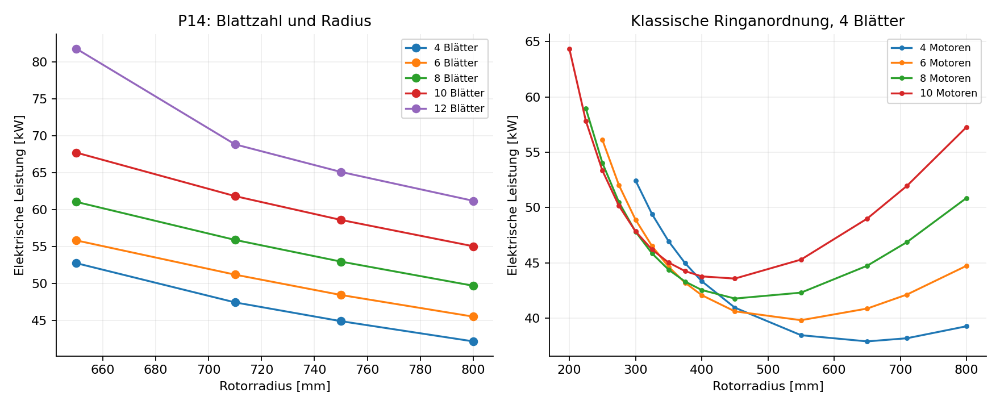
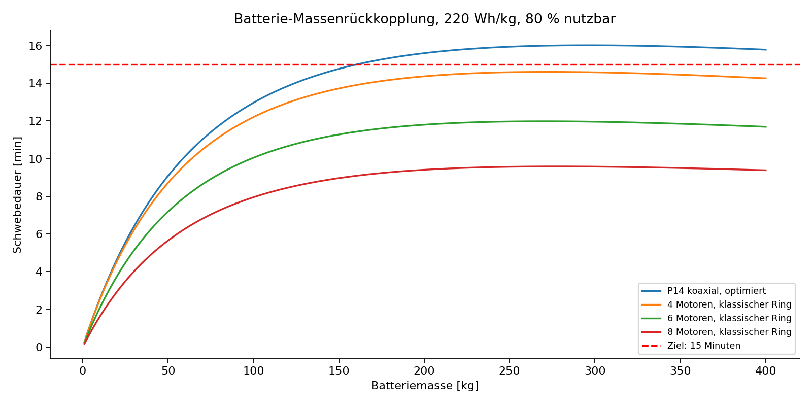
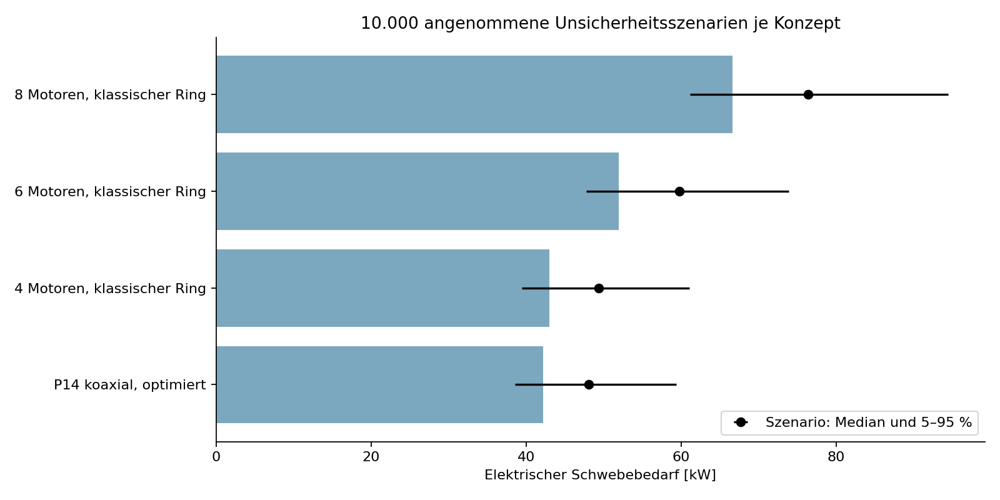

# PropBoard: Vergleich von 1 bis 10 Motoren und Rotorvarianten

Ausführliche parametrische Vorstudie auf Basis P14. Stand: 2. November 2026. Schwerpunkt: stationärer Schwebeflug mit 100 kg Nutzlast; klassische Multicopter, koaxiale Rotorpaare und Mischanordnungen.

## 1. Ergebnis und Entscheidung

Ein universell bestes System lässt sich aus Motoranzahl und Nennleistung allein nicht bestimmen. Größere wirksame Rotorfläche senkt den induzierten Leistungsbedarf, zusätzliche Motoren und Mechanik erhöhen die Masse. Im festen Bauraum entscheidet deren Zusammenspiel. Die Ergebnisse unten gelten für die geprüften Geometrien, die angenommenen Massen und die vereinfachte Aerodynamik; sie sind keine globalen Optima.

Das effizienteste untersuchte P14-Koaxialpaar benötigt rechnerisch 42,2 kW elektrisch: zwei Motoren, je vier Blätter, 800 mm Radius. Pro Motor ergeben sich 17,3 kW Wellenleistung und 93,0 Nm im Schwebepunkt. Mit 30 % Leistungsreserve wären mindestens 22,5 kW mechanische Dauerleistung je Motor erforderlich, sofern Drehmoment und Kühlung dies zulassen.

Der beste untersuchte klassische Quadrokopter innerhalb der reinen Rotorhülle liegt bei 43,0 kW elektrisch, 3 Blättern und 400 mm Rotorradius. Seine Rahmenmasse ist geschätzt; deshalb ist die Rangfolge gegenüber dem CAD-näheren P14-Konzept vorläufig.

Für eine Weiterentwicklung sind ein großes, niedrig belastetes Rotorsystem und ein klassischer Quad-/Hexakopter als konkurrierende Konzepte sinnvoll. Oktokopter und Dekakopter werden wegen zusätzlicher Regelmöglichkeiten mitgeführt; ein Nachweis von Motor-Ausfalltoleranz folgt aus der Motoranzahl nicht. Die geforderten 15 Minuten werden mit der angenommenen 12-kg-Batterie von keiner der empfohlenen Varianten erreicht.

## 2. Verbindliche Ausgangsdaten und Abgrenzung

| Größe | Projektbasis / Interpretation |
| --- | --- |
| Nutzlast | 100 kg; Person plus zusätzliche Ausrüstung noch offen |
| Fahrzeugziel | 2100 × 1700 × 600 mm einschließlich Rotoren und Schutz |
| Flugdauer / Geschwindigkeit | 15 min / etwa 80 km/h; hier nur stationärer Schwebeflug |
| P14-Geometrie | 710 mm Radius, 120 mm Tiefe, 360 mm Rotorabstand, 8 Blätter je Rotor |
| P14-CAD-Masse | 60,56 kg pro 8-Blatt-Rotorpaar; kein vollständiges Fahrzeug |
| Batterie / Elektronik | 12 kg / 2 kg als bisherige Annahmen |
| Motorreferenz | MN1330 KV40; 2,75 kg je Motor; etwa 92 V |
| Elektrischer Wirkungsgrad | 0,82 als Annahme; Nebenverbraucher nicht enthalten |
| Atmosphäre | Dichte 1,225 kg/m³; Schallgeschwindigkeit 340 m/s |

Aktuellster Bezug ist P14 laut Projekt-README. P11 und frühere kleine Modelle werden nicht mit P14 vermischt. Die alten sechs Rotorpositionen aus historischen Entwürfen sind keine verbindliche neue Motoranzahl. Die Nutzeranforderung 1–10 Motoren ersetzt diese Einschränkung für die Vergleichsstudie.

Die Bauraumprüfung umfasst Rotorhüllen in der Ebene und 80 mm angenommene Abstände zwischen benachbarten Scheiben. Schutz, Personendeck, Landegestell, Kabel, Strukturverformung und Fertigungsspiel sind nicht vollständig enthalten. Ein positiver Hüllencheck ist daher kein Nachweis der vollständigen Fahrzeugabmessungen. Für P14 bleibt die bekannte 360-mm-Ebenentrennung erhalten; neue klassische Rahmen besitzen noch keine ausgearbeitete Höhenkonstruktion.

Blattlänge bedeutet hier die freie aerodynamische Spannweite ab dem inneren Profilbeginn. Rotorradius ist der Abstand zwischen Drehachse und Spitze. Der Durchmesser beträgt das Doppelte des Radius. Diese Größen sind wegen Nabe und Blattanschluss ausdrücklich unterschiedlich.

## 3. Untersuchte Architekturen

| Architektur | Motorzahlen | Umfang |
| --- | --- | --- |
| P14-Koaxialpaare | 2, 4, 6, 8, 10 | 1–5 Paare; je 4/6/8/10/12 Blätter; Radius 650/710/750/800 mm |
| Große getrennte Rotoren | 1–10 | P14-nahe Blattgeometrie, gleiche Radien und Blattzahlen |
| Klassische Multicopter | 1–10 | Getrennte Rotoren, Ring und Raster; 2/3/4/6/8/10/12 Blätter; 15 Radien zwischen 150 und 800 mm |
| Mischsysteme | 3–10 | Je mögliche Mischung aus Paaren und Einzelrotoren; 8 Blätter; Radius 710/800 mm |

Klassischer Quadrokopter: vier getrennte Rotoren, einschließlich einer X-Anordnung als gedrehter regelmäßiger Viererring. Hexa-, Okto- und Dekakopter: regelmäßige Ringe mit sechs, acht beziehungsweise zehn Motoren. Zusätzlich werden Rechteckraster betrachtet. Ring und Raster besitzen im isolierten Schwebemodell gleiche Aerodynamik, unterscheiden sich aber in der Hülle. Interaktionen benachbarter Einzelrotoren sind nicht modelliert.

Ein Motor ohne Heckrotor beziehungsweise anderes Gegenmomentsystem ist nur ein aerodynamischer Rechenfall. Bicopter benötigen geeignete Schwenk-/Pitchmechanik; Tricopter und andere ungerade Anzahlen benötigen einen gesonderten Gierausgleich. Gleiche Lasten bei ungerader Anzahl gegenläufiger identischer Rotoren liefern kein ausgeglichenes Giermoment. Diese Fälle werden nicht als fertig regelbare Fluggeräte empfohlen.

## 4. Physikalisches Modell und Rechenverfahren

Verwendet wird die vorhandene Blattelement-Impuls-Theorie aus kreis_r04/simulation/r04_physik.js. Sie berechnet Profilkräfte und induzierte Geschwindigkeiten über radiale Elemente. Die Polaren sind vereinfachte symmetrische NACA-artige Ersatzpolaren mit Reynolds- und Abrissabhängigkeit, keine vermessenen P14-Profile.

Für Koaxialpaare liegt der untere Rotor im kontrahierten Nachlauf des oberen. Seine Pitchstellung wird innerhalb des vorhandenen P14-Gestängestellbereichs auf annähernd gleiche Gegenmomente getrimmt. Die Rückwirkung des unteren Rotors auf den oberen, instationäre Blattbegegnungen und komplexe 3D-Nachläufe fehlen. Ein Einzelrotor nutzt ausschließlich das obere, ungestörte Rotormodell; der rechnerisch mitberechnete untere Rotor wird verworfen.

Je Geometrie werden obere Pitchwerte von 10°, 12° und 14° geprüft. Die Drehzahl wird iterativ so angepasst, dass Gesamtschub und Gewicht übereinstimmen. Unter den zulässigen Pitchfällen wird der niedrigste elektrische Leistungsbedarf gewählt. Bei Mischanordnungen tragen alle seitlich getrennten Rotorpositionen denselben Anteil der Gesamtlast; diese Lastverteilung ist eine Annahme und keine globale Optimierung.

| Beziehung | Bedeutung |
| --- | --- |
| T = m × g | Erforderlicher Schwebeschub |
| Pideal = T^(3/2) / sqrt(2 × rho × A) | Idealer induzierter Leistungsbedarf |
| Pelektrisch = PWelle / 0,82 | Angenommene Motorumwandlung |
| Q = PWelle / omega | Erforderliches Motordrehmoment |
| t = mAkku × e × 0,8 / Pelektrisch | Energiebasierte Schwebedauer |
| PNenn >= 1,3 × PSchweben | Gewählte 30-%-Reserve in Leistung, keine Ausfallfreigabe |

Zulässigkeitsfilter: Blattspitzen-Machzahl höchstens 0,65; maximal 10 % abgerissene radiale Spannweite; maximal 0,5 % Schubabweichung. Für Koaxialpaare zusätzlich weniger als 0,1 % Momentabweichung. Die Grenzen sind Screeningschwellen, keine validierten Betriebsgrenzen. Die Machgrenze ersetzt insbesondere kein kompressibles Profilmodell.

Die Koaxialfläche wird als eine gemeinsame Ringfläche gezählt. Zwei übereinanderliegende Rotoren besitzen nicht die doppelte unabhängige Scheibenfläche. Seitlich getrennte Rotoren erschließen mehr Fläche, benötigen aber mehr Platz. Daher werden geometriefreie und bauraumbegrenzte Vergleiche getrennt ausgewiesen.

## 5. Massemodelle: belastbare Anker und freie Annahmen

| Blätter pro Rotor | P14-CAD-Masse pro Paar [kg] |
| --- | --- |
| 4 | 45,13 |
| 6 | 51,67 |
| 8 | 60,56 |
| 10 | 70,79 |
| 12 | 81,75 |

Nur diese Massen bei 710 mm Referenzradius stammen aus vorhandenen CAD-Varianten. Radiusänderungen erhalten eine grobe lineare Korrektur der CFK-Masse: Paarmasse = CAD-Masse + 8,84 kg × (Blattzahl/8) × (freie Spannweite / Referenzspannweite - 1). Neue Naben-, Lager- und Strukturmassen werden damit nicht nachgewiesen. Mehrere Rotorpaare benötigen außerdem einen Verbindungsrahmen, dessen Masse fehlt.

Getrennte große Rotoren übernehmen als Näherung die halbe Paarmasse je Modul. Für kompakte Neuentwürfe gilt die ausdrücklich freie Skalierung mModul = 2,75 kg + (45,13/2 - 2,75) kg × (R/0,71 m)² × (0,65 + 0,35 × B/4). Sie beinhaltet eine angenommene Struktur-/Antriebsreserve, aber keinen neu konstruierten Rahmen. Die Motormasse bleibt dabei zunächst bei 2,75 kg. Dadurch sind Vergleiche mit höheren Motorleistungen nur Anforderungsstudien. Eine separate Motormassen-Sensitivität korrigiert diesen Effekt näherungsweise.

Die kompakten Rotoren erhalten eine angenommene Blatttiefe c = max(0,06 m; 0,12 m × sqrt(R/0,71 m)) und einen inneren Profilradius r0 = max(0,09 m; 1,05 × B × c / (2 pi)). Die freie Spannweite muss mindestens 100 mm betragen. Diese Geometrie ist ein Neuentwurf, keine verkleinerte, fertig passende P14-Mechanik. Mehrblättrige Varianten verlieren durch größere Wurzelradien aktive Spannweite.

## 6. Vergleich der klassischen Quad-, Hexa-, Okto- und Dekakopter

| Konzept | Blätter / Radius [mm] | Masse [kg] | Elektrisch [kW] | min. Welle je Motor +30 % [kW] |
| --- | --- | --- | --- | --- |
| Quadrokopter | 3 / 400 | 148,0 | 43,0 | 11,5 |
| Hexakopter | 3 / 275 | 146,8 | 52,0 | 9,2 |
| Oktokopter | 6 / 200 | 150,8 | 66,7 | 8,9 |
| Dekakopter | kein zulässiger Fall | — | — | — |

| Konzept | Freie Blattlänge [mm] | Drehzahl [1/min] | Moment je Motor [Nm] | Rotorhülle [m] |
| --- | --- | --- | --- | --- |
| Quadrokopter | 310 | 4380 | 19,2 | 1,68 × 1,68 |
| Hexakopter | 185 | 7284 | 9,3 | 1,81 × 1,64 |
| Oktokopter | 110 | 10084 | 6,5 | 1,56 × 1,56 |
| Dekakopter | — | — | — | — |

Diese Tabelle enthält jeweils den besten zulässigen untersuchten regelmäßigen Ring innerhalb der Rotorhülle. Die Auswahl wird nicht mit dem besten Raster verwechselt. Kleine Rotoren verlangen hohe Drehzahlen und geeignete andere Motoren. MN1330 KV40 liefert bei 92 V eine ideale Leerlaufreferenz von etwa 3680/min; deutlich höhere erforderliche Drehzahlen sind mit dieser Spannungs-/KV-Kombination nicht abgedeckt. Die Tabellenwerte wählen daher keinen konkreten Kaufmotor aus.

Beim klassischen Dekakopter liefert das geprüfte Feld keinen Fall, der gleichzeitig Rotorhülle, Machgrenze, Mindestspannweite und Schwebelast erfüllt. Das ist eine Grenze dieses Parameterfeldes und kein allgemeiner Unmöglichkeitsbeweis für Dekakopter. Ein zehnmotoriges Rechteckraster besitzt dagegen zulässige Rechenfälle; die folgende Übersicht trennt diese Anordnungen.

Ein Quadrokopter bietet geringe Motor- und Regleranzahl sowie einfache Grundarchitektur. Hexa-, Okto- und Dekakopter verteilen die Leistung auf mehr Motoren, verlangen aber mehr Anschlüsse, Tragstruktur und Fehlerbehandlung. Im engen Bauraum sinkt der maximal mögliche Rotordurchmesser bei klassischen Ringen mit zunehmender Motoranzahl. Die geringere Leistung je Motor ist deshalb nicht gleichbedeutend mit geringerem Gesamtenergiebedarf.

Vergleich der jeweils besten bauraumkompatiblen Varianten. Ungerade Zahlen sind aerodynamische Fälle ohne nachgewiesenen Giertrim.

## 7. Vollständiger Überblick über 1–10 Motoren

| Motoren | Bezeichnung | Bestes Raster: B / R [mm] | Elektrisch [kW] | Bewertung |
| --- | --- | --- | --- | --- |
| 1 | Einrotor | 3 / 800 | 38,6 | Gierausgleich offen |
| 2 | Bicopter | 4 / 450 | 46,2 | Schwenk-/Pitchkonzept nötig |
| 3 | Tricopter | 3 / 400 | 45,3 | Gierausgleich offen |
| 4 | Quadrokopter | 3 / 400 | 43,0 | Regelung nicht nachgewiesen |
| 5 | 5-Motor-Konzept | 3 / 300 | 50,1 | Gierausgleich offen |
| 6 | Hexakopter | 3 / 300 | 48,7 | Regelung nicht nachgewiesen |
| 7 | 7-Motor-Konzept | 4 / 250 | 54,8 | Gierausgleich offen |
| 8 | Oktokopter | 3 / 250 | 54,0 | Regelung nicht nachgewiesen |
| 9 | 9-Motor-Konzept | 3 / 250 | 53,4 | Gierausgleich offen |
| 10 | Dekakopter | 4 / 225 | 57,8 | Regelung nicht nachgewiesen |

Die Rastertabelle beantwortet die vollständige Motoranzahlfrage. Sie dient zum Vergleich innerhalb des festen Rechtecks, auch wenn eine Anordnung beispielsweise acht Rotoren auf einem teilweise besetzten 3×3-Raster verteilt. Schwerpunkt, unbesetzte Positionen und Momente sind dort noch nicht konstruktiv optimiert. Der Ringvergleich ist für klassische Multicopter die aussagekräftigere Referenz.

## 8. P14, getrennte Großrotoren und Mischanordnungen

| P14-Variante | B / Radius [mm] | Elektrisch [kW] | Welle/Motor [kW] | Moment [Nm] |
| --- | --- | --- | --- | --- |
| Standardgeometrie, Pitch optimiert | 8 / 710 | 55,9 | 22,9 | 102,3 |
| Beste untersuchte P14-Variante | 4 / 800 | 42,2 | 17,3 | 93,0 |

Mehr Rotorblätter reduzieren bei gleicher Geometrie und Last häufig die notwendige Drehzahl. Gleichzeitig erhöhen sie Profilwiderstand, bewegte Masse und Anforderungen an Nabe und Pitchmechanik. Deshalb gewinnt im geprüften P14-Feld eine kleinere Blattzahl. Daraus folgt keine allgemeine Zwei- oder Vierblattregel für alle Profilformen und Lastfälle.

Bei gleicher angenommener Masse und Blattgeometrie benötigen zwei getrennte große Rotoren 33,3 kW statt 42,2 kW im Koaxialpaar. Das sind 21,1 % weniger elektrischer Bedarf in diesem Modell. Die Rotorhülle wächst jedoch auf 3,28 × 1,60 m und überschreitet das Projektziel. Dieser Vergleich zeigt den Flächen-/Bauraumkonflikt, nicht einen allgemeingültigen Koaxialverlust.

| Motoren | Günstigste reine Paaranordnung: B / R | Elektrisch [kW] | Rotorhülle passt? |
| --- | --- | --- | --- |
| 2 | 4 / 800 | 42,2 | ja |
| 4 | 4 / 800 | 43,7 | nein |
| 6 | 4 / 800 | 48,4 | nein |
| 8 | 4 / 800 | 53,9 | nein |
| 10 | 4 / 800 | 59,8 | nein |

Die Mischstudie enthält beispielsweise 4 Motoren als 1 Paar + 2 Einzelrotoren, 6 Motoren als 1 Paar + 4 Einzelrotoren oder 2 Paare + 2 Einzelrotoren. Alle Kombinationen mit mindestens einem Paar und einem Einzelrotor bis 10 Motoren werden für 710 und 800 mm Radius berechnet. Wegen mindestens zwei getrennten großen Rotorpositionen passen diese untersuchten Mischsysteme nicht in den Bauraum. Kompakte Mischrotoren, unterschiedliche Radien oder unterschiedliche Pitchwerte je Einzelposition bleiben ein weiterer Optimierungsschritt.

| Motoren | Bester Mischfall: Paare + Einzel | Elektrisch [kW] | Rotorpositionen |
| --- | --- | --- | --- |
| 3 | 1 + 1 | 47,4 | 2 |
| 4 | 1 + 2 | 48,6 | 3 |
| 5 | 1 + 3 | 51,1 | 4 |
| 6 | 1 + 4 | 54,2 | 5 |
| 7 | 1 + 5 | 57,6 | 6 |
| 8 | 1 + 6 | 61,2 | 7 |
| 9 | 1 + 7 | 64,9 | 8 |
| 10 | 1 + 8 | 68,7 | 9 |

Radius- und Blattzahleinfluss; rechte Kurven enthalten auch Fälle außerhalb des Zielbauraums.

## 9. Nennleistung, Drehmoment und Leistungsfähigkeit

Untersuchte hypothetische Motor-Nennleistungen: 3,4 / 10 / 20 / 30 / 40 / 60 kW mechanische Wellenleistung je Motor. Die 3,4-kW-Klasse ist ausschließlich eine hypothetische Vergleichsklasse. Sie darf nicht mit der realen MN1330-Angabe 3400 W für 180 s bei unklarer Leistungsseite gleichgesetzt werden. Dauerleistung, elektrische Aufnahme und kurzzeitige Prüfmaxima sind unterschiedliche Größen.

| Konzept | Schweben/Motor [kW Welle] | mit 30 % [kW] | Kleinste geprüfte Klasse [kW] |
| --- | --- | --- | --- |
| P14 koaxial, optimiert | 17,3 | 22,5 | 30 |
| 4 Motoren, klassischer Ring | 8,8 | 11,5 | 20 |
| 6 Motoren, klassischer Ring | 7,1 | 9,2 | 10 |
| 8 Motoren, klassischer Ring | 6,8 | 8,9 | 10 |

30 % Leistungsreserve entsprechen bei unveränderter Geometrie und Ähnlichkeit nur etwa 19 % zusätzlichem Schub: 1,3^(2/3) = 1,191. Für 30 % Schubreserve wären etwa 48 % zusätzliche Wellenleistung nötig. Leistungsklasse allein genügt nicht: Ein Motor muss das erforderliche Drehmoment bei der benötigten Drehzahl und Temperatur tatsächlich dauerhaft liefern. Ein größerer Hochdrehzahlmotor kann für einen langsamen Großrotor ungeeignet sein.

Die CSV-Dateien enthalten zusätzlich einen idealisierten Leistungs-Screen. Unter unveränderter Lastcharakteristik gilt Tmax/TGewicht ungefähr (verfügbare Wellenleistung / Schwebewellenleistung)^(2/3). Das ist ausschließlich eine leistungsbegrenzte Ähnlichkeitsabschätzung. Neue Drehzahlen, Abriss, Spitzen-Machzahl, Festigkeit, Drehmomentgrenzen, Strom und Kühlung werden darin nicht erneut nachgewiesen. Die Zahl ist kein maximal zulässiger Schub.

Ohne Begrenzung von Gesamtleistung, Motormasse, Batterie oder Kosten gewinnt bei maximalem theoretischem Schub trivial die größte eingesetzte Leistung. Eine sinnvolle Bewertung vergleicht daher zusätzlich Leistungsreserve pro Masse, Energiebedarf und Bauraum. Es wird keine unbegründete absolute „leistungsfähigste“ Hardwarekombination benannt.

## 10. Abgleich mit den vorhandenen MN1330-Daten

| Dokumentierte Angabe | Aussage für diese Studie |
| --- | --- |
| 2,75 kg / Motor | Referenzmasse; nicht jede neue Leistungsklasse wiegt so wenig |
| 3400 W / 180 s | Keine Dauerleistung für 15 min; Leistungsseite ungeklärt |
| 16,27 kW elektrische Prüfaufnahme | Haltedauer unbekannt; keine Dauerleistungsfreigabe |
| 46,25 Nm höchstes Prüfmoment | Kein vollständiges Drehmoment-Drehzahl-Kennfeld |
| NS52×20-Prüfpropeller | Keine direkte Schubübertragung auf den P14-Sonderrotor |

Schon die verbesserte P14-Variante fordert 93,0 Nm je Motor und damit deutlich mehr als das höchste dokumentierte Prüfmoment. Selbst wenn ein Leistungswert ausreichend erschiene, wäre der Betriebspunkt damit nicht belegt. Für klassische kompakte Rotoren sind die hohen Drehzahlen und ein anderes KV-/Spannungsniveau zusätzlich zu prüfen. Die Studie empfiehlt Leistungsanforderungen, keinen ungeprüften Motorzukauf.

## 11. Energie und Batterie-Massenrückkopplung

| Konzept | 12-kg-Akku: min | 15 min: Akku kg bei eingefrorener Masse | max. min mit Massenrückkopplung |
| --- | --- | --- | --- |
| P14 koaxial, optimiert | 3,0 | 59,9 | 16,0 |
| 4 Motoren, klassischer Ring | 2,9 | 61,0 | 14,6 |
| 6 Motoren, klassischer Ring | 2,4 | 73,8 | 12,0 |
| 8 Motoren, klassischer Ring | 1,9 | 94,7 | 9,6 |

Annahmen: 220 Wh/kg auf Packebene, 80 % nutzbare Energie, keine Zusatzleistungsverbraucher. Die Spalte mit eingefrorener Masse ist nur eine erste Energieumrechnung und kein konsistenter Akkuauslegungswert. Ein schwererer Akku erhöht den Schwebebedarf. Die Rückkopplungsrechnung setzt Pelektrisch = k × mGesamt^(3/2) bei unveränderter Geometrie und angenommenem konstantem Wirkungsgrad.

Mit Trockenmasse einschließlich Nutzlast md und Batteriemasse mb gilt t = 0,8 × e × mb / [k × (md + mb)^(3/2)]. Das theoretische Maximum liegt bei mb = 2 × md. Selbst dieses mathematische Maximum ist kein realisierbarer Betriebswert: Tragstruktur, Motorleistung, Drehzahl und Batterieleistung reichen bei solchen Massen möglicherweise nicht aus. Es liefert eine günstige Näherung innerhalb des Ähnlichkeitsmodells. Die Zusatzdatei untersucht außerdem 180 und 300 Wh/kg.

Eine größere Batterie verlängert die Schwebedauer wegen ihres Eigengewichts nicht beliebig. Das 15-Minuten-Ziel wird in diesen Rechenfällen verfehlt.

Die Auswertung berücksichtigt weder einen 80-km/h-Flug noch eine vollständige Mission mit Start, Steigen, Wind, Ausweichmanövern und Landung. Vorwärtsflug kann induzierte Leistung verändern und erzeugt zugleich zusätzlichen Widerstand. Ohne entsprechendes Modell lässt sich daraus keine belastbare Missionsreichweite ableiten.

## 12. Unsicherheit und Motormassen-Sensitivität

Für jedes ausgewählte Konzept wurden 10.000 Szenarien mit festem Zufallsstartwert 20261102 gerechnet. Unabhängige Gleichverteilungen: 0–20 kg zusätzliche Systemmasse, Motorwirkungsgrad 0,75–0,90 und aerodynamischer Leistungsmultiplikator 0,85–1,25. Diese Bereiche sind frei gesetzte Annahmen. Die Quantile beschreiben diese Szenarioverteilung; sie sind keine statistisch validierten Vertrauensintervalle für reale Fluggeräte.

| Konzept | Nennwert kW | Szenario 5 % | Median | Szenario 95 % |
| --- | --- | --- | --- | --- |
| P14 koaxial, optimiert | 42,2 | 38,5 | 48,1 | 59,3 |
| 4 Motoren, klassischer Ring | 43,0 | 39,5 | 49,4 | 61,0 |
| 6 Motoren, klassischer Ring | 52,0 | 47,7 | 59,7 | 73,9 |
| 8 Motoren, klassischer Ring | 66,7 | 61,1 | 76,4 | 94,5 |

Die Unsicherheitsbereiche überlappen. Kleine Unterschiede zwischen Konzepten rechtfertigen ohne vermessene Rotoren und reale Rahmenmassen keine endgültige Rangfolge.

Die separate Motormassentabelle untersucht mechanische spezifische Leistungen von 1, 3 und 6 kW/kg sowie 10–60 kW Nennleistung je Motor. Die vorhandenen 2,75 kg werden ersetzt durch mMotor = PNenn / spezifische Leistung. Anschließend wird die neue Masse mittels m^(3/2) auf den Bedarf zurückgeführt. Es handelt sich nicht um eine Marktübersicht realer Motormassen.

Damit kann eine nominell stärkere Motorvariante durch höhere Eigenmasse ihre Reserve teilweise wieder verlieren. Zusätzlich größere Regler, Kabel und Batterieanschlüsse sind weiterhin offen. Die Konsequenz ist, zuerst einen nachgewiesenen Betriebspunkt samt thermischem Dauerzustand und Masse zu wählen und danach die Fahrzeugmasse erneut zu schließen.

## 13. Numerische Prüfung und Grenzen

| Prüffall | Drehzahl [1/min] | Elektrisch [kW] |
| --- | --- | --- |
| Neuberechnung, 24 Elemente | 2141,5 | 55,931 |
| Neuberechnung, 48 Elemente | 2146,3 | 56,092 |
| Vorhandene P14-Funktion, 32 Elemente | 2143,7 | 56,000 |

Die Verdopplung der radialen Auflösung verändert den elektrischen Bedarf im 12°-Referenzfall um 0,29 %. Die Reproduktion des vorhandenen P14-Schwebefalls liegt ebenfalls nahe. Das prüft numerische Konsistenz, nicht die physikalische Genauigkeit der Ersatzpolaren. Die Vergleichsgrundlage ist bewusst der 12°-Fall; die Optimierung darf einen anderen Pitch wählen.

Nicht modelliert: instationäre 3D-Strömung, gegenseitige Rückwirkung koaxialer Rotoren, seitliche Nachlaufinteraktionen, Person-/Deckabschattung, Bodeneffekt, Kompressibilität, Aeroelastik, echte Blattprofilpolaren, Laminatfestigkeit, Ermüdung, Lagerlebensdauer, Akustik, Motor-/ESC-Kennfelder, Kühlung und Flugreglerausfälle. P14-Servostellbereich wird für Koaxialfälle geprüft; Servokräfte und Strukturfestigkeit für neue Geometrien werden nicht neu nachgewiesen.

Die Studie ist eine analytisch-numerische Entwurfsstudie mit stationärer BEMT. Es wurde keine neue 3D-CFD durchgeführt. Historische Re=40-Versuche sind keine Validierung der hier berechneten Rotoren. Aus reinem Schweben und einer Momentbilanz folgt weder dynamische Stabilität noch Motor-Ausfalltoleranz. Für einmotorige und ungerade Anordnungen bleibt ein Gegenmomentsystem erforderlich.

## 14. Konkrete Empfehlung für die nächste Revision

A: P14 als kompakte Koaxialreferenz mit 4 statt 8 Blättern und 750–800 mm Radius weiter untersuchen. Das verringert im vorhandenen Masse-/Aeromodell den Bedarf, verlangt jedoch weiterhin erheblich höhere dauerhaft belegte Motormomente als in den MN1330-Prüfdaten. Die 800-mm-Variante lässt innerhalb 1,70 m Breite nur 100 mm für beide Schutzseiten zusammen; der vollständige Schutzbauraum muss geschlossen werden.

B: Einen klassischen Quadrokopter und einen Hexakopter mit den oben angegebenen besten geprüften Radien als neue Rahmenentwürfe aufbauen. Zuerst Masse und Rotorfreiraum konstruktiv schließen, dann die Rangfolge mit echten Herstellerkennfeldern beziehungsweise Messdaten neu bewerten. Für alle Varianten Blätter, Motoren, Regler und Akkus über ihren gesamten Betriebspunkt prüfen; 30 % Leistungsreserve alleine genügt nicht.

C: Okto- und Dekakopter weiterführen, wenn Regelbarkeit und potenzielle Fehlerbeherrschung gegenüber Komponentenanzahl höher gewichtet werden. Ein Motor-Ausfallfall benötigt eine eigene Kraft-/Momentverteilung und Leistungsreserve der verbleibenden Antriebe. Ein Standardquad ist ohne besondere Maßnahmen üblicherweise nicht auf den vollständigen Ausfall eines Motors ausgelegt. In dieser Studie wurde kein Ausfallflug nachgewiesen.

D: Das 15-Minuten-Ziel als eigenständigen Machbarkeitskonflikt behandeln. Dafür sind wesentlich geringere Trockenmasse, mehr Rotorfläche, ein anderes Missionsprofil oder eine andere Energieversorgung zu untersuchen. Die Energietabelle zeigt, warum allein eine höhere Motor-Nennleistung oder ein größerer Akku das Ziel nicht löst.

## 15. Reproduzierbarkeit und Dateien

Berechnet wurden 2230 Geometrie-/Anordnungsfälle einschließlich geometrisch oder aerodynamisch ausgeschlossener Varianten. Ring- und Rastervarianten zählen als getrennte Anordnungen, teilen aber denselben isolierten Rotorbetriebspunkt. Pro Fall werden bis zu drei Pitchwerte geprüft. Die Motor-Kombinationstabellen enthalten sechs hypothetische Nennleistungsklassen. Die Unsicherheitsanalyse umfasst 40000 Szenarien.

Ausführung im Projektverzeichnis: node studie_antrieb/simulieren.cjs; node studie_antrieb/einzelrotoren.cjs; node studie_antrieb/kompakt.cjs; node studie_antrieb/mischanordnungen.cjs; MPLCONFIGDIR=/tmp/propboard-mpl python studie_antrieb/bericht.py. Voraussetzungen: Node.js sowie Python mit NumPy, Matplotlib und ReportLab. Es werden keine externen Dienste oder Dateien aus dem Netz benötigt.

| Datei | Inhalt |
| --- | --- |
| Rotorvergleich.csv / Motorkombinationen.csv | P14-nahe Koaxialpaare, Leistungs-Screen |
| Einzelrotoren_1_bis_10.csv | Große seitlich getrennte P14-nahe Rotoren |
| Kompakte_Anordnungen.csv / Kompakt_Motorkombinationen.csv | Klassische Ring- und Rastervarianten mit Motor-Klassen |
| Mischanordnungen.csv | Paare und Einzelrotoren gemeinsam |
| Batterie_Rueckkopplung.csv | Energie mit Massenrückkopplung |
| Unsicherheit.csv / Motormassen_Sensitivitaet.csv | Szenarioquantile und schwerere Motoren |
| Ergebnisse.json / weitere JSON | Rohdaten und numerische Vergleichsprüfungen |
| Manifest_SHA256.json | Integrität der Studienartefakte und verwendeten Projektquellen |

Projektquellen: README.md; kreis_r04/mn1330_p14/parameter.json; ERGEBNIS.md; MOTOR_DATEN.md; Ausgabe/Massenvarianten.json; Motor_Daten.json; vorhandene BEMT- und P14-Physikquellen. Dies sind interne Projektstände mit dokumentierten Annahmen, keine neu geprüften Herstellerfreigaben. Die Studie verändert weder CAD noch die vorhandenen Flugsimulatoren.
