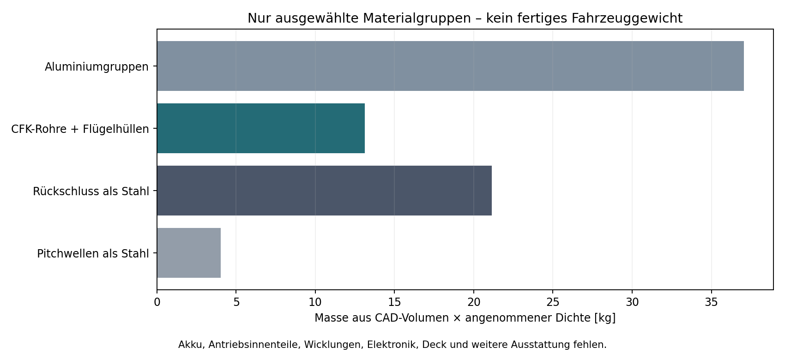
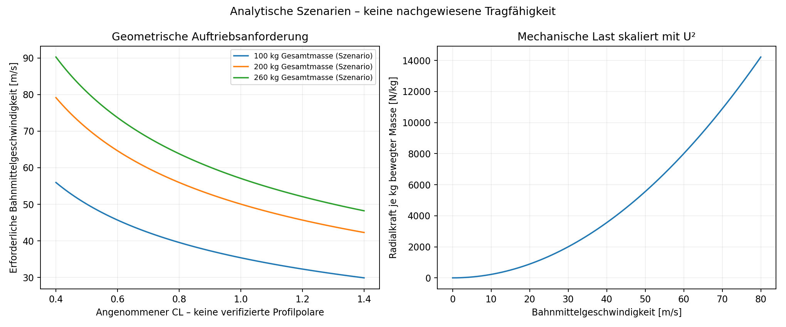
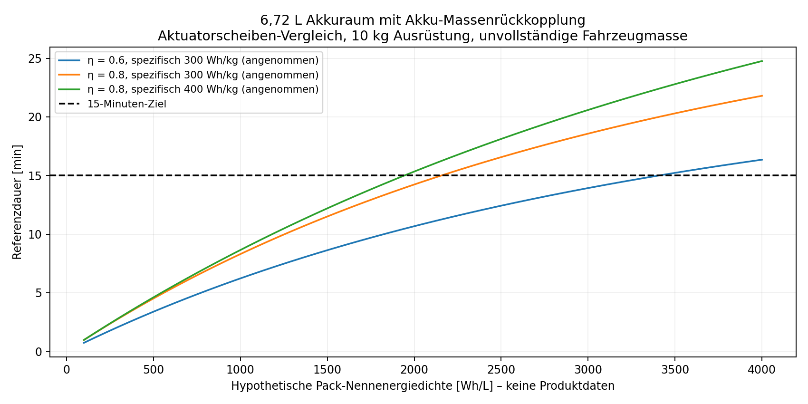

# 1. Ergebnis

**Der Nachweis für 100 kg Personengewicht plus Ausrüstung ist mit dem aktuellen Entwurf nicht erbracht. Eine zulässige Nutzlast in kg wird nicht freigegeben.** Das bedeutet weder, dass die nachgewiesene Tragfähigkeit 0 kg betrage, noch dass jeder weiterentwickelte Flügelumlauf unmöglich sei.

Dieser Bericht geht über ein bloßes „Daten fehlen“ hinaus: Er rechnet ausgewählte CAD-Materialgruppen nach, leitet Auftriebs- und Umlenkanforderungen ab, untersucht Energiebedarf und Akku-Massenrückkopplung in ausdrücklich definierten Referenzmodellen und prüft einzelne mechanische Bedingungen. Ein positiver Nachweis darf jedoch nicht durch frei gewählte Auftriebsbeiwerte, Wirkungsgrade oder Akkudaten ersetzt werden.

Wesentliche Ergebnisse:

- Ausgewählte Materialgruppen ergeben bei angesetzten Dichten bereits **75,36 kg**. Das ist eine unvollständige, bedingte CAD-Massenrechnung, kein gemessenes Leergewicht und keine allgemeine Untergrenze für einen später optimierten Entwurf.
- Im quasistationären Geometrieszenario benötigen 200 kg Gesamtmasse bei angenommenem CL = 1 ungefähr **50,05 m/s** am Bahnmittelpunkt. Dieser CL wurde für den realen Flügel nicht nachgewiesen.
- Das ergibt am mittleren Radius ungefähr **5568 N pro kg bewegter Masse** an radialer Schwerpunktkraft. Gegenläufigkeit beseitigt diese lokalen Lasten nicht.
- Der früher beschriebene Tattu-Pack passt nach seinen gegebenen nominalen Abmessungen nicht in die aktuellen 60-mm-hohen Modulräume.
- Im untersuchten hypothetischen 54-Fälle-Raster aus Akkuenergiedichten, Wirkungsgraden und 0/10/20 kg Ausrüstung werden im Vergleichsmodell maximal **9,33 Minuten** erreicht. Das gilt nur für diese Annahmen; es ist keine allgemeine Flugzeitgrenze.

Es wurden **keine neue realmaßstäbliche 3D-CFD, kein Magnetfeldnachweis, kein Antriebsprüfstand und kein Flugversuch** ausgeführt. Die derzeitige Konstruktion bleibt ein Vorentwurf.

# 2. Ziel und erforderliche Nachweiskette

Gefordert sind 100 kg Personengewicht zuzüglich Ausrüstung, maximal 2100 × 1700 × 600 mm Fahrzeughülle, mindestens 15 Minuten Flugzeit und ungefähr 80 km/h Zielgeschwindigkeit. Die Ausrüstungsmasse wird mangels bestätigtem Wert mit 0, 10 und 20 kg getrennt betrachtet. Zehn Kilogramm sind ein Rechenfall, keine bestätigte Nutzervorgabe.

Der Nachweis müsste gleichzeitig schließen:

1. `F_z,dauer >= m_gesamt × g`, mit ausreichender Regel-/Manöverreserve und kontrollierbaren Restkräften/Momenten.
2. `m_gesamt = Person + Ausrüstung + Struktur + bewegte Teile + Antriebe + Elektrik + Akku + Schutz + Nebenaggregate`.
3. Dauerkräfte, Drehmomente, Winkelraten und Temperaturen der tatsächlichen Linear-/Pitchantriebe und Führungen.
4. Genügend nutzbare Akkuenergie **und** gleichzeitig genügend Strom-/Dauerleistungsfähigkeit im zulässigen Bauraum.
5. Nachweis der CFK-Laminate, Verbindungen, Lager-/Fangkräfte, Ermüdung und Bewegungsfreiheit.

Nur ein Gleichgewicht der aerodynamischen Kraft ist noch keine zulässige Personen-Tragfähigkeit. Ein 30-%-Auftriebszuschlag wird weiter unten ausschließlich als zusätzliche Rechenannahme gezeigt; er ist keine Normvorgabe und kein ausreichender Ausfallnachweis.

# 3. Geometrie und Massenrechnung aus dem CAD

Die Hauptvariante besitzt zwei horizontale Gegenläufe mit zusammen 16 Flügeln, jeweils 120 mm Sehne und 600 mm Spannweite. Die geometrische Flächensumme beträgt 1,152 m². Mittlerer Kurvenradius: 450 mm. Gerade Abschnitte: je 500 mm. Die Batteriebauräume umfassen zusammen 6,72 Liter.

Für die Massenrechnung wurden aus `Stueckliste_Instanzen.csv` ausschließlich die markierten Körper der Steh-Hauptbaugruppe ausgewertet. Personenreferenzen und reine Antriebs-/Elektronik-Bauraumkörper wurden nicht als reale Hardwaremassen behandelt. Die Dichten sind ausdrücklich angenommene Rechenwerte, keine bestätigten Lieferantendaten.

| Gruppe | Rechenmasse, kg | Eingesetzte Dichte, kg/m³ |
| --- | --- | --- |
| Aluminiumgruppen | 37,05 | 2700 |
| CFK-Rohre und Fluegelhuellen | 13,12 | 1600 |
| Rueckschluss, als Stahl gerechnet | 21,15 | 7850 |
| Pitchwellen, als Stahl gerechnet | 4,04 | 7850 |

Die Instanzliste wurde separat gegen die native FreeCAD-Hauptdatei geprüft: 712 Instanzen stimmten hinsichtlich ID und gespeichertem CAD-Volumen innerhalb der Rundungstoleranz von 0,002 mm³ überein. Das verifiziert die Volumenübernahme, nicht die Materialdichten oder die Festigkeit.

Die Überlagerung von C-Rückwand und Flanschen wurde mit **1,470 Litern** aus der Aluminiumsumme abgezogen. Die hierfür verwendete Überlappung beträgt zwei 8-mm-Zonen an einer 60-mm-Rückwand. Andere noch nicht fertig ausgearbeitete Materialübergänge und Anschlusskontakte sind damit nicht automatisch bereinigt.

Die Summe liegt im gewählten Dichteszenario bei 75,36 kg; bei den variierten Dichten bei etwa 72,73 bis 78,72 kg. Die Szenariospanne erfasst nur die angesetzten Dichten, nicht sämtliche Konstruktions- und Volumenunsicherheiten.

**Nicht geschlossen enthalten:** tatsächliche Akkus, Motor-/Magnetlagerinnenteile, Wicklungsfüllung und Isolation, Lager/Regler, Sandwich-Deck, Elastomere, real ausgewählte Befestigungen, Kühlung, Schutz- und thermische Systeme. Deshalb darf die Summe nicht als verifiziertes Leergewicht oder als alleinige untere Massenbegrenzung verwendet werden. Ein später anderes Material-/Schienenkonzept verändert sie.



Die frühere pauschale 45-kg-Nicht-Akku-Annahme wird für diesen Detailentwurf nicht übernommen. Für das folgende gekoppelte Referenzszenario ergeben Person 100 kg, Ausrüstung 10 kg und die ausgewählte Teilmasse zusammen **185,36 kg ohne Akku**, wobei fehlende weitere Systemmassen zunächst mit null angesetzt werden. Das ist eine bewusst unvollständige, günstige Szenariobasis, kein geschlossenes Fahrzeug.

# 4. Auftrieb aus Geometrie: Anforderungen statt erfundener Polare

Für reale Luft werden rho = 1,225 kg/m³ und nu = 1,5 × 10⁻⁵ m²/s als Referenzwerte verwendet. Die einfache Beziehung lautet `F_z = 0,5 × rho × U² × S × CL × k2`.

CL ist ein **freier Szenarioparameter**, keine gemessene NACA-0012-Polare. Berücksichtigt wird im Modell die radiale Geschwindigkeitsverteilung eines starren radialen Flügels im Kreisabschnitt: `v(r) = U × r/R`. Die Spannweite reicht nominell von r = 0,15 bis 0,75 m. Auf den Geraden wird eine einheitliche Flügelgeschwindigkeit angesetzt.

Bei konstantem CL und gleichmäßiger Bahnmittelgeschwindigkeit ergibt das zeit- und spannweitengemittelt `k2 = 1 + f_Bogen × b²/(12R²) = 1,10944`. Der Bogenanteil der Bahnlänge beträgt ungefähr 73,9 %. Das Integral wurde zusätzlich numerisch überprüft.

| Gesamtmasse, kg | CL angenommen | U Mitte, m/s | U äußeres Ende, m/s |
| --- | --- | --- | --- |
| 100 | 0,8 | 39,57 | 65,95 |
| 100 | 1,0 | 35,39 | 58,99 |
| 100 | 1,2 | 32,31 | 53,85 |
| 200 | 0,8 | 55,96 | 93,27 |
| 200 | 1,0 | 50,05 | 83,42 |
| 200 | 1,2 | 45,69 | 76,16 |
| 260 | 0,8 | 63,81 | 106,35 |
| 260 | 1,0 | 57,07 | 95,12 |
| 260 | 1,2 | 52,10 | 86,83 |

Die 100-kg-Zeilen sind nur ein Rechenvergleich der Gesamtmasse. Sie entsprechen **nicht** einem Board, das bereits allein 100 kg Pilot tragen könnte: Fahrzeug und Akku fehlen dort vollständig. Die übrigen Zeilen sind ebenfalls Gesamtmassenfälle, keine bestätigten Gewichte.

Bei 200 kg und CL = 1 ergibt sich U = 50,05 m/s, innen am Flügel ungefähr 16,68 m/s und außen 83,42 m/s. Die mittlere Sehnen-Reynolds-Zahl liegt dann bei rund 400437, also etwa vierhunderttausend statt 40. Lokale Reynolds-Zahlen und gegebenenfalls Kompressibilität sind zusätzlich zu prüfen.

Ein hypothetischer 30-%-Kraftzuschlag würde in diesem Modell U auf 57,07 m/s erhöhen. Er sagt nichts über die verfügbare Stellreserve oder die thermische Dauerfähigkeit aus.

**Nicht enthalten:** realer induzierter Abstrom, Flügelspitzen, dynamischer Strömungsabriss, wechselnde wirksame Anstellung, Interaktion der Ebenen, Deck/Person, Kurvenübergänge und nichtstationäre Zirkulation. Insbesondere darf der Faktor k2 nicht als gemessener 10,9-%-Auftriebsgewinn ausgegeben werden.



# 5. Antrieb und magnetische Führung

Bei U = 50,05 m/s und R = 0,45 m beträgt die Schwerpunktbeschleunigung im Kreisabschnitt etwa 5568 m/s², entsprechend 568 g. Ein Kilogramm auf dieser mittleren Kreisbahn verlangt ideal bereits etwa 5568 N Radialkraft. Das ist eine Referenz pro bewegter Masse, nicht die bereits bestimmte Flügelbaugruppenlast.

Die Kräfte der beiden Endschlitten sind nicht einfach jeweils die Hälfte dieses Werts. Massenverteilung, Eigenrotation, unterschiedliche Radien, Flügelkräfte und Momente müssen gemeinsam aufgelöst werden. Innen-/Außenführungen fahren bei gleicher Winkelgeschwindigkeit im Bogen mit dem Verhältnis 5,92 : 1. Bei der genannten mittleren Geschwindigkeit ist eine Tangenten-Orientierungsrate um 111,2 rad/s erforderlich.

Die sprunghafte Krümmung der bisherigen Geraden-/Kreisübergänge erzeugt für eine starr tangential ausgerichtete Baugruppe einen idealen Sprung der Orientierungsrate. Eine mechanisch ausführbare Trajektorie benötigt geglättete Übergänge beziehungsweise eine begrenzte Orientierungsbewegung. Die CAD-Bahn allein schließt diese Kinematik noch nicht.

**Zentripetalkraft ist nicht mit Antriebsleistung gleichzusetzen.** Bei ideal konstanter Kreisfahrt steht sie senkrecht zur Geschwindigkeit und verrichtet keine translatorische Arbeit. Reale Führungs-, Regler-, Wirbelstrom- und Beschleunigungsverluste sind trotzdem zu ermitteln. Die unzulässige Rechnung `P = F_radial × U` wird hier nicht verwendet.

Für eine ideale Magnet-Normaldruckreferenz gilt `F = B² × A / (2 mu0)`. Mit rein angenommenen 1 T und einer einzelnen geometrischen Polfläche 24 × 12 mm ergeben sich ungefähr 114,6 N. Für 2000 N wären bei denselben idealisierten 1 T etwa 50,3 cm² wirksame Fläche nötig. Ein einzelner gezeichneter 24×12-mm-Pol hat nur 2,88 cm².

Diese Rechnung ist keine Feldsimulation: Tatsächliches B, wirksame Flächen, Lastaufteilung, Sättigung, Spalt, Streufluss und Regelsteifigkeit sind unbekannt. Sie zeigt, welche Größenordnungen geprüft werden müssen, nicht dass ein konkretes Magnetlager ausgewählt oder pauschal unmöglich sei.

Die CAD-Dateien besitzen weder ausgewählte Linear-/Pitchantriebe mit Dauerkennfeldern noch eine nachgewiesene kontaktlose Versorgung. Benötigt werden Tangentialkraft über Geschwindigkeit, Stellmoment und Winkelrate, thermische Dauerlast sowie Kraft-/Steifigkeitskurven der Magnetführung. Ein Motor-Bauraum kann diese Angaben nicht ersetzen.

# 6. Leistung und 15-Minuten-Energie: Vergleichsmodell

Die vollständige elektrische Aufnahme lässt sich aus der vorhandenen 2D-CFD nicht bestimmen. Auch eine Profilwiderstandsrechnung ohne konsistenten induzierten Abstrom würde keinen geschlossenen Schwebeleistungsnachweis liefern.

Als getrennte Orientierung wird deshalb eine ideale Aktuatorscheiben-Beziehung verwendet: `P_ideal = T^(3/2) / sqrt(2 rho A)`, mit T = m g und **angenommenem** A = 3,57 m². Diese Fläche entspricht der Ziel-Grundfläche 2,1 × 1,7 m und ist **keine gemessene Strahlfläche**. Die tatsächliche wirksame Abstromfläche ist nicht bekannt und muss auch nicht exakt der Fahrzeuggrundfläche entsprechen. Die Rechnung ist daher kein strenger universeller Leistungs-Untergrenzennachweis für diesen Flügelumlauf.

Für die elektrische Referenz werden `P_Bat = P_ideal / eta` und für 15 Minuten `E_nom = 0,25 × P_Bat / 0,8` verwendet. Eta = 0,4 / 0,6 / 0,8 und 80 % nutzbare Nennenergie sind freie Vergleichsannahmen, keine nachgewiesenen Wirkungsgrade oder sichere Reservefestlegung. Eta fasst hier die zusätzliche Differenz zur idealen Strahlleistung zusammen; Einzelverluste werden damit nicht zusätzlich doppelt addiert.

| Gesamtmasse, kg | P ideal, kW | P Referenz bei η=0,6, kW | E nominal für 15 min, kWh |
| --- | --- | --- | --- |
| 100 | 10,38 | 17,31 | 5,41 |
| 180 | 25,08 | 41,79 | 13,06 |
| 200 | 29,37 | 48,95 | 15,30 |
| 220 | 33,88 | 56,47 | 17,65 |
| 260 | 43,53 | 72,56 | 22,67 |

Bei 200 kg und eta = 0,6 ergeben sich im **Referenzmodell** 48,95 kW elektrische Aufnahme, 15,30 kWh Nennenergie und etwa 2276 Wh/L innerhalb des derzeitigen 6,72-L-Raums. Diese Zahlen sind kein ausgewählter Betriebspunkt und keine verifizierten Datenblattwerte.

Dieselbe angenommene Leistung entspräche bei beispielhaften 100 / 200 / 400 V ungefähr 490 / 245 / 122 A. Keine dieser Spannungen ist für das Fahrzeug ausgewählt. Aus dem Ø12-mm-Kabelbauraum folgt weder ein Leiterquerschnitt noch die Eignung für diese Ströme oder Spannungen.

# 7. Akku-Masse mitrechnen

Eine größere Batterie erhöht gleichzeitig die benötigte Tragkraft. Daher wurde `m = M0 + m_Akku`, `E_nom = e_spez × m_Akku` und die obige Referenzleistung gemeinsam gerechnet. M0 enthält hier Person, jeweilige Ausrüstung und nur die ausgewählte CAD-Teilmasse. Fehlende weitere Systemmassen werden mit null angesetzt, um die Rechnung nicht durch erfundene Hardwaremassen zu schließen.

Das erste Raster kombiniert 0/10/20 kg Ausrüstung, 200/300/400 Wh/kg, 500/700/1000 Wh/L und eta = 0,6/0,8 bei 6,72 L Bauraum. **Diese Energiespezifikationen sind hypothetische Sensitivitätswerte, keine identifizierten oder verfügbaren Produkte.** Es werden keine technologischen Höchstgrenzen behauptet.

Keiner der 54 Fälle erreicht im Referenzmodell 15 Minuten. Der beste Rasterfall ergibt 9,33 Minuten, bei 0 kg Ausrüstung, eta = 0,8, 400 Wh/kg und 1000 Wh/L. Er enthält nach wie vor keine vollständige Hardwaremasse. Dieses Ergebnis verwirft nur die untersuchten Annahmekombinationen; es beweist keine allgemeine Unmöglichkeit des Projekts.

Für den zusätzlichen 10-kg-Ausrüstungsfall wurde die kleinste Akkumasse gesucht, mit der das Vergleichsmodell genau 15 Minuten erreicht. Die Nullstellensuche berücksichtigt die zunehmende Gesamtmasse. Es gibt keine Kopplung an ein reales verfügbares Akkuprodukt.

| η angenommen | Wh/kg angenommen | Akku kg | Gesamt kg | Nennenergie kWh | Nötige Wh/L im 6,72-L-Raum |
| --- | --- | --- | --- | --- | --- |
| 0,6 | 200 | 223,85 | 409,22 | 44,77 | 6662 |
| 0,6 | 300 | 76,31 | 261,67 | 22,89 | 3407 |
| 0,6 | 400 | 48,29 | 233,66 | 19,32 | 2874 |
| 0,8 | 200 | 95,43 | 280,79 | 19,09 | 2840 |
| 0,8 | 300 | 48,29 | 233,66 | 14,49 | 2156 |
| 0,8 | 400 | 32,64 | 218,01 | 13,06 | 1943 |

Beispiel: eta = 0,6 und 300 Wh/kg führen rechnerisch zu ungefähr 76,31 kg Akku, 22,89 kWh Nennenergie und 261,67 kg unvollständiger Gesamtmasse. Die im bestehenden Bauraum dafür erforderliche nominale Energiedichte wäre etwa 3407 Wh/L. Ein solcher geeigneter Pack ist nicht belegt.

Auch der deutlich günstigere Fall eta = 0,8 und 400 Wh/kg benötigt im Referenzmodell ungefähr 13,06 kWh Nennenergie und 32,64 kg Akku. Innerhalb von 6,72 L wären ungefähr 1943 Wh/L erforderlich. Das ist eine abgeleitete Anforderung dieses Szenarios, keine Behauptung einer verfügbaren Batterie.



# 8. Konkreter Einbaucheck des früheren Tattu-Packs

Die früher übermittelten nominalen Packabmessungen lauten 230 × 104 × 70 mm. Die aktuellen Modulräume lauten 400 × 140 × 60 mm. Die kleinste Packabmessung ist damit 70 mm und überschreitet die 60-mm-Höhe.

Für einen starren Quader kann keine räumliche Drehung seine kleinste Stützbreite unter seine kleinste Kantenlänge senken. Damit passt der gegebene nominelle Packkörper **auch durch Schrägstellen nicht vollständig in diesen geschlossenen 60-mm-Raum**. Alle sechs achsparallelen Orientierungen wurden zusätzlich geprüft und passen ebenfalls nicht.

Dies ist eine geometrische Aussage anhand der früher gelieferten Nennmaße, kein physischer Einbauversuch und kein neu verifiziertes Herstellerdatenblatt. Sie betrifft diesen Packkörper, nicht jede mögliche andere Zell-/Packkonstruktion. Die zwei aktuellen CAD-Module sind weiterhin nur Bauraumreferenzen.

# 9. Struktur: was der Carbonquerschnitt allein aussagt

Als gesondertes Steifigkeitsscreening wird ein 40×40×3-mm-Querträger betrachtet. Sein geometrisches Flächenträgheitsmoment beträgt I = 1,01972 × 10⁻⁷ m⁴. Ein ideal einfach gelagerter Balken mit 1,62 m Stützweite erhält eine zentrale Last aus 100 kg Personengewicht. Dies ist ein definierter Balken-Prüffall, **nicht** die bereits ermittelte Lastverteilung im vollständigen Rahmen.

Die Beziehungen lauten `delta = F L³ / (48 E I)` und `sigma = F L / 4 × (h/2) / I`. Es werden hypothetische wirksame Längs-E-Moduln von 40/70/120 GPa und entweder ein belasteter Querträger oder ideale Gleichverteilung auf drei Querträger verglichen.

| E angenommen, GPa | Anzahl gleich belasteter Träger | Durchbiegung, mm | Nennbiegespannung, MPa |
| --- | --- | --- | --- |
| 40 | 1 | 21,30 | 77,90 |
| 40 | 3 | 7,10 | 25,97 |
| 70 | 1 | 12,17 | 77,90 |
| 70 | 3 | 4,06 | 25,97 |
| 120 | 1 | 7,10 | 77,90 |
| 120 | 3 | 2,37 | 25,97 |

Bei 70 GPa wären das etwa 12,17 mm Durchbiegung im Einträgerfall beziehungsweise 4,06 mm bei perfekter Dreifachverteilung. Das weist auf die erforderliche Steifigkeitsuntersuchung hin. Es beweist weder tatsächliche Rahmenverformungen noch automatisch ein Schließen der Magnetluftspalte: Lagerung und relative Verformung von Führung/Schlitten sind nicht berechnet.

Die Biegespannung darf ohne richtungsabhängige CFK-Kennwerte und Laminataufbau nicht mit einer pauschalen Carbonfestigkeit bewertet werden. Lokale Klemmdrücke, Delamination, Kerb-/Verbindungswirkungen, Instabilität, dynamische Lasten und Ermüdung fehlen. Deshalb ist keine zulässige Struktur-Tragfähigkeit in kg ableitbar.

# 10. Nachweisstatus und konkrete nächste Eingaben

| Nachweisteil | Ergebnis | Begründung |
| --- | --- | --- |
| Gesamtmasse | Nicht geschlossen | Ausgewählte CAD-Materialgruppen gerechnet; wesentliche Systeme fehlen |
| Aerodynamischer Dauerschub | Nicht nachgewiesen | Keine reale 3D-Polare/Schubkennlinie; Re-40-Tests nicht übertragbar |
| Linear- und Pitchantrieb | Nicht nachgewiesen | Keine ausgewählten Antriebe mit Dauerkennfeldern |
| Magnetführung und Fangfall | Nicht nachgewiesen | Lasten, Flächen, Fluss, Regelung und Ausfallreaktion offen |
| Akku-Einbau des früheren Tattu | Geometrisch ausgeschlossen nach gegebenen Nennmaßen | 70-mm-Mindestbreite des Packkörpers > 60-mm-Modulhöhe |
| Akku / 15 Minuten | Nicht geschlossen | Kein geeignetes Produkt belegt; untersuchte Referenzszenarien erfüllen Ziel nicht |
| CFK-/Verbindungsfestigkeit | Nicht nachgewiesen | Nur Balken-Vergleichsrechnung; kein Laminat-/Knotennachweis |
| 100 kg Person plus Ausrüstung | Nachweis nicht erbracht | Zulässige Nutzlast bleibt unbestimmt, nicht 0 kg |

Für einen positiven Nachweis sind nun konkrete Daten erforderlich:

- Reale 3D-Schub-/Leistungsdaten oder belastbare Modulprüfstandsdaten für diese Flügelbewegung, mit U, Pitch, Luftbedingungen und Geometrie. Die vorhandene Re-40-CFD kann keine reale CL-/Leistungskennlinie liefern.
- Ausgewählte Linear-/Pitchantriebe und Magnetführungen mit Dauerkräften, Momenten, Winkelraten, thermischen Grenzen und Fehlerreaktionen.
- Ein vollständig definierter Akku mit Außenmaßen, Masse, Nenn-/nutzbarer Energie, Spannung, Dauer-/Peakstrom und Last-/Temperaturkennlinien; erforderlichenfalls ein überarbeiteter Einbauraum.
- Material-/Laminat- und Verbindungsdaten sowie ein festgelegtes dynamisches Lastkollektiv und Massenbudget.

Erst anschließend können strukturmechanischer Nachweis, gekoppelte Strömungs-/Antriebsbilanz und abgesicherte unbemannte Versuche einen tatsächlichen Nutzlastwert tragen. Es wird kein Personenversuch aus den jetzigen Zahlen abgeleitet.

# 11. Reproduzierbarkeit und Quellen

`rechnen.py` erzeugt `Ergebnisse.json`, CSV-Tabellen zu Materialmassen, Auftriebsanforderungen, Leistungsreferenz, Akku-Sensitivität, Akku-Massenrückkopplung und Querträgerfällen. Quellprüfsummen dokumentieren den verwendeten lokalen Stand. `visualisieren.py` erzeugt die drei Szenariografiken; `bericht_erstellen.py` setzt die Werte in diesen Bericht und die Nachweisliste ein.

```sh
python tragfaehigkeit/rechnen.py
python tragfaehigkeit/visualisieren.py
python tragfaehigkeit/bericht_erstellen.py
```

Geprüft wurden die unabhängige numerische Integration des radialen v²-Faktors, die Wurzel-/Massen-Skalierung der Auftriebsanforderung, die m^(3/2)-Skalierung der Vergleichsleistung und die Residuen der 15-Minuten-Nullstellensuche. Das sind Rechenprüfungen, keine Validierung der gewählten physikalischen Modelle für das reale Board.

Verwendete Quellen: aktuelle lokale CAD-Parameter und Instanzvolumina der Steh-Hauptbaugruppe, ihre Prüfberichte, die vorhandene CFD-Auswertung und die vom Nutzer übergebene historische Projektzusammenfassung. **Es wurden keine neuen verifizierten Produktkennfelder oder Hardwaremessungen beschafft oder behauptet.**

Die konkreten Engpässe sind damit quantifiziert. Der aktuelle Nachweisstand bleibt: **100 kg Person plus Ausrüstung nicht nachgewiesen; zulässige Nutzlast unbestimmt.**
